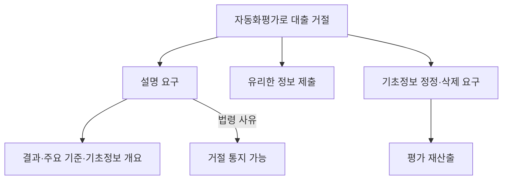

# 신용정보법 제36조의2

> 금융회사가 사람 개입 없이 컴퓨터로만 신용 평가(자동화평가)를 했을 때, 개인이 그 결과와 주요 기준·기초정보 개요에 대한 설명을 요구하고, 유리한 정보를 제출하거나 정정·삭제·재산출을 요구할 수 있게 한 한국 법 조항. (법률 자문 아님)

## 쉽게 말하면
AI·점수 시스템이 대출을 거절했을 때 "왜요?"라고 묻고 "내 정보가 틀렸으니 다시 계산해 주세요"라고 요청할 수 있는 권리다.

## 자세히
출처: 검색 결과에 인용된 조문 일부와 금융사 양식(BC카드 설명요구서 등). 법 원문·시행령은 국가법령정보센터에서 대조해야 한다.
- **설명 요구 범위(인용 문구 기준)**: 자동화평가의 **결과**, **주요 기준**, **이용된 기초정보의 개요**, 대통령령이 정하는 유사 사항.
- **이의제기 수단**: ① 본인에게 유리한 정보 제출 ② 기초정보가 부정확하거나 최신이 아니라고 보면 **정정·삭제 요구** ③ 자동화평가 결과를 **다시 산출**하도록 요구.
- **거부 가능 사유**: 법령상 특별 규정이나 의무 준수로 불가피한 경우, 요구를 따르면 거래 설정·유지가 곤란한 경우, 대통령령이 정한 유사 사유. 금융사 양식에는 정정 요청 내용이 사실과 다른 경우나 같은 거래에 3회 이상 반복 요구 같은 사유가 안내된다(하위 자료이므로 시행령 대조 필요).
- **절차·거절 통지**는 대통령령에 위임.
- **다른 조항과의 구분**: 대출 거절 사유 고지(36조)보다 더 들어가 설명을 요구하는 권리로 안내하는 자료가 있다.
- **관계**: 신용정보 영역에서 신용정보법은 특별법, 개인정보 보호법은 일반법이라 특별 규정이 없는 부분은 개인정보 보호법을 따른다([자동화된 결정 대응권](#pipa-automated-decision)).
- 한국 자동화 결정 권리 개요는 [kr-automated-decision-right](#kr-automated-decision-right).

## 그림으로 보기

## 예시
- 신용카드 한도 심사 거절 후 카드사 양식으로 설명요구서를 제출 → 기준 요약과 사용 정보 개요 수령 → 오래된 연체 기록 정정 요청 → 재산출.

## 헷갈리는 것과 비교
| 개념 | 차이 |
|---|---|
| 36조의2 | 자동화평가 설명·이의 권리 |
| 거절 사유 고지 | 일반 통지 |
| [PIPA 자동화 결정](#pipa-automated-decision) | 일반법상 대응권 |
| [미국 불리한 조치 통지](#adverse-action-notice) | 미국 사례 |

## 더 읽을거리
- [BC카드 설명요구서 양식](https://www.bccard.com/down/individual/membership/request_explanation.pdf) — 권리 행사 서식(검색 결과로만 확인)
- [20. 금융·보험 — 심사·상담·모니터링과 설명 책임 (WikiDocs)](https://wikidocs.net/388820) — 해설(검색 결과로만 확인)
