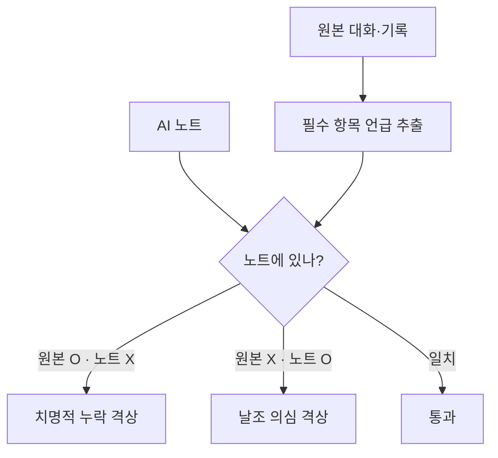
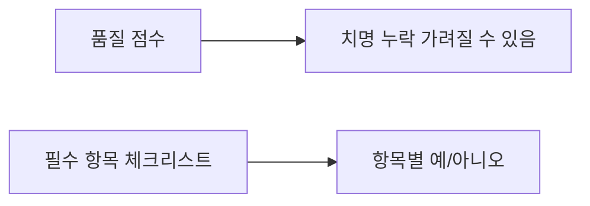

# 필수 항목 누락 체크리스트

> 알레르기, 투약 용량처럼 빠지면 위험한 필수 정보가 AI 요약·노트에 들어 있는지를 예/아니오로 확인하는 점검표. 품질 점수와 별도로 "치명적 누락"만 따로 거르는 장치다.

## 쉽게 말하면
비행기 이륙 전 점검표(체크리스트)처럼, 기장의 평균 실력과 무관하게 "연료 확인, 플랩 설정"은 항목마다 확인하고 하나라도 빠지면 이륙하지 않는다.

## 자세히
출처는 PDSQI-9 논문(arXiv 2501.08977, 열람), PDQI-9 논문(PMC3347480, 열람), CheckEval 초록(arXiv 2403.18771, 열람)이다. 필수 항목의 구체 목록은 이 자료들에 없고 기관별 임상 안전 담당자가 정해야 한다. 의료 조언이 아니다.
- **누락이 점수에 묻히는 구조(PDSQI-9)**: 이 도구는 LLM 요약을 아홉 속성으로 평가하며 누락은 주로 Thorough 속성 아래에서 평가된다. 별도의 중대 오류 범주나 처리는 보고되지 않았다. 즉 총점이 높아도 치명적 누락이 하나 있을 수 있다.
- **PDQI-9의 한계**: 한 질 평가 도구는 독창성이나 복사 붙여넣기를 측정하지 않는다고 했고, 평가자가 환자를 모르는 조건이었다([임상 노트 안전 검토](#clinical-note-safety-review)).
- **이진 체크리스트의 장점(CheckEval, 초록)**: 모호한 점수 대신 이진 예/아니오 질문으로 분해하면 어떤 속성이 판단을 좌우하는지 추적하기 쉽고 평가 모델 간 일치가 올랐다고 보고한다([이진 체크리스트 평가](#binary-checklist-eval)).
- **설계(해석)**: ① 원본 대화·기록에서 해당 정보가 언급됐는지 먼저 추출(예: 알레르기 언급 있음/없음), ② 노트에 그 정보가 있는지 예/아니오 확인, ③ 원본에는 있는데 노트에 없으면 "치명적 누락"으로 격상, ④ 원본에 없는데 노트에 있으면 날조 의심으로 별도 격상, ⑤ 결과를 점수와 따로 집계. 항목 목록은 의료진과 만든다.
- **주의**: 체크리스트가 모든 누락을 잡지는 못한다. 목록에 없는 정보는 점검되지 않으므로 항목은 정기적으로 점검·갱신하고 사람 검토와 병행한다. 이 설계의 효과를 시험한 연구는 이번에 확인하지 못했다.

## 그림으로 보기

## 예시
- 필수 항목 예(실제 목록은 기관 결정): 알레르기, 현재 복용 약물과 용량, 응급 연락처 변경. 대화에서 "페니실린 알레르기"가 언급됐는데 노트에 없으면 격상.
- 교육 실습: 가상 대화와 AI 노트 쌍 3개에서 필수 항목 세 가지의 있음/없음을 표로 확인.

## 헷갈리는 것과 비교
| 개념 | 차이 |
|---|---|
| 필수 항목 체크리스트 | 치명적 누락만 예/아니오로 확인 |
| 품질 점수 | 전반적 질 평가 |
| 날조(환각) | 없던 내용을 만들어 넣음 |
| [이진 체크리스트 평가](#binary-checklist-eval) | 같은 원리의 일반 평가 설계 |

## 더 읽을거리
- [PDSQI-9 (arXiv 2501.08977)](https://arxiv.org/html/2501.08977v2) — 누락은 Thorough 아래(열람)
- [CheckEval (arXiv 2403.18771)](https://arxiv.org/abs/2403.18771) — 이진 체크리스트(초록 열람)
- [PDQI-9 (PMC3347480)](https://pmc.ncbi.nlm.nih.gov/articles/PMC3347480) — 한계(열람)
