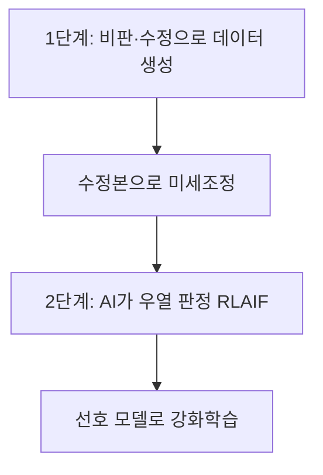

# 비판·수정 루프

> **비판·수정 루프**는 모델이 자기 답을 먼저 비판(문제점 지적)하고, 그 비판을 반영해 고쳐 쓰게 하는 기법이다. 추가 학습 없이 프롬프트만으로도, 학습 데이터를 만드는 데도 쓰인다.

## 쉽게 말하면
글쓰기 수업에서 초고를 쓰고, 체크리스트로 스스로 첨삭한 뒤 재작성하는 것과 같다. 처음부터 완벽하게 쓰려 하지 않고 "쓰기 → 점검 → 고치기"를 돈다.

## 자세히
- **Self-Refine**(Madaan 외, arXiv 2303.17651): 한 LLM이 생성자·피드백 제공자·수정자를 모두 맡아 반복한다. 추가 데이터·학습·강화학습이 필요 없다. 7개 과제(대화 응답~수학 추론)에서 단발 출력보다 사람·자동 지표 모두 선호했고, 평균 약 20%p 개선을 보고했다(GPT-3.5, ChatGPT, GPT-4).
- **Constitutional AI**(Anthropic, arXiv 2212.08073): 사람은 **원칙 목록**만 주고, 1단계(지도학습)에서 모델이 응답을 원칙에 따라 **비판→수정**하고 수정본으로 미세조정한다. 2단계에서는 AI가 응답 쌍의 우열을 판정(RLAIF)해 보상 신호로 쓴다. 주장: 해롭지 않으면서 회피적이지 않고, 사람 라벨이 훨씬 적게 든다.
- 한계(일반 지식): 자기 오류를 못 알아보는 모델은 비판도 부정확하다. 외부 검증(테스트·검색)이 있으면 더 안정적이며, 반복 횟수를 제한해야 비용이 통제된다.

## 그림으로 보기



## 예시
```
[1] 아래 보도자료 초안을 써 줘.
[2] 위 초안을 '근거 없는 수치 금지·300자 이내' 기준으로 비판해 줘.
[3] 비판을 반영해 다시 써 줘.
```
- 업무 예: 교육 자료 초안을 "비전공자가 이해 가능한가" 기준으로 스스로 점검시키기.

## 헷갈리는 것과 비교
| 개념 | 차이 |
|---|---|
| 비판·수정 루프 | 출력 시점에 자기 답을 반복 개선 |
| Constitutional AI | 같은 원리를 학습 데이터 생성에 사용 |
| LLM 심판 | 다른(또는 같은) 모델이 점수만 매김 |
| 사람 피드백(RLHF) | 선호 라벨을 사람이 제공 |

## 더 읽을거리
- [Self-Refine](https://arxiv.org/abs/2303.17651) — 반복 자기 피드백 원 논문.
- [Constitutional AI: Harmlessness from AI Feedback](https://arxiv.org/abs/2212.08073) — 원칙 기반 비판·수정과 RLAIF.
