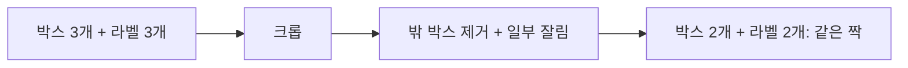
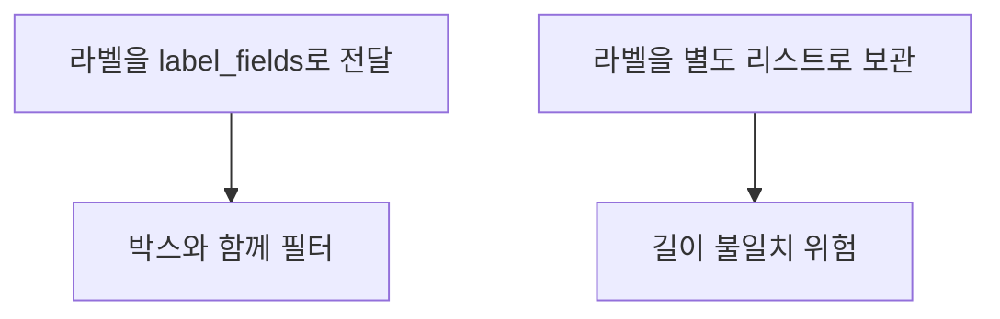

# 크롭과 라벨 일치

> 이미지를 자르면 일부 박스가 사라지거나 줄어든다. **남은 박스와 클래스 라벨이 같은 순서·같은 개수로 짝을 이루는지** 확인하는 것이 크롭 후 라벨 검수의 핵심이다.

## 쉽게 말하면
사진에서 인물을 오려 낸 뒤 명찰을 붙이는 경우, 사라진 사람의 명찰도 같이 버려야 한다. 박스는 줄었는데 명찰 목록이 그대로이면 이름이 엉뚱한 사람에게 붙는다.

## 자세히
- 직접 실험(Albumentations 2.0.8, 640×480, `Crop(0,0,200,200)`, pascal_voc): 박스 3개 `cat [10,10,60,60]`, `dog [300,300,400,400]`(크롭 영역 밖), `bird [150,20,250,120]`(오른쪽 일부가 밖).
  - `label_fields=['names']`로 라벨을 따로 넘기면 결과는 박스 `[10,10,60,60]`, `[150,20,200,120]`과 라벨 `['cat','bird']` — **dog가 박스와 라벨에서 함께 제거되고 bird는 잘린 채 라벨 유지**.
  - 라벨을 박스 배열 뒤에 문자열로 붙여 넘기면(`[x1,y1,x2,y2,'cat']`) `could not convert string to float: 'cat'` 오류. 박스 배열의 추가 열은 숫자여야 하므로 **문자열 라벨은 `label_fields`로** 따로 넘긴다.
- 왜 중요한가: 라벨을 라이브러리 밖에서 별도 리스트로 들고 있다가 박스만 증강에 맡기면 길이가 어긋난다. 오류가 안 나는 경우([조용한 데이터 버그](#silent-data-bugs))도 많다.
- 검수 방법(제안): ① 증강 후 `len(bboxes) == len(labels)` 단언 ② 샘플을 그려 라벨 텍스트와 박스를 함께 확인([박스 그려 보기 점검](#draw-bbox-sanity-check)) ③ 크롭 후 박스가 0개인 이미지 비율을 센다 — 너무 높으면 크롭 크기·위치 규칙을 조정.
- 필터와의 상호작용: [min_area](#min-area-filter)·[min_visibility](#min-visibility-filter)를 켜면 더 많은 박스가 사라지며, 이때도 `label_fields`의 라벨이 같이 걸러진다.
- 부수 관찰: 정수 라벨이 float(`1.0`)로 돌아올 수 있다(앞 실험).

## 그림으로 보기



## 예시
```python
t = A.Compose([A.Crop(0,0,200,200)],
   bbox_params=A.BboxParams(format='pascal_voc', label_fields=['names']))
r = t(image=img, bboxes=boxes, names=names)
assert len(r['bboxes']) == len(r['names'])
```
- 교육: "증강은 이미지와 정답을 한 몸으로 변환해야 한다"는 설명 사례.

## 헷갈리는 것과 비교
| 개념 | 차이 |
|---|---|
| 크롭-라벨 일치 | 박스·라벨의 개수·순서 대응 확인 |
| [min_visibility](#min-visibility-filter) | 일부만 보이는 박스를 남길지 정하는 기준 |
| 이미지-라벨 파일 매칭 | 파일 단위 짝 확인(다른 문제) |

## 더 읽을거리
- [Albumentations 바운딩 박스 문서](https://albumentations.ai/docs/3-basic-usage/bounding-boxes-augmentations/) — label_fields 설명.
- 직접 실행: Albumentations 2.0.8 크롭 실험.
