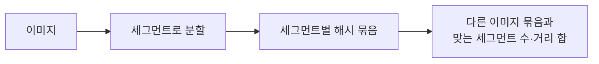
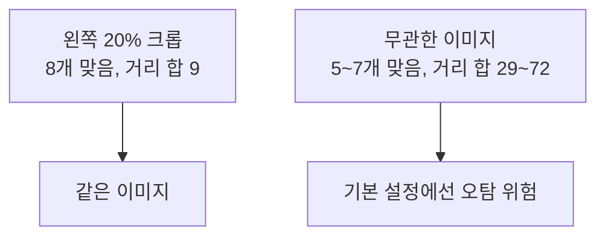

# 크롭 내성 해시

> 크롭 내성 해시는 이미지를 여러 영역(세그먼트)으로 나눠 영역마다 해시를 만들고, 두 이미지에서 서로 맞는 영역이 몇 개인지로 유사도를 보는 방법이다. 한 장 전체를 해시하는 지각 해시가 크롭에 약한 점을 보완한다.

## 쉽게 말하면
그림 전체를 한 줄로 요약하면 가장자리가 잘리는 순간 요약이 달라진다. 대신 그림을 구역별로 나눠 구역마다 메모를 하면, 잘려 나간 구역은 못 맞춰도 남은 구역의 메모는 원본과 그대로 맞는다.

## 자세히
- **구조(imagehash 소스 docstring·README, 열람)**: `crop_resistant_hash`는 이미지를 세그먼트로 나눠 세그먼트별 해시의 묶음(`ImageMultiHash`)을 만든다. 비교 함수 `hash_diff`는 두 값을 돌려준다. 첫째는 맞는 세그먼트 수, 둘째는 맞는 세그먼트들의 해밍 거리 합이다. 세그먼트가 맞는 기준은 `hamming_cutoff`나 `bit_error_rate`(기본 0.25, 즉 64비트면 16비트까지 달라도 맞는 것으로 침)다. `matches()`는 기본 `region_cutoff=1`, 즉 한 세그먼트만 맞아도 참이다.
- **직접 해 본 실험(합성 이미지 600×600, 색 도형 12개, `min_segment_size=500`, `segmentation_image_size=600`)**: 원본은 세그먼트 14개. 왼쪽 20%를 잘라 내면 세그먼트 10개로 8개가 맞고 거리 합 9(세그먼트당 평균 약 1.1). 중앙 400×400만 남기면 세그먼트 7개로 4개가 맞고 거리 합 17(평균 약 4). 같은 두 크롭을 일반 `phash`로 비교하면 둘 다 거리 26으로 [무관한 이미지 거리](#hash-threshold-calibration)(20~38) 범위에 있어 구분이 안 됐다.
- **중요한 주의(같은 실험)**: 무관한 이미지 15장과의 `hash_diff`는 맞는 세그먼트가 5~7개나 나오고 거리 합이 29~72(세그먼트당 평균 약 5~10)였다. 기본 설정(`bit_error_rate=0.25`)에서는 무관한 이미지도 여러 세그먼트가 "맞다"고 판정되므로 `matches()`의 기본값은 너무 느슨했다. 맞는 세그먼트 수와 평균 거리를 함께 보고, `bit_error_rate`를 낮추거나 `region_cutoff`를 높여야 한다.
- **판정 규칙(해석)**: 맞는 세그먼트가 일정 수 이상이면서 세그먼트당 평균 거리가 작으면 같은 이미지로 본다. 기준은 내 데이터의 같음·다름 쌍으로 보정한다.
- **한계**: 세그먼트 분할은 이미지 내용에 의존하므로 밋밋한 이미지는 세그먼트가 적다. 회전·뒤집기에는 따로 대응해야 한다.

## 그림으로 보기



## 예시
```python
import imagehash
h1 = imagehash.crop_resistant_hash(img1)
h2 = imagehash.crop_resistant_hash(img2)
n, dist = h1.hash_diff(h2, bit_error_rate=0.1)
```
(`bit_error_rate=0.1`은 예시 값이며 데이터로 보정한다.) 교육 활용: 크롭 정도를 바꿔 맞는 세그먼트 수가 어떻게 줄어드는지 표로 본다.

## 헷갈리는 것과 비교
| 개념 | 차이 |
| --- | --- |
| 일반 지각 해시 | 이미지 전체 1개 해시, 크롭에 약함 |
| 크롭 내성 해시 | 세그먼트별 해시 묶음 |
| [해시 임계값 보정](#hash-threshold-calibration) | 기준선 정하기 |
| [이미지 임베딩 유사도](#image-embedding-similarity) | 의미 기반 |

## 더 읽을거리
- [ImageHash (GitHub)](https://github.com/JohannesBuchner/imagehash) — 크롭 내성 해시 사용법과 비교 함수
