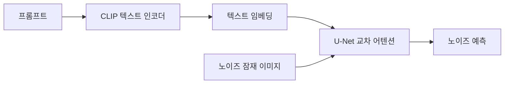
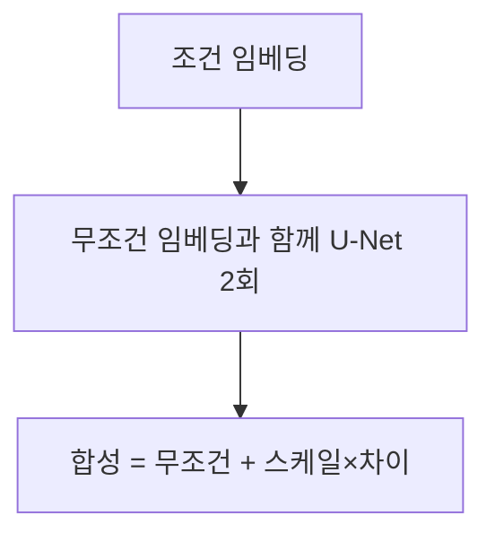

# 교차 어텐션 (확산 모델)

> 확산 모델의 U-Net 안에서 이미지 특징이 텍스트 임베딩을 "참조"하게 하는 어텐션 층으로, 프롬프트가 이미지 생성에 영향을 주는 경로다.

## 쉽게 말하면
화가(U-Net)가 그림을 그리는 중간중간 주문서(텍스트 임베딩)를 다시 들여다보며 "여기에 고양이가 있어야 하지"를 확인하는 것이다. 주문서를 보는 행위가 교차 어텐션이다.

## 자세히
HF Stable Diffusion 블로그 기준:
- 동결된 **CLIP 텍스트 인코더**가 프롬프트를 토큰 임베딩으로 바꾼다(SD 학습 중 갱신하지 않음, 재사용).
- **U-Net**은 인코더·디코더 양쪽의 교차 어텐션 층(ResNet 블록 사이)에서 텍스트 임베딩에 조건화된다. 이미지 특징이 질의(query)를, 텍스트 임베딩이 키·값 역할을 한다(일반적 설명).
- **Classifier-free guidance**: 빈 프롬프트의 임베딩도 만들어 U-Net을 둘 다 돌리고 `무조건 + guidance_scale × (텍스트 − 무조건)`으로 합친다. 기본 guidance_scale 7.5, 7~8.5가 흔하며 높을수록 프롬프트를 따르지만 다양성이 줄어든다.
- 매 단계에서 [스케줄러](#diffusion-scheduler)가 U-Net이 예측한 노이즈로 덜 노이즈 낀 잠재 이미지를 계산한다.
- 교차 어텐션 가중치를 시각화하면 단어가 이미지의 어느 영역에 영향을 주는지 볼 수 있다(일반적 연구 기법, 이번에 확인하지 않음). 77토큰 한계는 [여기](#clip-77-token-limit).

## 그림으로 보기



## 예시
```python
image = pipe("a photo of an astronaut riding a horse", guidance_scale=7.5, num_inference_steps=50).images[0]
```
`guidance_scale`을 4와 12로 바꿔 비교하면 프롬프트 충실도와 다양성의 균형을 체감할 수 있다.

## 헷갈리는 것과 비교
| 개념 | 차이 |
|---|---|
| 교차 어텐션 | 서로 다른 입력(이미지↔텍스트) 사이 어텐션 |
| 자기 어텐션 | 같은 입력 내부 토큰 사이 어텐션 |
| [U-Net](#unet-denoiser) | 교차 어텐션이 들어 있는 노이즈 예측망 |
| [CLIP 텍스트 인코더](#clip-text-encoder) | 임베딩을 만들어 주는 앞단 |

## 더 읽을거리
- [Stable Diffusion with Diffusers](https://huggingface.co/blog/stable_diffusion) — 텍스트 조건화·CFG·스케줄러 흐름.
