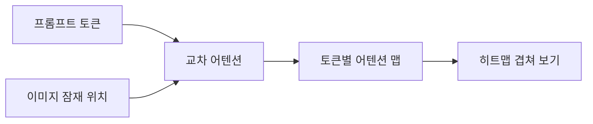
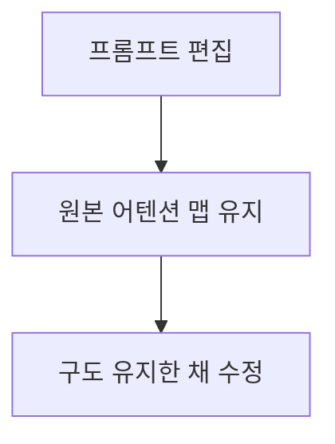

# 교차 어텐션 시각화

> 교차 어텐션 맵을 이미지로 그려 보면 프롬프트의 각 단어가 이미지의 어느 영역에 영향을 주는지 볼 수 있다.

## 쉽게 말하면
시험 답안에 형광펜을 칠하듯, "고양이"라는 단어가 그림의 어느 부분을 칠했는지 히트맵으로 보여 주는 도구다.

## 자세히
- Prompt-to-Prompt 논문(Hertz 외, arXiv 2208.01626)은 텍스트 조건 이미지 모델의 교차 어텐션 층이 **프롬프트 단어와 이미지 공간 영역의 관계를 결정하는 핵심**이라고 주장한다.
- 이를 이용해 마스크 없이 프롬프트만 바꿔 편집한다: 단어 교체(국소 편집), 문구 추가(전역 편집), **어텐션 재가중**(특정 단어 강도 조절).
- 시각화는 각 단계·층의 어텐션 확률을 토큰별로 모아 이미지 크기로 키워 히트맵으로 겹친다(구현 세부는 이번에 논문 본문을 열지 않았음).
- 활용: 프롬프트 디버깅(단어가 무시되는지), 객체 위치 제어, 편집 일관성 유지.

## 그림으로 보기

## 예시
"a cat on a sofa"에서 "cat" 토큰 맵이 소파 쪽에 번지면 프롬프트를 고치거나 단어 가중치를 올린다.

## 헷갈리는 것과 비교
| 개념 | 차이 |
|---|---|
| 교차 어텐션 | 텍스트↔이미지 연결 |
| 자기 어텐션 | 이미지 안 위치끼리 |
| 어텐션 재가중 | 맵을 바꿔 단어 강도 조절 |

## 더 읽을거리
- [Prompt-to-Prompt (arXiv)](https://arxiv.org/abs/2208.01626) — 초록과 편집 방식.
