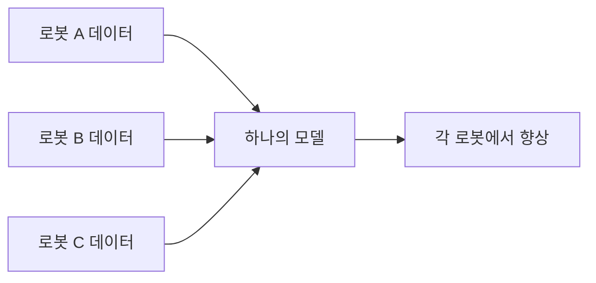
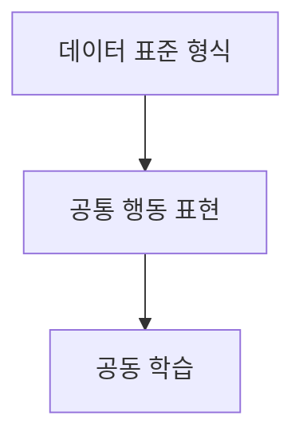

# 교차 로봇 학습

> **교차 로봇 학습(cross-embodiment)** 은 서로 다른 형태의 로봇 데이터를 합쳐 하나의 모델을 학습해, 한 로봇의 경험이 다른 로봇의 능력을 높이게 하는 접근이다.

## 쉽게 말하면
요리사가 여러 주방에서 일해 본 경험이 새 주방에서도 도움이 되듯, 팔 길이나 그리퍼가 다른 로봇 데이터도 "물건 집기" 공통 감각을 가르쳐 준다는 생각이다.

## 자세히
(Open X-Embodiment 논문, arXiv 2310.08864 초록 확인)
- **22종 로봇, 21개 기관**이 협업해 모은 조작 데이터셋: **527개 스킬, 160,266개 과제**, 표준 형식으로 공개.
- 이 데이터로 대형 모델 **RT-X**를 학습해 다른 플랫폼 경험에서 배워 여러 로봇의 능력이 오르는 **긍정적 전이**를 보고했다.
- 장애물: 로봇마다 관절 수·행동 공간이 달라 행동 표현을 통일해야 한다([행동 토큰화](#action-tokenization)). 구체적 통일 방식은 이 글에서 확인하지 않았다.
- [OpenVLA](#openvla)는 이런 다기종 시연 약 97만 개로 학습한 오픈 모델이다.

## 그림으로 보기

## 예시
- 한 연구실이 가진 팔 로봇 데이터가 적을 때 공개된 다기종 데이터로 사전학습한 뒤 자기 로봇으로 미세조정.

## 헷갈리는 것과 비교
| 개념 | 차이 |
|---|---|
| 교차 로봇 학습 | 여러 기종 데이터 공동 학습 |
| [도메인 랜덤화](#domain-randomization) | 시뮬 조건 무작위화 |
| 전이 학습 | 한 과제에서 다른 과제로 지식 이동(일반 개념) |

## 더 읽을거리
- [Open X-Embodiment: Robotic Learning Datasets and RT-X Models](https://arxiv.org/abs/2310.08864) — 데이터셋과 RT-X.
