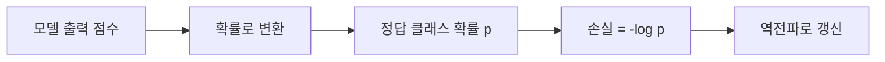
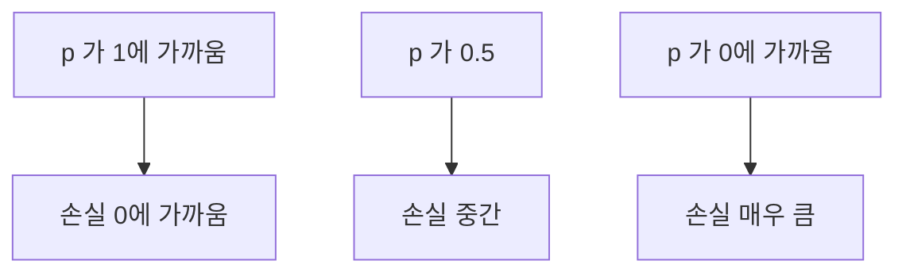

# 교차 엔트로피

> 교차 엔트로피(cross-entropy)는 모델이 정답에 준 확률이 낮을수록 손실을 크게 매기는 분류용 손실 함수다. 이진 분류에서는 로그 손실(log loss)이라고도 한다.

## 쉽게 말하면
일기예보관이 "비 올 확률 1%"라고 했는데 비가 오면 크게 신뢰를 잃는다. 확신을 갖고 틀릴수록 벌점이 폭발적으로 커지는 채점 방식이다. 모르면 솔직히 50%라고 하는 편이 낫다.

## 자세히
- 이진 분류 로그 손실(Google ML Crash Course): −(1/N)·Σ[ y·log(y') + (1−y)·log(1−y') ]. y는 0/1 정답, y'는 0~1 예측 확률.
- 예시마다 한 항만 살아 있다. 정답이 1이면 −log(y'), 0이면 −log(1−y'). 정답에 0에 가까운 확률을 주면 값이 매우 커진다.
- 여러 클래스일 때는 정답 클래스에 준 확률의 −log를 쓴다. LLM은 어휘 전체에 대한 확률 분포를 내고 정답 토큰의 −log 확률을 줄인다([다음 토큰 예측](#next-token-prediction)).
- 평균(1/N)을 쓰면 배치 크기와 학습률을 따로 조정할 수 있다.
- 로지스틱 회귀에서는 규제(L2 등)나 조기 종료가 중요하다. 규제가 없으면 손실이 0으로 계속 끌려가 [과적합](#overfitting)하기 쉽다. 규제 손실은 보통 로그 손실에 λ×패널티를 더한 형태다.
- 평균 손실에서 구한 값의 지수가 [퍼플렉시티](#perplexity)다.

## 그림으로 보기

## 예시
- 정답이 스팸인 메일에 확률 0.9를 주면 손실 −log 0.9 ≈ 0.105, 0.1을 주면 ≈ 2.30으로 20배 이상 커진다.
- 이미지 분류 모델의 학습 곡선에서 "loss"라고 나오는 값은 대개 이것이다.

## 헷갈리는 것과 비교
| 개념 | 차이 |
|---|---|
| [MSE 계열](#mse-vs-mae) | 숫자 거리를 잼. 회귀용 |
| 교차 엔트로피 | 확률의 정확도를 잼. 분류·언어 모델용 |
| 정확도 | 맞았는지 여부만 봄. 확률의 확신도는 반영 못 함 |

## 더 읽을거리
- [Google ML Crash Course: Logistic regression · Loss and regularization](https://developers.google.com/machine-learning/crash-course/logistic-regression/loss-regularization) — 로그 손실 공식과 규제.
