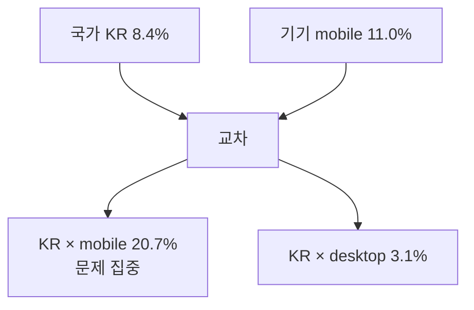
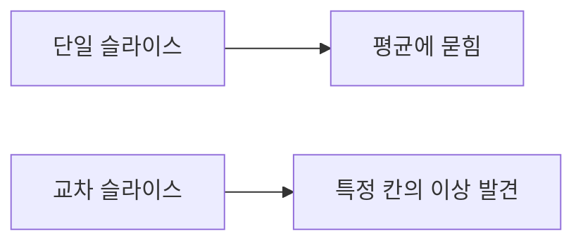

# 교차 슬라이싱

> 두 개 이상의 특징 값을 **조합(예: 국가 × 기기)** 으로 데이터를 잘라 각 조합별 통계·성능을 따로 보는 방법이다. 특징 하나씩 잘랐을 때는 평균에 묻히는 **특정 조합의 문제**를 드러낸다.

## 쉽게 말하면
"한국 사용자 평균"과 "모바일 사용자 평균"은 둘 다 조금 나쁘게만 보이는데, 사실 문제는 "한국의 모바일 사용자"에게만 집중돼 있을 수 있다. 가로세로 표를 만들어 칸 하나하나를 보면 그 칸이 보인다.

## 자세히
(TFDV 시작 가이드의 슬라이싱 코드 예를 직접 읽었다. 숫자 예는 이 지도가 **가상 데이터를 시뮬레이션**해 계산한 것이며 현실 수치가 아니다.)
- **교차 슬라이서(TFDV 문서)**: 두 특징의 **교차**(모든 고유 값 쌍)로 자르는 함수는 `slicing_util.get_feature_value_slicer(features={'country': None, 'state': None})`다. 특징 하나로는 `features={'country': None}`, 지정 값만으로는 `features={'age': [10, 50, 70]}`. 슬라이싱을 켜면 출력에 조각마다 하나씩 `DatasetFeatureStatistics`가 들어가고 전체 통계도 기본으로 함께 만들어진다.
- **가상 시뮬레이션(직접 계산, 시드 11, 2,000건)**: 국가(KR/US) × 기기(mobile/desktop)별로 오류율을 다르게 설정해 만든 데이터.

  | 보는 단위 | 건수 | 오류율 |
  |---|---|---|
  | 전체 | 2,000 | 6.45% |
  | 국가 KR | 1,000 | 8.4% |
  | 국가 US | 1,000 | 4.5% |
  | 기기 mobile | 800 | 11.0% |
  | 기기 desktop | 1,200 | 3.4% |
  | **KR × mobile** | 300 | **20.7%** |
  | KR × desktop | 700 | 3.1% |
  | US × mobile | 500 | 5.2% |
  | US × desktop | 500 | 3.8% |

  국가별·기기별 평균만 보면 KR(8.4%)이나 mobile(11.0%)이 조금 나빠 보일 뿐이지만, 교차해 보면 문제가 **KR × mobile 한 칸(20.7%)에 집중**돼 있고 KR × desktop은 오히려 정상(3.1%)이다. 단일 특징 슬라이스는 이를 "KR이 나쁘다", "mobile이 나쁘다"로 흩뜨려 보여 준다.
- **조각 수와 표본 수의 대가(앞선 [슬라이스 개수와 비용](#slice-cardinality-cost))**: 조합이 늘수록 칸당 표본이 줄어 통계가 불안정해진다. 위 예도 가장 작은 칸이 300건이었다. 칸이 수십 건 이하이면 비율이 크게 흔들리므로 최소 표본 하한을 둔다.
- **쓰는 법(제안, 일반 원칙)**: ① 평균이 정상인데 민원·지표가 이상한 집단이 의심되는 특징 쌍을 고른다 ② 교차 슬라이스 통계와 성능을 비교해 이탈 칸을 찾는다 ③ 칸의 표본이 충분한지 확인한다 ④ 원인(데이터 부족·수집 방식·실제 어려움)을 조사한다.
- **한계**: 슬라이싱은 **알려진 특징**으로만 자를 수 있어 정의되지 않은 집단은 찾지 못하고, 많은 조합을 보면 우연히 이상해 보이는 칸이 생긴다(다중 비교 문제, 일반 원칙).

## 그림으로 보기



## 예시
```python
slice_fn = slicing_util.get_feature_value_slicer(
    features={'country': None, 'device': None})
stats_options = tfdv.StatsOptions(slice_functions=[slice_fn])
```
- 교육 소재: 같은 데이터를 표 한 장으로 단일/교차로 보는 연습.

## 헷갈리는 것과 비교
| 개념 | 차이 |
|---|---|
| 교차 슬라이싱 | 여러 특징 조합으로 조각 생성 |
| 단일 슬라이싱 | 특징 하나의 값별 조각 |
| [교차 조합 커버리지](#intersectional-coverage) | 조합별 데이터 충분성·성능 점검 |
| [슬라이스 개수와 비용](#slice-cardinality-cost) | 교차 시 조각 수 폭증 관리 |

## 더 읽을거리
- [Get started with TensorFlow Data Validation — slices](https://www.tensorflow.org/tfx/data_validation/get_started) — 교차 슬라이서 코드(직접 읽음).
