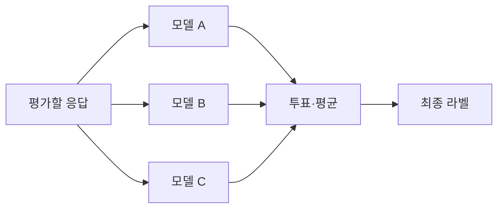
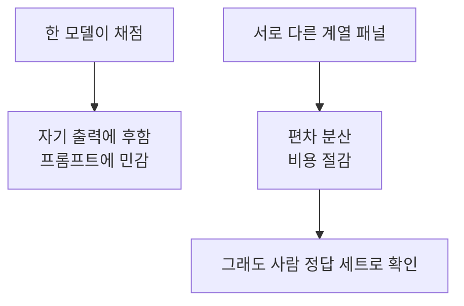

# 교차 모델 채점

> 라벨이나 평가 점수를 **서로 다른 회사·계열의 모델 여러 개(또는 다른 프롬프트)에게 따로 맡기고 결과를 합쳐** 한 모델의 편향·우연한 일관성을 줄이는 방법. 심사 "배심원단(jury)" 방식이라고도 한다.

## 쉽게 말하면
판사 한 명보다 출신이 다른 배심원 세 명이 평결하면 한 사람의 취향에 덜 휘둘린다. 대신 배심원들이 같은 교과서로 공부했다면 소용이 없으므로, 배경이 서로 다른 사람을 고르는 것이 핵심이다.

## 자세히
- 대표 사례: Verga 외(Cohere), "Replacing Judges with Juries"(arXiv 2404.18796, 2024-04). 서로 다른 세 계열 모델 **Command R, Claude 3 Haiku, GPT-3.5**로 패널(PoLL)을 만들어 각자 독립 채점한 뒤 합친다. 이진 QA는 최대 투표(max voting), 1~5점 Chatbot Arena는 평균 풀링을 썼다.
- 사람 판단과의 일치(코헨 κ, KILT 단일 홉 QA, 논문 표 1): NQ에서 PoLL 0.763 vs GPT-4 0.627, TQA 0.906 vs 0.841, HotpotQA는 Haiku 단독 0.873이 PoLL 0.867보다 약간 높다. 즉 모든 데이터에서 패널이 이기는 것은 아니다. Chatbot Arena 순위 상관은 PoLL 피어슨 0.917·켄달 τ 0.778로 GPT-4(0.817, 0.667)보다 높았다.
- 자기 선호 편향: 각 모델이 사람 대비 가장 크게 후하게 매기는 경우는 자기 출력을 채점할 때였다. Arena Hard에서 GPT-4가 다른 GPT-4 변형을 실제 4위 대신 2위로 평가한 예가 있다. HotpotQA·Bamboogle에서 PoLL은 사람과의 점수 편차의 퍼짐이 가장 작았다(표준편차 2.2, GPT-3.5는 6.1).
- 프롬프트 민감성: GPT-4의 NQ κ가 제로샷 0.518, 퓨샷 0.627, "너무 깊이 생각하지 말라" 지시 추가 0.725로 크게 변했지만, 같은 지시가 GPT-3.5에서는 0.509로 오히려 낮췄다. 프롬프트 개선은 모델 간에 옮겨지지 않는다.
- 비용: 패널이 GPT-4 Turbo보다 7~8배 저렴(논문 가격표 기준: 패널 입력 $1.25·출력 $4.25 /백만 토큰 vs $10·$30). 지연은 측정하지 않았다.
- 주의: 같은 데이터로 학습한 모델끼리면 같은 오류를 공유할 수 있다. 합쳐도 사람 정답 세트([사람 정답 세트 점검](#gold-set-check))와의 비교를 대신하지 못한다.

## 그림으로 보기

## 예시
| 방식 | NQ κ (논문) |
|---|---|
| GPT-4 단독 | 0.627 |
| Haiku 단독 | 0.749 |
| PoLL(3개) | 0.763 |
- 업무 장면: 고객 응대 답변 품질 채점에 서로 다른 계열 모델 3개를 쓰고 2표 이상으로 결정한다. 의견이 갈린 항목만 사람이 본다.

## 헷갈리는 것과 비교
| 개념 | 차이 |
|---|---|
| 교차 모델 채점 | 서로 다른 모델 여러 개가 채점 |
| 같은 모델 다중 샘플링 | 한 모델을 여러 번 돌림. 편향은 그대로 |
| [신뢰성과 타당성](#reliability-vs-validity) | 합의(신뢰성)가 곧 정답(타당성)은 아님 |
| [일관되지만 틀린 주석](#consistent-but-wrong) | 모델이 같은 편향을 공유하면 합의해도 틀림 |

## 더 읽을거리
- [Replacing Judges with Juries (arXiv 2404.18796)](https://arxiv.org/abs/2404.18796) — PoLL 패널의 κ·비용·자기 선호 분석(직접 읽음).
