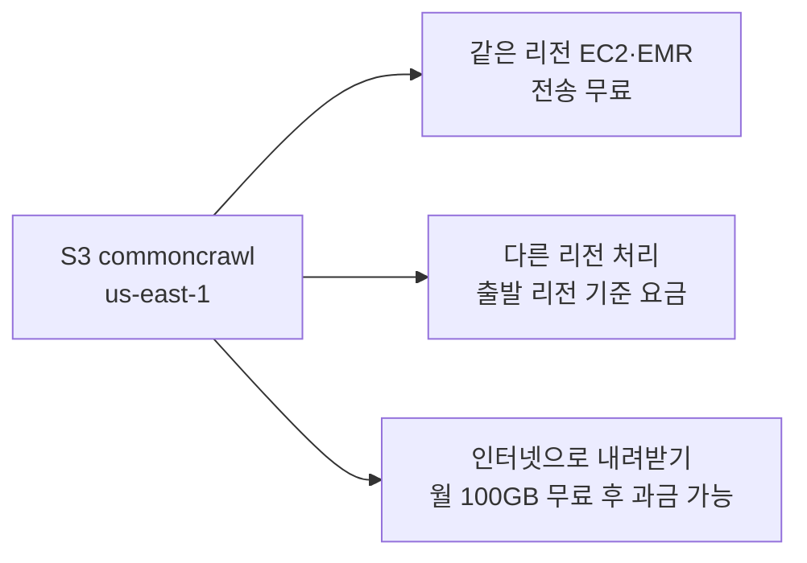
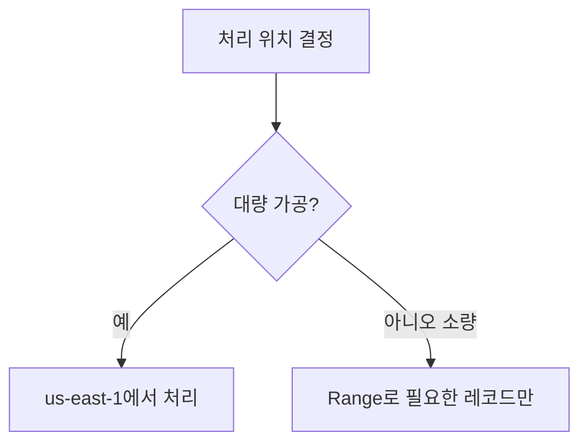

# 리전 간 전송 요금

> Common Crawl 데이터는 AWS **us-east-1(버지니아 북부)**의 S3에 있다. 같은 리전에서 처리하면 전송 요금이 없고 빠르지만, 다른 리전·인터넷 쪽에서 받으면 **나가는 트래픽 요금**이 붙을 수 있다.

## 쉽게 말하면
창고가 서울에 있으면 서울 안 공장으로 옮길 때는 배송비가 없는데, 부산 공장으로 옮기면 거리만큼 배송비가 든다. 데이터도 "어느 도시(리전)에서 처리하느냐"에 따라 비용이 갈린다.

## 자세히
(Common Crawl 시작하기 페이지와 AWS S3 요금 페이지를 직접 읽음. 요금은 바뀌므로 사용 시점의 공식 페이지를 확인한다.)
- **Common Crawl 안내**: 데이터는 `s3://commoncrawl/`(us-east-1)에 있고, 가능하면 **같은 리전에서 접근**하라고 권한다. 이유는 S3 연결이 더 빠르고 리전 간 전송 요금을 피하기 때문이다. 예전 안내에서는 이를 "필수"라고 했다. 탄력적 IP나 로드 밸런서를 거치면 라우팅된 트래픽에 요금이 붙을 수 있다는 주의도 있다. us-east-1 밖에서의 요청은 외부로 나가는 트래픽으로 과금될 수 있다.
- **AWS 요금 페이지가 밝힌 것**:
  - 같은 리전의 S3 버킷끼리, 그리고 S3→같은 리전의 AWS 서비스 전송은 **무료**.
  - 인터넷에서 AWS로 들어오는 전송은 무료.
  - S3→CloudFront는 무료.
  - 인터넷으로 나가는 전송은 월 100GB까지 무료(여러 서비스·리전 합산), 이후 단가표는 이 페이지 텍스트에 없었다.
  - 리전 간 전송은 **출발 리전 기준**이다. 페이지 예시: 버지니아→오하이오 GB당 0.01달러, 오리건→버지니아 GB당 0.02달러.
- **어림 계산(예시 단가 기준, 실제 요금 아님)**: 1TB(1,000GB)를 GB당 0.01달러 경로로 옮기면 10달러, 0.02달러면 20달러. 수백 TB를 처리하는 크롤 가공은 규모에 따라 큰 차이가 생긴다. 단 Common Crawl 데이터의 출발지는 us-east-1이므로 다른 리전으로 가져갈 때의 단가는 AWS 요금표의 해당 구간을 확인해야 한다(이 글에서 단정하지 않는다).
- **실무 규칙**: ① 처리 클러스터(EMR·EC2)를 us-east-1에 만든다 ② 결과물만 다른 곳으로 옮긴다 ③ 로컬 PC에서는 필요한 레코드만 Range 요청으로 받는다([오프셋으로 레코드 받기](#record-fetch-by-offset)).
- 한계: HTTPS(`data.commoncrawl.org`)·CloudFront 경유 시 청구 구조가 다를 수 있으나 이번에 요금 문서에서 확인하지 못했다.

## 그림으로 보기

## 예시
| 상황 | 요금 관점 |
|---|---|
| us-east-1 EC2에서 S3 읽기 | 같은 리전, 전송 무료 |
| 다른 리전 EC2에서 읽기 | 리전 간 전송 요금 가능 |
| 집 PC로 수 GB 다운로드 | 월 100GB 무료 범위 안 가능(요금제 확인) |
- 업무 장면: 교육 실습용으로 크롤 일부를 처리할 때 서울 리전에 인스턴스를 만들지 말고 버지니아에 만든다고 안내한다.

## 헷갈리는 것과 비교
| 개념 | 차이 |
|---|---|
| 리전 간 전송 | 출발 리전 기준 요금 |
| 인터넷 아웃바운드 | 월 100GB 무료 후 과금 |
| [s3a 프로토콜](#s3a-hadoop-protocol) | 하둡·Spark에서 S3에 접근하는 주소 형식 |
| [CloudFront 주소](#cloudfront-mirror) | S3→CloudFront는 무료, 별도 주소 |

## 더 읽을거리
- [Common Crawl 시작하기](https://commoncrawl.org/get-started) — 접근 방법과 리전 안내(직접 읽음).
- [Amazon S3 요금](https://aws.amazon.com/s3/pricing/) — 데이터 전송 요금 설명(직접 읽음, 단가표 일부 미포함).
