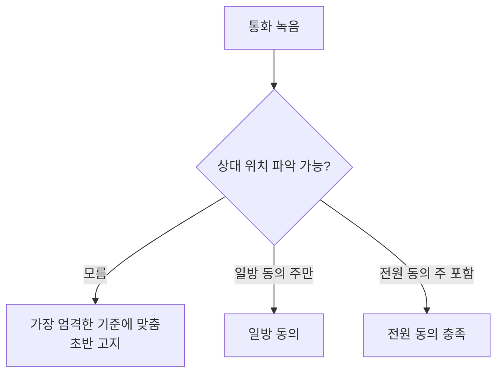
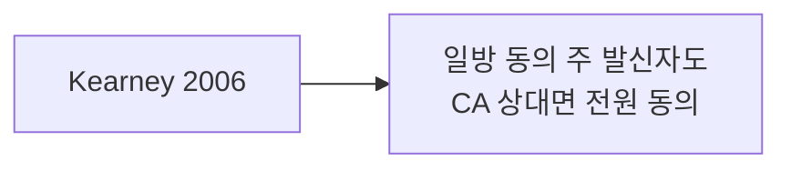

# 주 경계 통화 (cross-state calls)

> 통화 양쪽이 서로 다른 주에 있고 한 주는 일방 동의, 다른 주는 전원 동의를 요구할 때 어느 주 법이 적용되느냐의 문제. 법원 판례가 상대방이 전원 동의 주에 있으면 더 엄격한 쪽을 따르게 한 사례가 있어 보수적으로 접근한다.

## 쉽게 말하면
두 나라 사이를 오가는 택배에서 어느 나라 세관 규칙이 적용되는지 따지는 것과 같다. 통화 한쪽이 엄격한 주에 있으면 그 규칙을 무시하기 어렵다.

## 자세히
출처는 위키백과 "Telephone call recording laws"(열람, 2차 출처)와 18 U.S.C. § 2511(앞 노드, 열람)이다. 위키 문서는 연방 동의 규칙을 직접 요약하지 않았고 개별 판결·주 목록은 인용 수준이다. 미국법 맥락이며 법률 자문이 아니다.
- **전원 동의 주(문서 목록)**: California, Connecticut(전자 녹음만), Florida, Hawaii(사적 장소 기기 경우), Illinois(비전자 대화), Maryland, Massachusetts, Montana(고지만), New Hampshire, Oregon(대면 대화), Pennsylvania, Washington(당사자가 녹음을 알리면 동의 불필요). 나머지 주는 일방 동의로 열거된다. 조건·예외가 주마다 달라 이 목록은 요약일 뿐이다.
- **Michigan**: 2021년 연방 법원 판결로 일방 동의이나 흔히 전원 동의로 오해된다고 문서가 적었다. Virginia와 Wisconsin은 법정에서 쓰려면 양쪽 동의가 필요하다고 했다.
- **주 경계 판례**: Kearney v. Salomon Smith Barney(2006, 캘리포니아 대법원)는 일방 동의 주의 발신자가 캘리포니아에 있는 사람과의 대화를 녹음하면 캘리포니아의 전원 동의 요건을 충족해야 한다고 보았다.
- **통신 비밀(Rathbun 판결 인용)**: 연방 대법원은 "한쪽이 전화를 쓴다는 이유로 상대에게 비밀을 강요할 수 없다"는 취지로, 어느 쪽이든 대화를 녹음하고 공개할 수 있다고 언급했다고 문서가 전한다.
- **고지 관행(FCC)**: 전화회사의 녹음에 대해 FCC가 인정하는 고지는 모든 당사자에 대한 사전 구두·서면 고지, 녹음 전 구두 고지(가장 흔함), 통화 중 일정 간격의 경고음 세 가지다.
- **실무 지침(해석)**: 통화 상대 위치를 모르면 가장 엄격한 기준(전원 동의)에 맞춰 통화 초반에 녹음 사실을 고지한다([녹음 고지 설계](#recording-notice-design)). 구체 판단은 변호사와 한다.

## 그림으로 보기

## 예시
- 텍사스(일방 동의) 콜센터가 캘리포니아 고객 통화를 녹음하려면 통화 초반에 녹음 고지와 동의 확인을 둔다(보수적 운영 예, 법률 검토 필요).
- 교육 실습: 고객 위치별로 적용될 수 있는 주법 유형(일방/전원)을 표로 만들고, 위치를 모르는 경우 기본 멘트를 정한다.

## 헷갈리는 것과 비교
| 개념 | 차이 |
|---|---|
| 주 경계 통화 | 두 주의 법이 겹침 |
| [일방 동의](#one-party-consent) | 당사자 한 명 동의 |
| [전원 동의](#all-party-consent) | 모든 당사자 동의 |
| [녹음 고지 설계](#recording-notice-design) | 고지·동의 흐름 |

## 더 읽을거리
- [Wikipedia: Telephone call recording laws](https://en.wikipedia.org/wiki/Telephone_call_recording_laws) — 주 목록·판례·FCC 고지(열람, 2차 출처)
- [18 U.S.C. § 2511 (Cornell LII)](https://www.law.cornell.edu/uscode/text/18/2511) — 연방 당사자 동의 예외(열람)
