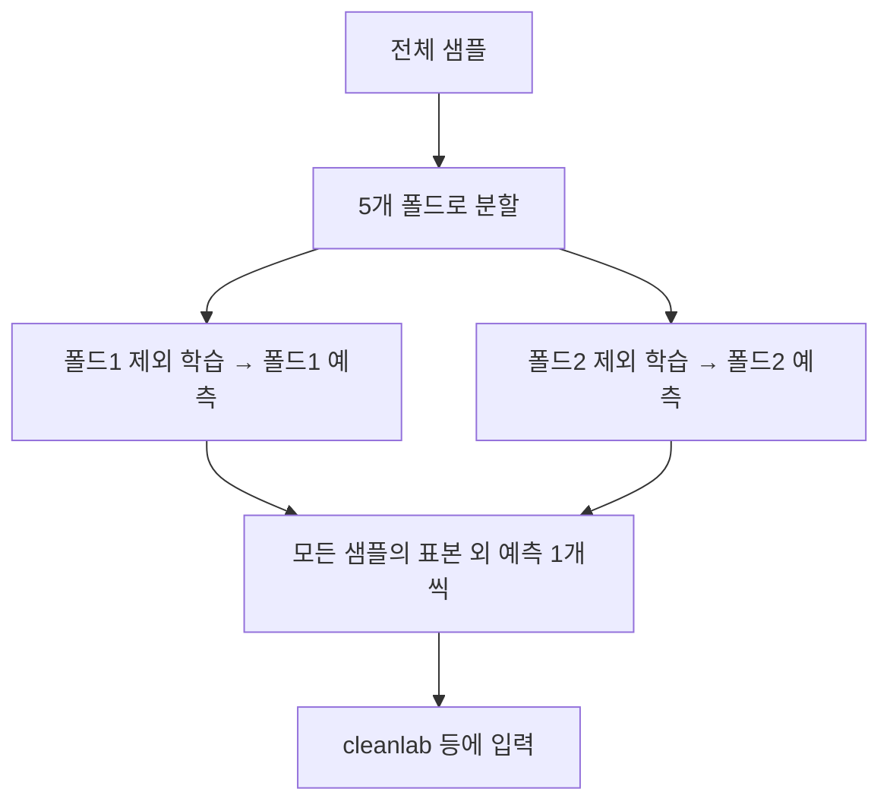

# cross_val_predict

> scikit-learn에서 **교차검증으로 모든 샘플의 "표본 외(out-of-fold) 예측"을 한 번씩 얻는 함수**다. 각 샘플의 예측은 그 샘플이 들어 있지 않은 폴드들로 학습한 모델이 낸 것이라, cleanlab 같은 라벨 오류 탐지의 입력(`pred_probs`)을 만드는 표준 방법이다.

## 쉽게 말하면
모든 학생의 시험을 "그 학생이 빠진 공부 모임"에서 만든 모델로 채점해 한 장의 예측표를 만드는 일이다. 자기 답을 이미 본 모델이 내놓은 예측이 아니므로 믿을 만한 '처음 보는 문제' 예측이 된다.

## 자세히
(scikit-learn 1.9.1 공식 API + 직접 실행)
- **시그니처**: `cross_val_predict(estimator, X, y=None, *, groups=None, cv=None, n_jobs=None, method='predict', ...)`. 데이터를 `cv`로 나누고 **각 샘플은 정확히 한 테스트 폴드에 속하며**, 예측은 그 폴드를 제외하고 학습한 모델이 낸다. 기본 `cv`는 5-폴드이고 분류에서는 `StratifiedKFold`(셔플 없음).
- **method**: `'predict'`(기본), `'predict_proba'`, `'predict_log_proba'`, `'decision_function'`. 라벨 오류 탐지에는 `predict_proba`를 쓴다.
- **반환 모양**: `predict`는 `(n_samples,)`, `predict_proba` 등은 `(n_samples, n_classes)`. 직접 실행: iris `predict_proba` → `(150, 3)`, 각 행의 합 1.0, 단순 정확도 0.973.
- **파티션 조건**: 모든 샘플이 한 번씩 테스트에 들어가야 하므로 `ShuffleSplit`처럼 겹치거나 빠지는 분할기는 `ValueError: cross_val_predict only works for partitions`(직접 확인).
- **클래스 누락 함정**: 순서가 정렬된 iris에 `KFold(3)`(셔플 없음)을 쓰면 학습 폴드에 클래스가 2개뿐이라 `Number of classes in training fold (2) does not match total number of classes (3)` 경고가 뜬다. 공식 문서는 학습 폴드에 없는 클래스에 기본값(확률 0)이 들어간다고 설명한다. 층화 분할기(`StratifiedKFold`, 셔플)를 쓴다.
- **주의(공식 문서)**: 이 예측을 평가 지표에 넣은 값은 `cross_val_score`/`cross_validate`의 폴드 평균과 다를 수 있다(폴드 크기가 같고 지표가 샘플별로 분해될 때만 동일). **일반화 성능 추정이 아니라 샘플별 표본 외 예측을 얻는 용도**로 쓰는 편이 안전하다.
- **누수 방지**: 전처리를 포함해 `Pipeline`으로 넣어야 폴드마다 학습 부분에만 fit된다([늦은 분할 오류](#late-split-error)). 그룹이 있으면 `groups`와 그룹 분할기를 함께 쓴다.

## 그림으로 보기



## 예시
```python
from sklearn.model_selection import cross_val_predict, StratifiedKFold
from sklearn.linear_model import LogisticRegression
pred_probs = cross_val_predict(LogisticRegression(max_iter=2000), X, labels,
    cv=StratifiedKFold(5, shuffle=True, random_state=0), method="predict_proba")
# → cleanlab.filter.find_label_issues(labels, pred_probs)
```
- 이 글의 다른 실험(라벨 오류 탐지, 다중 주석자)은 모두 이 방식으로 `pred_probs`를 만들었다.

## 헷갈리는 것과 비교
| 개념 | 차이 |
|---|---|
| cross_val_predict | 샘플별 표본 외 예측 |
| cross_val_score | 폴드별 점수 |
| cross_validate | 점수 + 시간 등 여러 지표 |
| [표본 외 예측 확률](#out-of-sample-probabilities) | 이 함수로 얻는 대상 개념 |

## 더 읽을거리
- [cross_val_predict API](https://scikit-learn.org/stable/modules/generated/sklearn.model_selection.cross_val_predict.html) — 파라미터, 반환, 주의사항.
- [cleanlab 튜토리얼](https://docs.cleanlab.ai/stable/tutorials/indepth_overview.html) — `pred_probs`가 필요한 이유.
