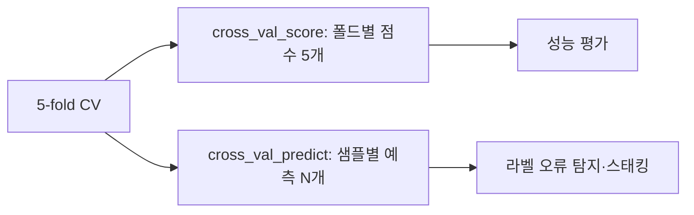
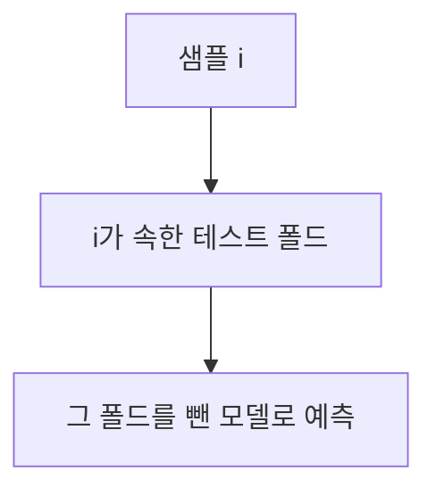

# cross_val_score vs cross_val_predict

> scikit-learn의 `cross_val_score`는 폴드마다 점수 하나를 돌려주고, `cross_val_predict`는 샘플마다 예측(또는 확률) 하나를 돌려준다. 라벨 오류 탐지에는 후자의 샘플별 out-of-sample 예측이 필요하지만, 성능 측정에는 전자를 써야 한다.

## 쉽게 말하면
반 전체 시험을 여러 번 나눠 채점할 때, 하나는 "회차별 평균 점수표"이고 다른 하나는 "학생 한 명 한 명의 답안 모음"이다. 점수표는 실력 평가용이고, 답안 모음은 학생별로 어디서 틀렸는지 들여다보는 용도다.

## 자세히
- **차이(scikit-learn 문서)**: `cross_val_score(clf, X, y, cv=5)`는 폴드별 점수를 반환해 평균을 낸다. `cross_val_predict(clf, X, y, cv=5)`는 각 샘플이 테스트 폴드였을 때의 예측을 반환하므로 샘플마다 정확히 한 번 예측된다. 모든 샘플을 정확히 한 번 테스트에 넣는 CV 전략만 쓸 수 있고, 아니면 예외가 난다.
- **중요한 주의(문서)**: 두 결과는 묶는 방식이 달라서 다를 수 있다. `cross_val_predict`는 서로 다른 여러 모델의 예측을 구분 없이 모아 돌려주므로 일반화 오차의 적절한 측정이 아니다. 시각화, 모델 블렌딩(스태킹)에는 쓰고, 일반화 오차는 `cross_val_score`·`cross_validate`로 잰다.
- **라벨 오류 탐지에서의 쓰임(해석)**: cleanlab은 out-of-sample 예측 확률을 요구하는데, `cross_val_predict(..., method="predict_proba")`가 이를 만든다([cleanlab 문서](https://docs.cleanlab.ai/stable/cleanlab/filter.html)). 이 확률로 샘플별 이슈 점수를 구하되, 그 확률로 모델 성능을 보고하지는 않는다.
- **분류 결과 확인(해석)**: 반환 배열의 열 순서는 `classes_` 순서다. 클래스가 폴드에서 빠지면 열이 어긋날 수 있으니 [폴드에 클래스가 빠질 때](#missing-class-in-fold)를 본다.

## 그림으로 보기



## 예시
```python
from sklearn.model_selection import cross_val_score, cross_val_predict
scores = cross_val_score(clf, X, y, cv=5)                 # 성능 보고용
pred_probs = cross_val_predict(clf, X, y, cv=5, method="predict_proba")  # 오류 탐지용
```
- 교육 활용: 같은 데이터로 두 함수를 돌려 출력 모양(5개 vs N개)을 비교해 용도를 구분하게 한다.

## 헷갈리는 것과 비교
| 개념 | 차이 |
| --- | --- |
| cross_val_score | 폴드별 점수, 일반화 성능 측정 |
| cross_val_predict | 샘플별 out-of-sample 예측, 성능 측정 부적절 |
| cross_validate | 점수·시간 등 여러 지표를 한 번에 |
| [폴드에 클래스가 빠질 때](#missing-class-in-fold) | predict_proba 열 문제 |

## 더 읽을거리
- [scikit-learn Cross-validation 가이드](https://scikit-learn.org/stable/modules/cross_validation.html) — 두 함수의 차이와 경고 문구
