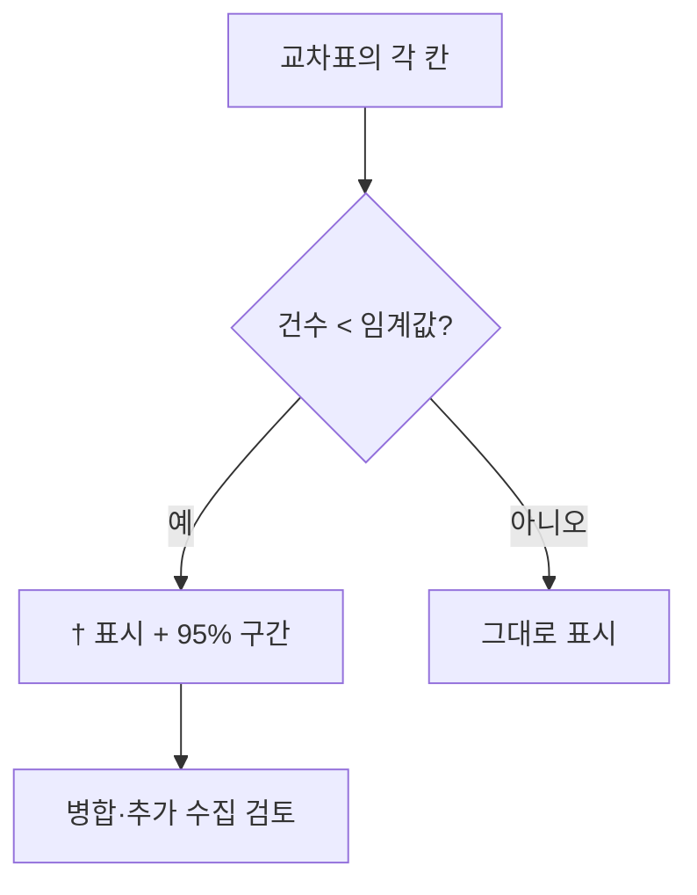

# 작은 칸 표시

> 데이터 구성 표(교차표)에서 **건수가 적은 칸에 경고 표시를 붙이는 관행**이다. 칸의 건수가 작으면 그 칸의 비율·정확도는 우연에 크게 흔들리므로, 평균만 보고 "이 집단도 괜찮다"고 결론 내리지 않게 한다.

## 쉽게 말하면
어느 반에서 학생이 3명뿐인 동아리의 평균 점수를 보고 "이 동아리가 우수하다"고 말하면 믿기 어렵다. 한 명만 달라도 평균이 크게 변하기 때문이다. 표에서 사람 수가 적은 칸에 "표본 작음" 딱지를 붙이는 이유다.

## 자세히
(Wilson 구간 계산은 직접 실행했고, 영국 통계청(ONS) 공표 지침 문서와 검색 결과의 지침 요약을 확인했다. 두 가지 다른 목적이 있어 구분해서 쓴다.)
- **목적 1 — 신뢰도 경고(이 노드의 초점)**: 칸이 작을수록 그 칸에서 잰 정확도의 불확실성이 커진다. 직접 계산한 95% Wilson 구간(관측 정확도 약 0.90 가정)
  | 칸의 건수 | 관측 정확도 | 95% 구간 | 구간 폭 |
  |---|---|---|---|
  | 5 | 4/5 = 0.80 | 0.38~0.96 | 0.59 |
  | 10 | 9/10 = 0.90 | 0.60~0.98 | 0.39 |
  | 20 | 18/20 = 0.90 | 0.70~0.97 | 0.27 |
  | 50 | 45/50 = 0.90 | 0.79~0.96 | 0.17 |
  | 100 | 90/100 = 0.90 | 0.83~0.94 | 0.12 |
  10건 이하의 칸은 구간이 0.4 이상으로 넓어, 정확도 0.90이든 0.60이든 가능하다. 예시 표(가상 수치): 밝은 피부 남 400건 정확도 0.93(0.90~0.95), 어두운 피부 여 12건 0.75(0.47~0.91) — 성능 격차처럼 보이지만 작은 칸은 구간이 넓어 **격차가 있다고도 없다고도 단정하기 어렵다.**
- **목적 2 — 공표 시 비밀 보호(다른 문제)**: 통계청은 작은 건수가 개인을 식별시킬 수 있어 가림 규칙을 쓴다. ONS 문서는 **10-5 규칙**(10 미만 건수 숨김, 10 초과는 5 단위로 반올림)을 설명하며, 노이즈가 더 적은 **섭동(perturbation)**을 대체로 선호하되 민족·종교처럼 민감하거나 이전 공표와 일관성이 필요할 때는 10-5를 허용한다고 한다. 검색 결과에서는 미국 캘리포니아 보건 지침이 11 미만 칸을 숨기고 숨긴 값을 역산하지 못하게 다른 칸도 함께 가리는 사례, 임계값 선택이 해결되지 않은 문제라는 논의도 있었다(원문을 열어 확인한 것은 ONS 문서뿐). 데이터 공유 때만 해당하며 **모델 평가에서는 숨기는 대신 구간을 보여 주는 편이 정보가 많다**(제안).
- **표시 방법(제안)**: ① 칸 건수 < 30(또는 < 10)이면 `†` 표시하고 각주에 "표본 작음, 정확도 구간 넓음" ② 건수 옆에 95% 구간을 함께 표기 ③ 칸 병합으로 건수 늘리기(예: 연령대를 합침) ④ 작은 칸이 서비스 취약 집단일수록 별도 표본 수집을 계획 ⑤ 임계값(예: 30)을 사전에 정하고 문서화.
- **한계**: 임계값은 보편 기준이 아니다. 건수가 같아도 비율이 극단이면 구간 폭이 다르므로 임계값보다 구간 자체를 보여 주는 것이 좋다. 여러 칸을 동시에 비교하면 우연히 격차가 나올 수 있다(다중 비교).

## 그림으로 보기

## 예시
- 얼굴·음성 모델의 성별×피부색 정확도 표에서 12건짜리 칸에 †를 붙이고 "추가 수집 필요"로 분류.
- 교육 소재: 학급 교차표로 "작은 칸의 평균을 믿어도 될까?"를 토론(통계 리터러시).

## 헷갈리는 것과 비교
| 개념 | 차이 |
|---|---|
| 작은 칸 표시(신뢰도) | 통계적 불확실성 경고 |
| 작은 칸 억제(공표 비밀) | 개인 식별 방지를 위해 숨김(ONS 10-5 규칙 등) |
| [데이터 구성 표](#dataset-composition-table) | 표 전체 |
| [기준 집단 비율과 비교](#reference-population-comparison) | 실제 대상 집단 비율과의 차이 |

## 더 읽을거리
- [ONS: Overview of statistical disclosure control (post-tabular methods)](https://www.ons.gov.uk/peoplepopulationandcommunity/populationandmigration/populationestimates/methodologies/comparisonofposttabularstatisticaldisclosurecontrolmethods) — 10-5 규칙과 섭동 방식의 비교(직접 확인).
- [Binomial proportion confidence interval — 위키백과](https://en.wikipedia.org/wiki/Binomial_proportion_confidence_interval) — Wilson 구간(앞서 직접 확인).
