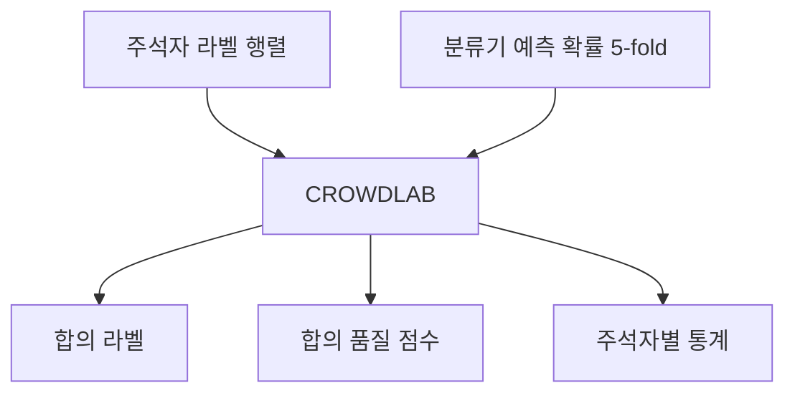
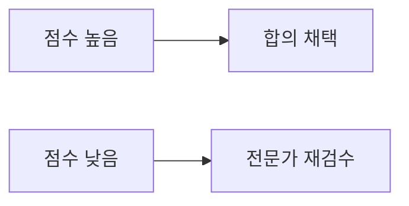

# CROWDLAB

> CROWDLAB은 여러 주석자의 라벨과 학습된 분류기의 예측 확률을 함께 써서, 샘플마다 합의 라벨과 그 라벨이 맞을 확신도(품질 점수)를 추정하는 알고리즘이다. cleanlab의 multiannotator 기능이 이 방식을 쓴다.

## 쉽게 말하면
여러 심사위원의 점수에 AI 심사위원 한 명을 더해 최종 결과를 정하는 방식이다. 단순 다수결은 심사위원이 한두 명뿐인 항목에서 흔들리지만, 모델의 의견을 같이 반영하면 근거가 더 든든해진다. 심사위원마다 믿을 만한 정도가 달라서 그 신뢰도도 같이 추정한다.

## 자세히
- **함수(cleanlab 튜토리얼)**: `get_label_quality_multiannotator(multiannotator_labels, pred_probs)`. 입력은 (샘플 × 주석자) 라벨 행렬(없는 값은 NaN)과 out-of-sample 예측 확률이다. 예측 확률은 처음 다수결 라벨로 분류기를 학습해 5-fold 교차 검증으로 얻는다.
- **출력 세 가지**: `label_quality`(샘플별 `consensus_label`, `consensus_quality_score`, `annotator_agreement`, `num_annotations`), `detailed_label_quality`(주석자 라벨 하나하나의 품질 점수), `annotator_stats`(주석자별 통계, [주석자 품질 통계](#annotator-quality-stats)).
- **성능 주장(문서)**: 문서는 CROWDLAB이 Dawid-Skene, GLAD 같은 방법보다 낫다고 밝힌다. 직접 재현하지는 않았으므로 "주장"으로 읽는다.
- **라벨 수가 적은 샘플(문서)**: 품질 점수는 샘플에 라벨을 단 주석자 수를 반영한다. 다수결은 주석자가 한두 명인 샘플에서 믿기 어려워서 모델 예측을 함께 쓴다. 한 명만 달았을 때의 세부 계산은 문서에 자세히 나오지 않는다.
- **쓰임(해석)**: 합의 점수가 낮은 샘플을 전문가 재검수 대상으로 올리면, 모든 샘플에 같은 검수 비용을 쓰지 않아도 된다([precision@k 검수 효율](#precision-at-k-review)).

## 그림으로 보기

## 예시
- 코드 예(문서): `results = get_label_quality_multiannotator(labels_df, pred_probs)`; `results["label_quality"]`에서 점수가 낮은 순으로 정렬해 재검수 큐를 만든다.
- 교육 활용: 같은 문항을 학습자 5명에게 라벨링시켜 다수결과 합의 점수가 갈리는 항목을 찾아본다.

## 헷갈리는 것과 비교
| 개념 | 차이 |
| --- | --- |
| CROWDLAB | 라벨 + 모델 예측을 함께 써서 합의 추정 |
| 단순 다수결 | 라벨 수만 센다. 적은 라벨 샘플에 약함 |
| [이중 검수](#double-annotation-review) | 두 명 일치 여부 + 전문가 |
| [평가자 간 일치도](#inter-annotator-agreement) | 주석자끼리 얼마나 같은지 재는 통계 |

## 더 읽을거리
- [cleanlab multiannotator 튜토리얼](https://docs.cleanlab.ai/stable/tutorials/multiannotator.html) — 함수·출력·5-fold 예측 확률
