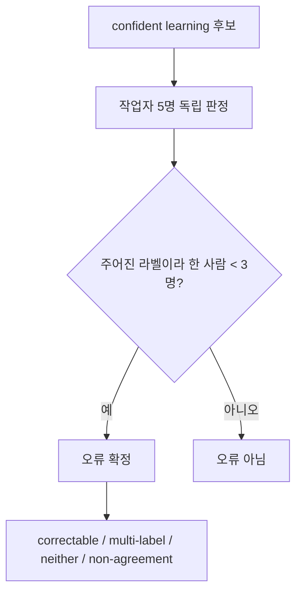
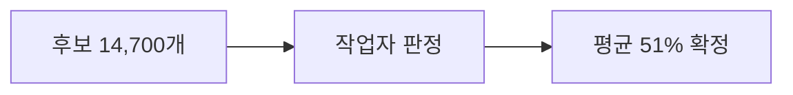

# 크라우드 라벨 검증

> 알고리즘이 "라벨이 틀렸을 것 같다"고 표시한 **후보를 여러 사람에게 보여 줘서 진짜 오류인지 확인**하는 절차다. Northcutt 등이 10개 벤치마크 시험 세트의 라벨 오류를 확정할 때 Mechanical Turk로 쓴 방식이 대표 사례다.

## 쉽게 말하면
의심스러운 영수증 몇백 장만 골라 여러 명이 각각 다시 확인하고, 과반이 "틀렸다"고 하면 오류로 확정하는 것이다. 전부 사람이 보지 않고도 효율적으로 오류를 확정한다.

## 자세히
(논문 "Pervasive Label Errors in Test Sets Destabilize Machine Learning Benchmarks", arXiv 2103.14749, ar5iv 본문 확인)
- **후보 추출**: confident learning이 의심 샘플(후보)을 고른다.
- **질문 설계**: 후보마다 **5명**의 작업자가 독립적으로 보고 "이 샘플의 라벨이 주어진 라벨 / 모델이 예측한 라벨 / 둘 다 / 둘 다 아님" 중 고른다. 화면에는 두 클래스의 확신도 높은 예시 이미지도 함께 보여 준다.
- **확정 규칙**: 5명 중 **3명 미만**이 주어진 라벨이라고 하면 오류로 확정(3-of-5). 확정된 오류는 correctable(과반이 예측 라벨 선택), multi-label(과반이 둘 다), neither(과반이 둘 다 아님), non-agreement(과반 없음)로 분류.
- **규모**: 후보 검토 수는 MNIST 100, CIFAR-10 275, CIFAR-100 2,235, Caltech-256 2,360, ImageNet 5,440, QuickDraw 1,870, 20news 93, IMDB 1,310, Amazon Reviews 732, AudioSet 307로 총 약 14,700개. QuickDraw와 Amazon은 무작위 표본만 검토.
- **확정률**: 후보 중 진짜 오류로 확정된 비율은 MNIST 100개 중 15개부터 Amazon Reviews 1,000개 중 732개까지 다양했다. ImageNet은 5,440개 중 2,916개(약 54%). 데이터셋 평균 약 51%(초록 요약).
- **비용**: 작업자 시급 7.2달러(이미지당 5초로 추정), 총 1,623.29달러. 전체를 사람이 보는 것보다 훨씬 싸다.
- **설계 포인트**
  1. 후보만 검증하므로 알고리즘 정밀도가 낮으면(위 평균 51%) 사람 시간의 절반이 낭비된다 → 점수 상위부터([검수 순서](#human-relabel-triage)).
  2. 다수 판정으로 개인 오판을 줄인다([다중 주석자 합의](#cleanlab-multiannotator)).
  3. "둘 다/둘 다 아님" 선택지가 있어야 모호한 샘플을 오류와 구분할 수 있다([모호 vs 오류](#ambiguous-vs-wrong-label)).
  4. 작업자 품질 관리(자격 검사)와 임계값 사전 정의.
- 알고리즘이 놓친 오류는 이 절차로 찾을 수 없다(재현율은 별도).

## 그림으로 보기

## 예시
- 사내 평가셋 의심 300건을 3명이 각각 보고 2명 이상이 "라벨 틀림"이면 수정 대상으로 확정.
- 교육: 크라우드 검증 설계 실습(질문 문구·선택지·합의 규칙 정하기).

## 헷갈리는 것과 비교
| 개념 | 차이 |
|---|---|
| 크라우드 검증 | 알고리즘 후보를 사람이 확정 |
| 처음부터 크라우드 라벨링 | 라벨을 새로 만듦 |
| [수정된 시험 세트](#corrected-test-labels) | 이 절차의 결과물 |
| [자동 삭제](#auto-delete-risk) | 사람 확인 없이 제거(위험) |

## 더 읽을거리
- [Pervasive Label Errors in Test Sets (arXiv 2103.14749)](https://arxiv.org/abs/2103.14749) — 초록과 결과.
- [ar5iv HTML 판](https://ar5iv.labs.arxiv.org/html/2103.14749) — 검증 절차·비용 상세(본문 확인).
