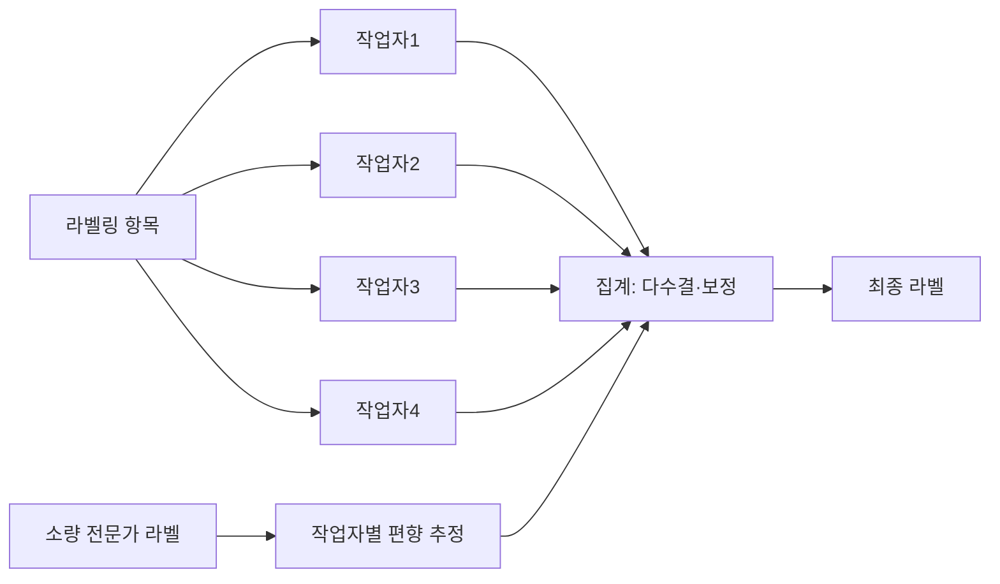
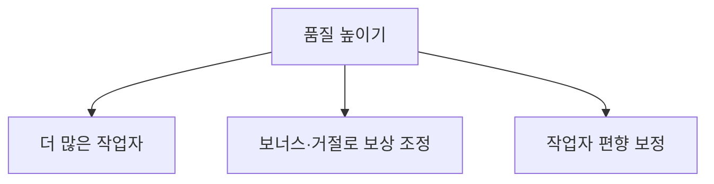

# 크라우드소싱 라벨링

> 온라인 노동 시장(대표적으로 Amazon Mechanical Turk)에서 불특정 다수의 비전문가에게 라벨 붙이기를 맡기는 방식이다. 싸고 빠르지만 작업자 편차가 크므로, 같은 항목을 여러 명이 라벨링하고 편향을 보정하는 설계가 필요하다.

## 쉽게 말하면
전문 번역가 한 명 대신 아르바이트생 열 명에게 같은 문장을 번역시키고 다수결로 합치는 것이다. 한 명은 틀려도 여럿의 평균은 꽤 정확하고 비용은 훨씬 싸다. 다만 일부는 대충 하는 사람이라, 누가 믿을 만한지 가려내는 장치도 필요하다.

## 자세히
(Snow, O'Connor, Jurafsky, Ng, "Cheap and Fast — But is it Good?", EMNLP 2008, PDF 본문을 직접 읽어 정리. 2008년 연구이므로 오늘날 플랫폼 환경과 단가와는 다를 수 있다.)
- **연구 설계**: Mechanical Turk로 감정 인식·단어 유사도·텍스트 함의 인식·사건 시간 순서·단어 의미 중의성 해소 등 5개 과제(본문 표는 7개 과제 풀링)를 시험했다. 모든 과제에서 **항목마다 독립적으로 10개씩 라벨**을 받아 라벨 수에 따른 품질 변화를 분석했다. 과제는 객관식·정해진 범위의 숫자 입력으로 제한했다.
- **핵심 결과(논문 주장)**
  - 모든 과제에서 비전문가 라벨은 전문가의 정답 라벨과 **높은 일치**를 보였다. 개별 전문가가 개별 비전문가보다 낫지만(전문가끼리가 전문가-비전문가보다 더 일치), 비전문가 라벨을 정답 구성에 포함시키면 일치도가 오르기도 했다.
  - 평균적으로 **예시당 비전문가 라벨 4개**면 전문가 1명 수준의 주석자 간 일치도에 도달했다(7개 과제 풀링). 감정 인식("Fear" 제외)은 9명 이내, 자주 2명 이내.
  - 비용 환산: 7,000개 비전문가 라벨을 수집하는 데 **2달러**를 썼고 이는 달러당 3,500라벨, 전문가 환산으로 **달러당 최소 875개**라는 해석(2008년 단가).
  - 감정 인식에서는 비전문가 라벨로 학습한 분류기가 전문가 정답으로 학습한 것만큼 효과적이었다.
  - 정답 오류 발견: 비전문가 투표가 원래 정답과 9대 1로 어긋난 항목이 알고 보니 원래 정답 라벨의 오류였던 사례도 보고된다.
- **작업자 편차와 보정(5절)**: 일부는 정확하고 일부는 부주의하며 소수는 매우 노이즈가 크다. 소수의 작업자가 전체 작업의 큰 부분을 하는 경우가 많다. 품질을 높이는 세 가지: ① 더 많은 작업자 ② 보너스·지급 거절 같은 보상 메커니즘 ③ **소량의 전문가 라벨로 작업자별 편향을 보정**(Dawid-Skene식 모델링을 정답 라벨 기반으로 변형). 저자들은 편향 보정이 두 과제에서 품질을 크게 개선했다고 보고한다.
- **현대적 맥락(일반적)**: 지금은 크라우드 플랫폼 외에 관리형 인력·LLM 라벨러가 선택지다([데이터 라벨링](#data-labeling)). 개인정보가 들어간 데이터는 크라우드에 보내기 어려우니 [자체 호스팅 라벨링](#self-hosted-labeling-privacy)을 먼저 고려한다.
- **이번에 확인하지 못한 것**: Mechanical Turk 공식 문서(접근 403)의 HIT·자격(Qualification) 기능 세부.

## 그림으로 보기

## 예시
- 상품 리뷰 감성 라벨 1만 건: 항목당 3~5명에게 맡겨 다수결, 정답이 확실한 문항을 섞어 작업자 정확도를 추적(골드 문항, [라벨링 품질 관리](#data-labeling-qa)).
- 교육 소재: "AI의 정답은 사람들이 붙인 라벨의 평균"이라는 점을 보여 주는 사례로 활용.

## 헷갈리는 것과 비교
| 개념 | 차이 |
|---|---|
| 크라우드소싱 | 불특정 다수에게 맡김(저비용·편차) |
| 관리형 인력 | 훈련된 팀, 비용 높고 품질 안정 |
| [모델 보조 사전 라벨링](#model-assisted-prelabeling) | 모델 초벌 + 사람 검수 |
| [라벨링 규칙서](#label-consistency-guideline) | 크라우드에서도 명확한 지침과 예시가 필수 |

## 더 읽을거리
- [Cheap and Fast — But is it Good? (ACL Anthology D08-1027)](https://aclanthology.org/D08-1027/) — 비전문가 라벨 품질·비용·편향 보정(PDF 본문 직접 확인).
- [AltexSoft: 데이터 라벨링 접근법](https://www.altexsoft.com/blog/how-to-organize-data-labeling-for-machine-learning-approaches-and-tools/) — 크라우드·외주 비교(직접 열어 확인, 벤더 글).
