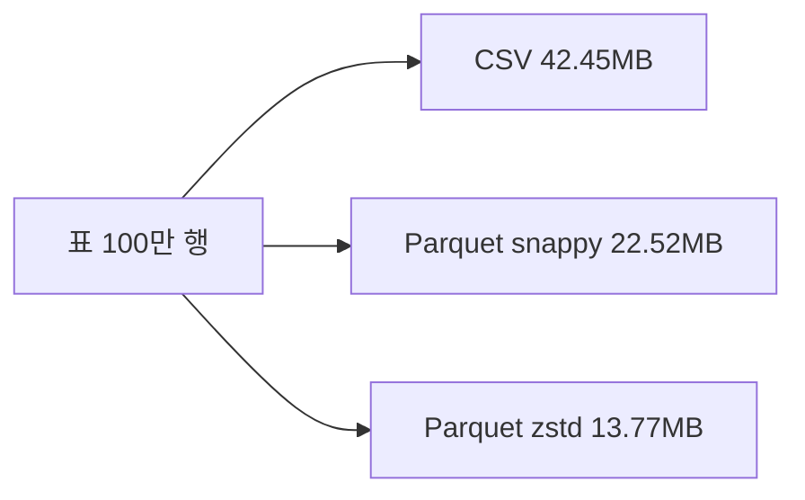
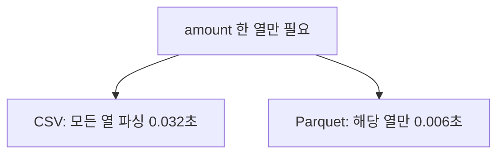

# CSV vs Parquet 실험

> 같은 100만 행 표를 CSV와 Parquet으로 저장해 **파일 크기와 읽기 시간을 직접 재 본** 실험이다. 숫자는 이 지도가 이 세션에서 한 번 측정한 값이며 일반 결론이 아니다.

## 쉽게 말하면
같은 책을 두 가지 방식으로 제본해 무게(크기)와 원하는 장 하나를 찾는 속도를 비교해 본 것이다. 한 열만 필요한 질의에서 열 단위로 저장된 Parquet이 얼마나 유리한지 눈으로 확인한다.

## 자세히
(실험 환경: Python 3.13, **pyarrow 26.0.1**, 합성 데이터, 한 대의 클라우드 컨테이너. 읽기 시간은 3회 중 **최솟값**. 반복 횟수가 적고 환경이 하나라 오차가 크며 다른 데이터·엔진·디스크에서는 결과가 다를 수 있다.)
- **데이터(합성)**: 100만 행 × 5열 — `id`(정수, 연속), `user_id`(정수, 0~49,999 무작위), `city`(8개 도시 중 무작위 문자열), `amount`(0~100 무작위 소수 둘째 자리), `note`(무작위 소문자 12자). 무작위 값이 많아 실제 업무 데이터보다 **압축이 덜 되는** 편이다.
- **파일 크기(직접 측정)**

| 형식 | 크기(MB) | 쓰기 시간(초) |
|---|---|---|
| CSV | 42.45 | 0.15 |
| Parquet(none, 압축 없음) | 28.83 | 0.12 |
| Parquet(snappy) | 22.52 | 0.16 |
| Parquet(zstd) | 13.77 | 0.18 |
| Parquet(gzip) | 14.92 | 9.8 |

  CSV 대비 Parquet은 압축 없이도 약 32% 작고, snappy는 약 47%, zstd는 약 68% 작다. **gzip의 쓰기 9.8초는 이 환경의 기본 설정에서 나온 값**이며 압축 수준·스레드 설정 영향은 확인하지 않았다.
- **읽기 시간(초, 3회 중 최솟값)**

| 작업 | CSV | Parquet(snappy) |
|---|---|---|
| 전체 열 읽기 | 0.050 | 0.042 |
| **`amount` 한 열만** 읽기 | 0.032 | 0.006 |

  전체를 읽을 때는 거의 비슷했지만(pyarrow의 CSV 리더는 다중 스레드라 빠르다) 한 열만 읽을 때 Parquet이 약 5배 빨랐다. 단, CSV 한 열 읽기(`include_columns`)도 전체 행을 파싱하는 비용은 든다.
- **해석(일반)**: Parquet은 열 단위로 저장하고 압축·타입 정보를 가지므로 필요한 열만 읽는 [열 가지치기](#column-pruning)와 크기 절감에서 유리하다. 읽기 속도 차이는 데이터 크기·엔진(pandas 등 다른 CSV 리더)·캐시 상태에 크게 좌우된다.
- **한계**: 1회 환경, 합성 데이터, 파일 하나. 행 그룹 통계 스킵은 이 실험에서 측정하지 않았다.

## 그림으로 보기



## 예시
```python
import pyarrow as pa, pyarrow.parquet as pq, pyarrow.csv as pc
pc.write_csv(tbl, "t.csv")
pq.write_table(tbl, "t_snappy.parquet", compression="snappy")
pq.read_table("t_snappy.parquet", columns=["amount"])   # 한 열만
pc.read_csv("t.csv", convert_options=pc.ConvertOptions(include_columns=["amount"]))
```
- 교육 소재: 자기 데이터로 같은 실험을 해 보고 압축률 차이가 왜 나는지 토론.

## 헷갈리는 것과 비교
| 개념 | 차이 |
|---|---|
| CSV | 행 단위 텍스트, 타입 정보 없음 |
| Parquet | 열 단위 이진, 압축·통계 내장 |
| [열 가지치기](#column-pruning) | 필요한 열만 읽는 최적화 |
| [Parquet 압축 코덱](#parquet-compression-codecs) | 열별 압축 방식 선택 |

## 더 읽을거리
- [Apache Parquet 문서](https://parquet.apache.org/docs/) — 형식 개요(이전 노드에서 설정 문서를 읽음).
- [pyarrow.parquet.write_table](https://arrow.apache.org/docs/python/generated/pyarrow.parquet.write_table.html) — 압축 옵션(이번 실험에서 사용, 문서 본문은 열지 않음).
