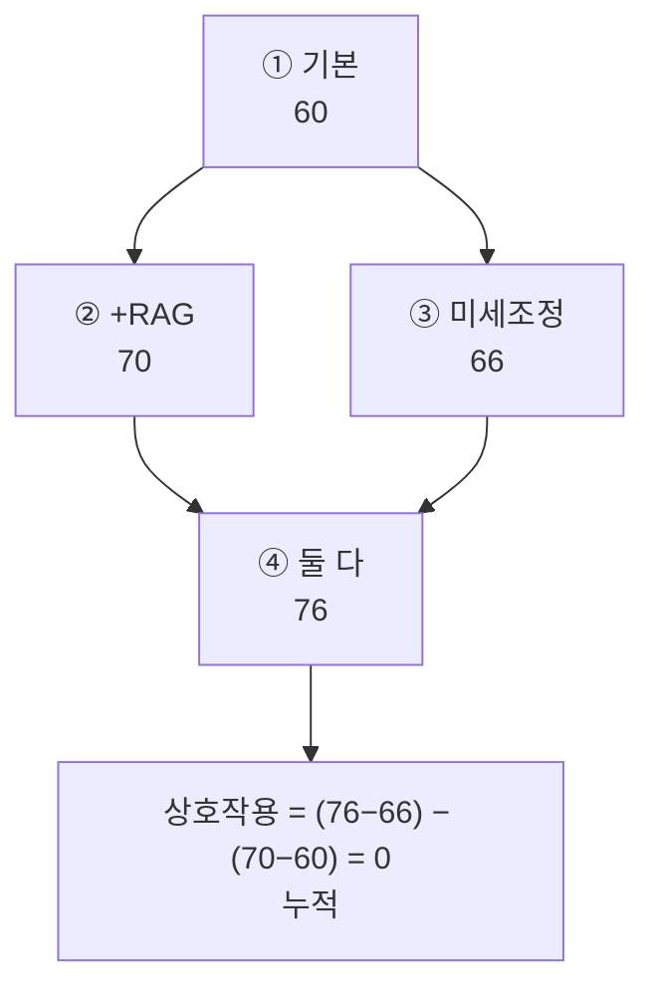
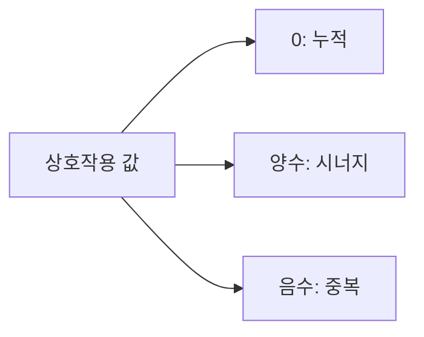

# 효과 누적성 확인

> 효과 누적성 확인은 RAG와 미세조정처럼 두 가지를 함께 적용했을 때의 개선이 각각의 개선을 더한 것과 같은지, 더 큰지(시너지), 더 작은지(중복)를 2×2 비교의 상호작용으로 확인하는 일이다.

## 쉽게 말하면
감기약 A는 열을 1도 낮추고 B도 1도 낮춘다. 둘을 같이 먹었을 때 2도가 내리면 효과가 "누적"된 것이다. 1도만 내리면 둘이 같은 곳에 작용해 중복이고, 3도 내리면 서로 돕는 시너지다. 합쳐서 좋아졌다는 사실과 합이 맞는지는 다른 질문이다.

## 자세히
- **2×2 설계(Wikipedia Factorial experiment, 열람)**: 요인 A와 B가 각각 두 수준일 때 네 칸의 평균 (1)·a·b·ab가 있다. 주효과는 높은 수준과 낮은 수준의 평균 차이이고, **상호작용 = [ab − a − b + (1)] / 2**로 계산한다(문서의 정의에서 유도한 식). 상호작용이 0이면 효과가 더해지는 가법적 상태다. 문서의 베어링 수명 예(18·23·21·106)에서는 한 요인의 효과가 다른 요인의 수준에 따라 5에서 85로 달라져 상호작용이 크다. 한 번에 한 요인만 보는 설계는 이를 놓칠 수 있다고 문서가 지적한다.
- **하이브리드 평가에 적용**: [하이브리드 평가 설계](#hybrid-eval)의 네 칸 ① 기본 ② 기본+RAG ③ 미세조정 ④ 미세조정+RAG에서 상호작용 = (④ − ③) − (② − ①)으로 본다(여기서는 한 번에 쓰는 정의라 1/2 배는 생략). 0이면 누적, 양수면 시너지, 음수면 중복이다.
- **사례(Microsoft 농업 연구, arXiv 2401.08406, 초록 열람)**: Llama2-13B·GPT-3.5·GPT-4로 시험해 미세조정이 정확도를 6%p 넘게 올렸고 RAG가 그 위에 약 5%p를 더해 효과가 누적적이라고 보고한다. 이 경우 상호작용은 0 근처이며 합이 거의 맞는다. 초록에는 칸별 수치가 없어 정확한 상호작용은 계산할 수 없다. 같은 조건에서 RAG만 적용했을 때의 증가도 초록엔 없다(해석).
- **가상 예시(직접 계산)**: 기본 60, RAG 70, 미세조정 66, 둘 다 76이면 RAG +10, 미세조정 +6, 둘 다 +16으로 상호작용 0이다. 둘 다 72라면 상호작용 −4(중복), 둘 다 80이라면 +4(시너지)다.
- **한계**: 평가 세트가 작으면 칸 차이가 잡음일 수 있으므로 신뢰구간이나 반복 실행으로 확인한다([보류 평가 세트](#held-out-eval-set)와 같은 세트를 쓰는 것이 공정하다). 정확도 같은 비율은 천장 효과로 누적처럼 보이지 않을 수 있다(해석).

## 그림으로 보기

## 예시
- 사내 문서 QA: 네 가지 구성의 정확도를 같은 200문항으로 재고 상호작용을 계산해, 두 비용을 모두 낼 가치가 있는지 판단한다. 중복이 크면 한 가지만 쓴다.
- 교육 활용: "두 가지를 함께 하면 효과도 2배다"라는 직관을 4칸 표로 검증하는 실습.

## 헷갈리는 것과 비교
| 개념 | 차이 |
| --- | --- |
| [하이브리드 평가 설계](#hybrid-eval) | 네 칸을 돌리는 설계. 누적성 확인은 그 결과 해석 |
| 주효과 | 한 요인의 평균 효과. 상호작용은 요인 간 의존 |
| 절제 연구(ablation) | 구성 요소를 빼 보는 실험. 같은 취지, 설계는 2×2에 가까움 |

## 더 읽을거리
- [Wikipedia: Factorial experiment](https://en.wikipedia.org/wiki/Factorial_experiment) — 주효과와 상호작용 정의
- [RAG vs Fine-tuning: Pipelines, Tradeoffs, and a Case Study on Agriculture (arXiv 2401.08406)](https://arxiv.org/abs/2401.08406) — 누적 효과 보고
