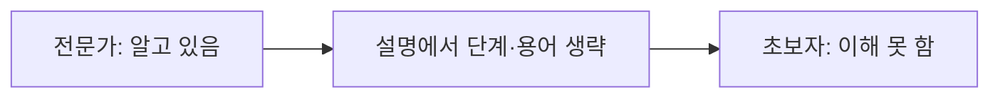
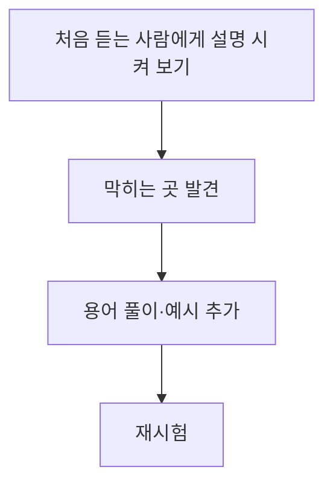

# 지식의 저주

> **지식의 저주**는 어떤 것을 **알고 나면 모르는 사람의 입장을 상상하기 어려워지는** 인지 편향이다. 전문가가 설명을 못 하는 이유이자, 교육 설계자가 가장 조심해야 할 함정이다.

## 쉽게 말하면
머릿속으로 노래를 들으며 책상을 두드리면, 듣는 사람도 곡명을 쉽게 맞힐 것 같다. 하지만 상대에게는 의미 없는 두드림 소리만 들린다. 내가 아는 정보가 상대에게도 보인다고 착각한다.

## 자세히
(검색 요약 기준, 원문은 열지 않음)
- **기원**: 이 용어는 Camerer, Loewenstein, Weber의 1989년 *Journal of Political Economy* 논문에서 나왔다. 정보 비대칭 경제 모형들이 "더 많이 아는 사람이 덜 아는 사람의 판단을 재현할 수 있다"고 가정하는데, 그 가정이 틀렸다는 지적이다.
- **두드리기 실험**: 1990년 스탠퍼드 대학원생 Elizabeth Newton이 "tapper(두드리는 사람)와 listener(듣는 사람)" 실험을 했다. 두드리는 사람은 곡을 머릿속으로 알고 있어서 듣는 사람이 쉽게 곡명을 맞힐 것이라고 가정했다. 구체적 예측 비율·적중률은 가져온 자료에 없어 적지 않는다(통용되는 숫자는 일반 지식이므로 인용 전에 확인할 것).
- **교육에서의 의미**(권고): 전문가는 용어·단계를 생략하고 설명한다. 초보자에게 **직접 설명해 보게 하고 막히는 곳을 관찰**하거나, 학습자 입장의 질문을 모아 반영한다. AI를 "처음 듣는 학생"으로 두고 설명이 통하는지 시험할 수도 있다([AI를 학생으로 두고 가르치기](#explain-to-ai-student)).
- 이 편향은 [설명 깊이의 착각](#illusion-of-explanatory-depth)과 다르다: 후자는 **내가 안다고 착각**, 전자는 **남도 알 거라고 착각**.

## 그림으로 보기

## 예시
- 재무 담당자가 "EBITDA 개선" 한 줄로 설명하면 마케팅팀은 못 알아듣는다 → 숫자 예시와 용어 풀이를 추가.
- 교안을 신입사원 한 명에게 먼저 읽혀 모르는 용어에 밑줄을 치게 한다.

## 헷갈리는 것과 비교
| 개념 | 차이 |
|---|---|
| 지식의 저주 | 남도 알 거라 착각 |
| [설명 깊이의 착각](#illusion-of-explanatory-depth) | 내가 안다고 착각 |
| 확증 편향 | 믿음에 맞는 정보만 수집 |
| [파인만 기법](#feynman-technique) | 쉬운 말로 설명해 빈틈 찾기 |

## 더 읽을거리
- [Curse of knowledge (Wikipedia)](https://en.wikipedia.org/wiki/Curse_of_knowledge)
- [Camerer, Loewenstein, Weber 1989 (RePEc)](https://ideas.repec.org/a/ucp/jpolec/v97y1989i5p1232-54.html)
