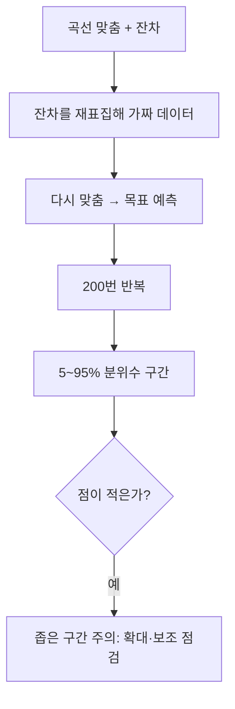
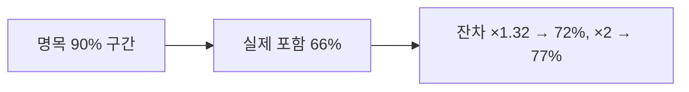

# 곡선 맞춤 불확실성 부트스트랩

> 학습 곡선을 한 번 맞춘 예측값만 보고하지 말고, **잔차를 재표집해 여러 번 다시 맞춰** 예측값의 범위를 구한다. 다만 점이 적으면 이 부트스트랩 구간도 **실제보다 좁게** 나올 수 있어 확인과 보정이 필요하다.

## 쉽게 말하면
7번의 측정으로 "40만 건이면 오류 5.3%"라고 한 점 예측을 내놓으면 얼마나 믿을지 알 수 없다. 측정 잡음을 다시 섞어 곡선을 수백 번 다시 그려 보면 "4.9~5.7% 사이"처럼 범위가 보인다.

## 자세히
- **잔차 부트스트랩 절차**: ① 곡선 ε = a·m^(−β) + γ를 맞춘다 ② 각 점의 잔차(관측−적합)를 구한다 ③ 적합값에 **잔차를 무작위로 골라 더해** 새 가짜 데이터를 만든다 ④ 다시 맞추고 목표 크기의 예측을 저장 ⑤ 수백 번 반복해 5%·95% 분위수를 예측 구간으로 쓴다([부트스트랩 일반](#bootstrap-ci-for-cv)).
- **직접 실험(순수 파이썬)**: 진짜 곡선 ε = 2.0·m^(−0.35) + 0.05, 곱셈 잡음 2%, m = 10³~6.4×10⁴의 2배 간격 7점으로 맞춘 뒤 **측정 최대의 4배(2.56×10⁵)** 를 예측. 데이터셋 100개 각각에서 잔차 부트스트랩 200회로 90% 구간을 만들어 **진짜 값을 포함하는 비율**을 쟀다.
  | 잔차 확대 계수 | 실제 포함 비율(명목 90%) | 평균 구간 폭(진짜 값 대비) |
  |---|---|---|
  | 1.0(그대로) | **66%** | 15.0% |
  | 1.32(√(7/4)) | 72% | 18.1% |
  | 2.0 | 77% | 21.7% |
  점 추정의 평균 상대 오차는 4.9%로 작았지만 **90% 구간이 진짜 값을 66%만 포함**했다 — 구간이 너무 좁다. 7점에 3개 모수를 맞추면 잔차가 실제 잡음보다 작게 나오고(자유도 소진) 곡선 형태·γ 추정의 불확실성도 구간에 충분히 반영되지 않기 때문이다. 잔차를 √(n/(n−p))=1.32배 키워도 72%, 2배로 키워도 77%로 명목에 못 미쳤다(이 한 설정의 결과, 점이 더 많거나 잡음이 다르면 달라진다).
- **해석**: 부트스트랩 구간은 "하한"으로 읽는다. 폭이 좁아 보여도 **실제 불확실성은 더 크다**. 점이 7개 수준이면 구간을 임의로 1.5~2배 넓혀 보고하거나 다른 방법(맞춤 구간 점검, [범위를 바꿔 맞추기](#fit-range-stability))과 함께 본다.
- **개선 방향(일반 통계 상식, 이 글에서 검증하지 않음)**: ① 점 수를 늘린다(특히 큰 크기 점) ② 각 크기에서 **반복 측정**해 잡음을 직접 추정 ③ γ에 사전 범위를 둔 베이즈 맞춤 ④ 파라미터 부트스트랩 대신 구간별 하위 맞춤의 변동을 사용.
- **보고 서식**: "4배 외삽 예측 5.3%, 잔차 부트스트랩 90% 구간 4.9~5.7%(점 7개 기준으로는 좁을 수 있어 실제 불확실성은 이보다 큼)".

## 그림으로 보기



## 예시
```python
resid = err - fitted
preds = []
for _ in range(200):
    boot = fitted + rng.choice(resid, size=len(resid)) * inflate   # inflate=1.0~2.0
    a, b, g = fit_powerlaw(sizes, boot)
    preds.append(a * target**(-b) + g)
print(np.percentile(preds, [5, 50, 95]))
```
- 학습 곡선 예측을 임원 보고서에 쓸 때 점 추정과 함께 "부트스트랩 구간은 하한"이라고 주석을 단다.

## 헷갈리는 것과 비교
| 구간 | 포착하는 것 |
|---|---|
| 잔차 부트스트랩 구간 | 측정 잡음의 영향 |
| 맞춤 범위 변경 변동 | 사용한 점·구간에 대한 민감도 |
| 형태 오지정 오차 | 구간에 포함 안 됨([형태 오지정](#model-misspecification-extrapolation)) |
| [외삽 거리 제한](#extrapolation-distance-limit) | 거리에 따른 오차 증가 |

## 더 읽을거리
- [Deep Learning Scaling is Predictable, Empirically (arXiv 1712.00409)](https://arxiv.org/abs/1712.00409) — 멱법칙 학습 곡선의 맞춤 맥락(PDF 본문 확인). 포함 비율 표는 이 글의 직접 시뮬레이션(100개 데이터셋, 한 설정).
