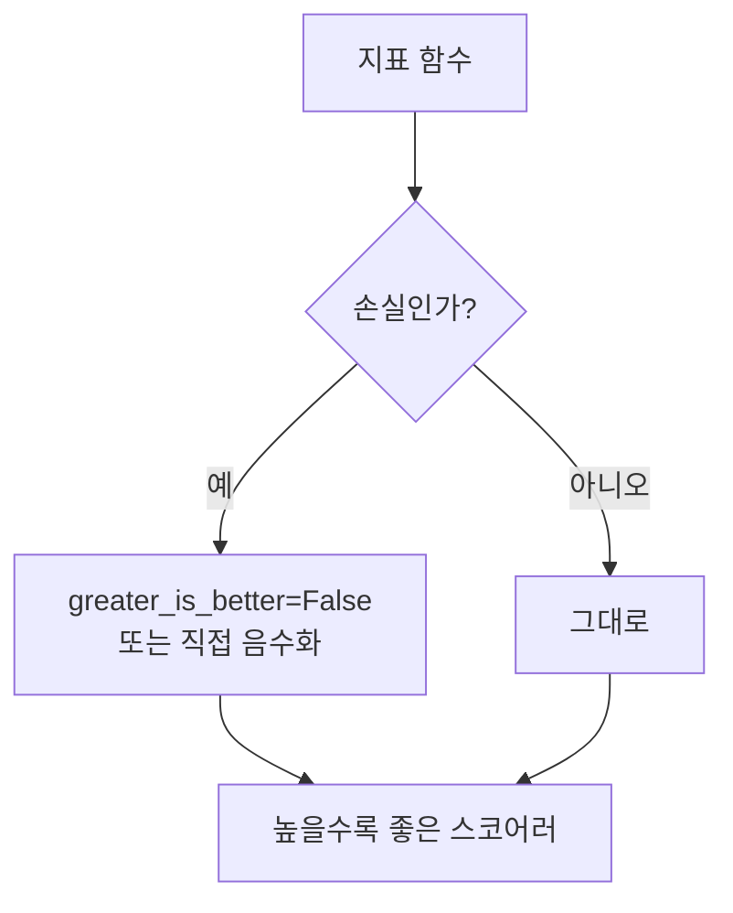

# 사용자 정의 스코어러

> 사용자 정의 스코어러는 정확도·F1 같은 기성 지표 대신 "이 모델을 쓰면 돈이 얼마 남나"처럼 사업 이득이나 손실을 점수 함수로 직접 만들어 모델 선택과 임계값 튜닝의 기준으로 쓰는 것이다. scikit-learn에서는 `make_scorer`나 `(estimator, X, y)` 함수로 만든다.

## 쉽게 말하면
운동선수를 뽑을 때 "100m 기록"만 보는 대신 우리 팀 경기 방식에 맞는 점수표(수비 가중 2배 등)를 직접 만들어 쓰는 것이다. 점수표가 사업 목표와 같아야 뽑힌 선수가 팀에 도움이 된다.

## 자세히
scikit-learn 문서(Model evaluation, 열람)의 내용이다.
- **`make_scorer`**: 파이썬 함수를 스코어러로 감싼다. 주요 인자는 지표 함수, `greater_is_better`(기본 True. 손실 함수면 False로 두면 부호를 뒤집어 항상 높을수록 좋게 만든다), `response_method`(분류에서 지표에 넘길 출력: `"predict_proba"` 등. 리스트로 주면 지원하는 첫 번째를 쓴다), 그 밖의 키워드 인자(지표에 전달)다. 옛 버전의 `needs_proba`는 현재 `response_method`로 대체됐다고 문서가 안내한다(해당 페이지 앞부분만 열람).
- **직접 만든 호출 가능 객체**: `scoring`에 `(estimator, X, y)`를 받는 함수를 넘기면 숫자 하나 또는 이름 붙은 숫자 딕셔너리(다중 지표)를 돌려줄 수 있다. 문서는 `n_jobs > 1`일 때 함수를 인라인이 아니라 import 가능한 모듈에 정의하라고 안내한다.
- **비용 기반 점수 함수 예(직접 작성, scikit-learn은 이 환경에 없어 실행은 못 하고 함수 논리만 순수 파이썬으로 확인)**

```python
from sklearn.metrics import make_scorer

def net_benefit(y_true, y_pred, fn_loss=200_000, review=3_000):
    tp = sum(1 for t, p in zip(y_true, y_pred) if t == 1 and p == 1)
    fp = sum(1 for t, p in zip(y_true, y_pred) if t == 0 and p == 1)
    fn = sum(1 for t, p in zip(y_true, y_pred) if t == 1 and p == 0)
    return -(fn * fn_loss + (tp + fp) * review)   # 비용을 음수로 = 높을수록 좋음

scorer = make_scorer(net_benefit)   # 이미 음수화했으므로 greater_is_better=True
```
  10건(오류 2건) 중 오류 1건을 잡고 정상 1건을 잘못 플래그하고 오류 1건을 놓치면 −(200,000 + 2×3,000) = −206,000이 나온다(위 함수 로직을 순수 파이썬으로 실행해 확인).
- **임계값 튜닝과 연결**: [결정 임계값 튜닝](#decision-threshold-tuning)의 `TunedThresholdClassifierCV(scoring=scorer)`에 넘기면 비용을 최소화하는 기준선을 찾는다(scikit-learn 문서는 사용자 정의 효용을 callable scorer로 넘길 수 있다고 설명).
- **주의(해석)**: 단가 가정이 바뀌면 최적 모델도 바뀌므로 단가를 인자로 두고 [민감도 분석](#sensitivity-range-selection)한다. 점수가 건마다 다른 비용(거래 금액)을 반영해야 하면 `sample_weight`나 `(estimator, X, y)` 형태가 필요하다.

## 그림으로 보기



## 예시
- 송장 오류 탐지: 놓친 오류 20만 원, 검토 3,000원을 인자로 둔 스코어러로 후보 모델 3개를 교차검증해 가장 이득이 큰 모델을 고른다.
- 교육 활용: 같은 모델을 정확도와 비용 스코어러로 각각 평가해 선택 결과가 달라지는지 비교하는 실습.

## 헷갈리는 것과 비교
| 개념 | 차이 |
| --- | --- |
| [비용 행렬](#cost-matrix) | 단가표. 스코어러는 그 표를 코드 함수로 구현 |
| [결정 임계값 튜닝](#decision-threshold-tuning) | 기준선 탐색 절차. 스코어러는 그 목적함수 |
| 손실 함수(학습용) | 학습 중 최소화. 스코어러는 평가·선택용(미분 불필요) |

## 더 읽을거리
- [scikit-learn: Metrics and scoring](https://scikit-learn.org/stable/modules/model_evaluation.html) — make_scorer와 callable scorer
