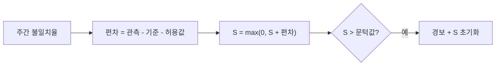
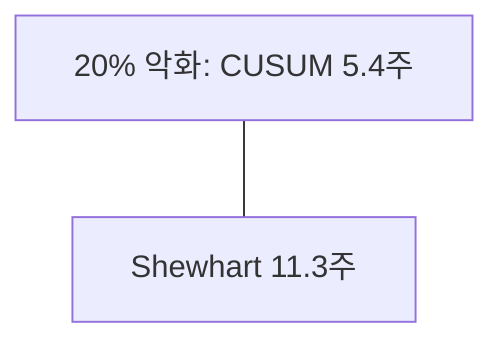

# 누적합(CUSUM) 감시

> CUSUM은 기준값에서 벗어난 정도를 매주 누적해 더하다가 그 합이 문턱값을 넘으면 경보하는 관리도 기법이다. 한 번에는 작아 보이는 변화도 쌓이면 드러나므로 라벨 품질의 작은 하락을 일반 관리도보다 빨리 잡을 수 있다.

## 쉽게 말하면
하루에 100원씩 새는 수도꼭지는 하루만 보면 티가 안 나지만, 통장 잔액의 누적 감소를 보면 며칠 안에 알아챈다. CUSUM은 "새는 양을 누적해서 보는" 방식이다.

## 자세히
- **정의(Wikipedia, CUSUM)**: S₀=0에서 시작해 Sₙ₊₁ = max(0, Sₙ + xₙ₊₁ − ω)로 갱신하고(관측값 − 기준 허용값을 더하되 0 밑으로 내려가지 않게 함) S가 문턱값 T를 넘으면 경보한다. ω가 크면 덜 민감하다. 문서의 예에서는 어떤 관측도 3σ를 넘지 않아 단순 경보는 변화를 놓치지만 CUSUM 값은 17번째 관측에서 4를 넘는다. 성능은 평균 런 길이(ARL)로 말하며, 정상일 때 ARL은 오경보 비용, 이상일 때 ARL은 탐지 지연을 뜻한다.
- **직접 시뮬레이션(주 100개 이중 라벨, 기준 불일치율 15%, 상승 쪽 CUSUM: S = max(0, S + 주간 불일치율 − 0.15 − 0.025), 문턱값 h를 바꿈, ARL은 평균 몇 주 만에 경보하는가)**:

| 방식 | 정상일 때 ARL(오경보까지 주) | 20%로 악화 시 탐지까지 주 | 25%로 악화 시 |
| --- | --- | --- | --- |
| CUSUM h=0.08 | 79 | 3.9 | 1.7 |
| CUSUM h=0.10 | 159 | 4.6 | 1.9 |
| CUSUM h=0.12 | 253 | 5.4 | 2.2 |
| Shewhart 3σ 한계선만 | 233 | 11.3 | 2.3 |

  정상일 때 오경보 간격이 비슷한 CUSUM h=0.12(253주)와 Shewhart 3σ(233주)를 비교하면, 불일치율이 20%로 오른 경우 탐지까지 5.4주 대 11.3주로 CUSUM이 절반이다. 큰 변화(25%)는 둘 다 약 2주로 비슷하다. (가정된 시뮬레이션이며 ω=0.025는 5%p 상승을 겨냥해 정한 값이다.)
- **쓰는 법(해석)**: ① 기준선은 안정기 데이터로 설정 ② 감지하려는 최소 변화(예: 5%p)로 허용값 k를 정한다 ③ 문턱값 h는 원하는 오경보 간격(ARL₀)이 되게 시뮬레이션으로 고른다 ④ 경보 후에는 S를 0으로 되돌리고 원인을 점검 ([재보정 조건](#recalibration-trigger)).
- **한계(해석)**: 변화 크기를 미리 가정해야 하고, 지침 개정·인력 교체 후에는 기준선을 새로 잡아야 한다. 하락 쪽과 상승 쪽을 따로 둔다.

## 그림으로 보기

## 예시
- 위 설정에서 불일치율이 15→20%로 올랐을 때 평균 5.4주 만에 경보(Shewhart는 11.3주).
- 교육 활용: 엑셀로 주간 값에 누적합 열을 만들어 단순 한계선과 비교한다.

## 헷갈리는 것과 비교
| 개념 | 차이 |
| --- | --- |
| CUSUM | 편차를 누적, 작은 변화에 민감 |
| Shewhart 관리도 | 한 점이 한계를 넘을 때만 경보 |
| [라벨링 관리도](#control-chart-for-labeling) | 관리도 일반 |
| [이동 평균 kappa](#moving-average-kappa) | 여러 주를 평균해 추세 보기 |

## 더 읽을거리
- [CUSUM (Wikipedia)](https://en.wikipedia.org/wiki/CUSUM) — 정의, ARL, 3σ를 넘지 않는 변화 탐지 예
- [Control chart (Wikipedia)](https://en.wikipedia.org/wiki/Control_chart) — Shewhart 관리도
