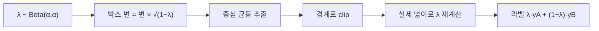
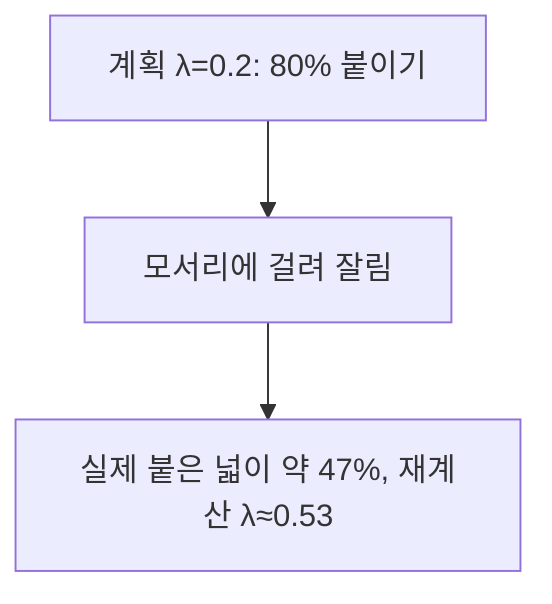

# CutMix 박스 샘플링

> CutMix는 한 이미지의 사각형 영역을 다른 이미지 조각으로 바꿔 붙인다. 박스 크기는 혼합 비율 λ에서 **한 변 = 이미지 변 × √(1−λ)**로 정하고 중심은 이미지 안에서 균등하게 뽑는다. 박스가 경계에 걸려 잘리면 실제 붙은 넓이로 **λ를 다시 계산**해 라벨에 쓴다.

## 쉽게 말하면
고양이 사진 위에 개 사진 조각을 오려 붙이는데, "개가 40%를 차지하게 하자"고 계획했더라도 오려 붙일 위치가 모서리면 조각이 잘려서 실제로는 20%만 붙는다. 이때 라벨을 "개 40%"로 두면 거짓이므로 **실제 붙은 넓이(20%)로 라벨을 고쳐야** 한다.

## 자세히
- **알고리즘**(Yun 외 2019, arXiv 1905.04899 ar5iv 확인): λ ~ Beta(α,α)(α=1이면 균등), 박스 중심 (r_x, r_y)는 이미지 전체에서 균등, r_w = W√(1−λ), r_h = H√(1−λ)라 박스 넓이가 약 (1−λ)배. 모서리 좌표를 이미지 범위로 자르고 정수로 맞춘 뒤 **실제 넓이로 λ = 1 − (x2−x1)(y2−y1)/(WH)로 재계산**한다. 혼합 이미지는 `M·x_A + (1−M)·x_B`, 라벨은 `λ·y_A + (1−λ)·y_B`. 논문 결과: CIFAR-100(PyramidNet-200) top-1 오류 16.45→14.47%, ImageNet(ResNet-50) 23.68→21.40%.
- **왜 √인가**: 넓이는 변의 곱이므로 변을 √(1−λ)배로 해야 넓이가 (1−λ)배가 된다.
- **직접 계산**(32×32, α=1, 20만 번 시뮬레이션): 계획한 박스 넓이 비율(1−λ)의 평균은 0.500인데, **경계에서 잘린 뒤 실제 붙은 넓이의 평균은 0.299**였다. 계획 λ와 재계산 λ의 평균 차이는 0.201이고 **62%의 샘플에서 차이가 0.1 초과**였다. 계획 λ별로 실제 "남은 원본 비율":

| 계획 λ | 재계산 λ 평균 | 10~90 백분위 |
|---|---|---|
| 0.2 | 0.531 | 0.341~0.701 |
| 0.5 | 0.676 | 0.527~0.801 |
| 0.8 | 0.851 | 0.809~0.904 |

  즉 계획 λ=0.2(원본 20%만 남기려 함)라도 실제로는 평균 53%가 남는다. **재계산 없이 계획 λ를 라벨에 쓰면 라벨이 실제 이미지와 크게 어긋난다.** 박스가 클수록 경계에 걸리기 쉬워 차이가 커진다.
- **부수 효과**: 중심이 균등이라 경계 걸림이 흔해 실제 혼합 비율 분포가 계획과 달라진다. 박스 위치를 이미지 안으로 제한하는 변형은 [CutMix 변형들](#cutmix-variants)에서 다룬다.

## 그림으로 보기



## 예시
```python
r = (1 - lam) ** 0.5
rw, rh = int(W * r), int(H * r)
cx, cy = np.random.randint(W), np.random.randint(H)
x1, x2 = np.clip(cx - rw//2, 0, W), np.clip(cx + rw//2, 0, W)
y1, y2 = np.clip(cy - rh//2, 0, H), np.clip(cy + rh//2, 0, H)
lam = 1 - (x2-x1)*(y2-y1)/(W*H)       # 반드시 재계산
```
- 구현 점검: 라벨 λ를 계획값으로 쓰는 코드가 있는지 확인.
- 교육: 위 표를 재현하고 재계산 전후 라벨 차이를 시각화.

## 헷갈리는 것과 비교
| 개념 | 차이 |
|---|---|
| CutMix | 사각형 영역을 다른 이미지 조각으로 대체, 라벨은 넓이 비례 |
| [Cutout](#cutout) | 영역을 0으로 가림. 라벨 안 섞음 |
| [MixUp](#mixup-beta-alpha) | 이미지 전체를 가중 평균 |
| [CutMix 라벨·넓이](#cutmix-label-area) | 라벨 비율과 넓이의 관계 |

## 더 읽을거리
- [CutMix 논문 — ar5iv](https://ar5iv.labs.arxiv.org/html/1905.04899) — 박스 샘플링, λ 재계산, 결과(열어 확인).
