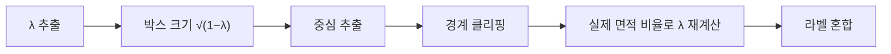
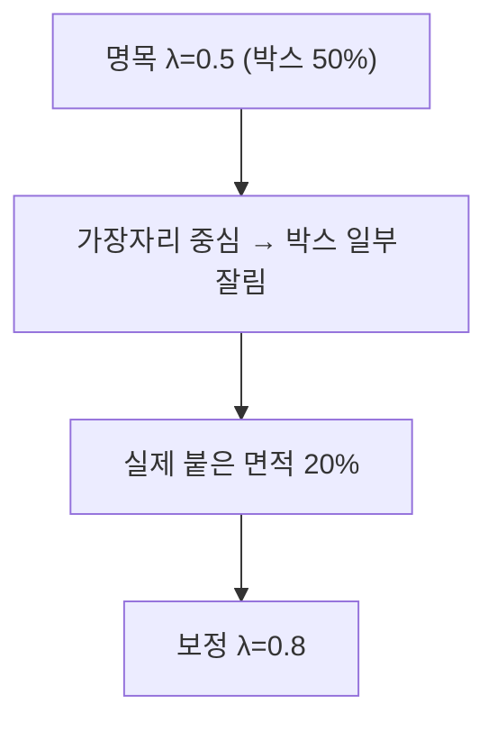

# CutMix 면적 기반 라벨 보정

> CutMix는 한 이미지의 사각형 영역을 다른 이미지로 바꿔 붙이는데, **박스가 이미지 경계에서 잘리면 실제로 바뀐 면적이 처음 뽑은 비율과 달라진다.** 그래서 라벨 혼합 비율 λ를 "실제로 남은 원본 면적 비율"로 다시 계산해 라벨에 쓴다.

## 쉽게 말하면
케이크 사진 위에 쿠키 사진 조각을 오려 붙이는데, 조각이 가장자리에 걸려 반쯤 잘려 나갔다. "쿠키 30%로 하려 했다"가 아니라 눈에 보이는 쿠키 면적을 재서 "쿠키 15%, 케이크 85%"로 라벨을 적어야 정직하다.

## 자세히
(Yun 외 2019, arXiv 1905.04899 본문과 부록 A 의사코드를 직접 읽음)
- 박스: 중심 (rx, ry)를 이미지 안에서 균등 추출하고 폭·높이를 `W·√(1−λ)`, `H·√(1−λ)`로 한다. 그러면 박스 면적 비율이 정확히 1−λ가 된다(본문). λ는 Beta(α,α)에서 뽑는데 α=1이면 균등분포다.
- 문제: 중심이 가장자리에 가까우면 박스가 이미지 밖으로 나가 **클리핑**된다. 의사코드는 x1=Round(Clip(rx−rw/2, min=0)), x2=Round(Clip(rx+rw/2, max=W)) 식으로 자른 뒤 **"Adjust lambda to the exact area ratio"**라며 `λ = 1 − (x2−x1)(y2−y1)/(W·H)`로 다시 계산한 값을 라벨(`λ·y_A + (1−λ)·y_B`)에 쓴다.
- 직접 시뮬레이션(32×32, 시행 10만 번, 위 규칙 구현): 처음 뽑은 λ의 평균은 0.50인데 보정 후 평균은 **0.70**이었고, |차이| 평균 0.20, 최대 0.77. 처음 박스가 이미지의 절반 넘게 덮도록 뽑힌 경우에는 보정 λ가 평균 0.32 더 컸다(클리핑으로 붙은 조각이 훨씬 작아짐). 보정하지 않으면 라벨이 실제 픽셀 비율과 크게 어긋난다는 뜻이다. 구현 세부(정수 반올림)에 따라 값은 달라질 수 있다.
- 효과: 라벨이 보이는 내용과 맞아야 "보이는 만큼 정답"이라는 학습 신호가 유지된다([소프트 라벨 손실](#soft-label-loss)로 계산).
- 변형: 논문은 박스 중심을 이미지 중앙 가우시안으로 뽑는 Center Gaussian, 크기를 16×16(λ=0.75)으로 고정하는 Fixed-size, 적용 확률을 늘리는 Scheduled 등을 비교했다.

## 그림으로 보기

## 예시
- 32×32 이미지에서 λ=0.5로 16×16 가까운 박스를 뽑았는데 모서리에 걸려 8×8만 붙었다면, 라벨은 이미지B 6.25%, 이미지A 93.75%.
- 교육: "수치(약속)가 아니라 실제 결과를 기준으로 라벨링"이라는 정직한 채점 비유.

## 헷갈리는 것과 비교
| 개념 | 차이 |
|---|---|
| 명목 λ | Beta에서 뽑은 값, 박스 설계에만 사용 |
| 보정 λ | 실제 붙은 면적으로 다시 계산, 라벨에 사용 |
| [MixUp](#mixup-beta-alpha) | 픽셀 전체를 λ로 블렌딩해 보정 불필요 |
| [Cutout](#cutout) | 영역을 0으로 지우고 라벨은 그대로 |

## 더 읽을거리
- [CutMix (arXiv 1905.04899)](https://arxiv.org/abs/1905.04899) — 박스 식과 부록 A 의사코드(PDF 본문 읽음).
