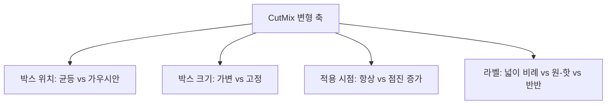
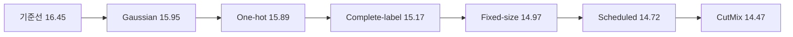

# CutMix 변형들

> CutMix 논문은 박스 위치(균등 vs 가우시안), 박스 크기(가변 vs 고정), 적용 시점(처음부터 vs 점진적), 라벨(넓이 비례 vs 원-핫 vs 반반)을 바꾼 변형들을 비교했다. **본래 CutMix가 모든 변형보다 오류가 낮았고**, 변형들도 기준선보다는 나았다.

## 쉽게 말하면
요리 레시피의 재료 비율·불 세기·넣는 순서를 하나씩 바꿔 보며 어느 것이 맛에 영향을 주는지 확인한 실험이다. 본래 레시피가 가장 맛있었고 바꾼 것도 대체로 괜찮았다. 어느 요소를 바꾸면 얼마나 손해인지가 이 노드의 요점이다.

## 자세히
- **변형 비교**(CutMix 논문 ablation, ar5iv 확인. CIFAR-100, PyramidNet-200, top-1 오류. 기준선 16.45%, 제안 CutMix 14.47%):

| 변형 | 설명 | 오류(%) |
|---|---|---|
| Scheduled CutMix | 적용 확률을 학습 중 0에서 1로 선형 증가 | 14.72 |
| Fixed-size CutMix | 박스를 16×16으로 고정(λ=0.75) | 14.97 |
| Complete-label CutMix | 라벨을 항상 0.5/0.5로 | 15.17 |
| One-hot CutMix | 더 넓은 쪽 이미지의 원-핫 라벨 | 15.89 |
| Center Gaussian CutMix | 박스 중심을 가운데 중심 가우시안에서 추출 | 15.95 |
| (제안 CutMix) | 균등 중심, 넓이 비례 라벨 | **14.47** |

  단일 학습의 논문 보고 수치이며 시드 반복 오차는 표에 없다.
- **해석**: 라벨 변형 두 가지(원-핫 15.89, 0.5/0.5 15.17)가 손해가 컸으므로 **라벨을 넓이에 비례해 섞는 것이 중요**했다(해석). Gaussian 변형이 가장 나빴는데 박스가 가운데에 몰려 물체가 자주 가려지고 가장자리 정보가 덜 섞이기 때문으로 보인다(가설).
- **직접 계산**(32×32, α=1 균등 λ, 중심 분포만 바꿔 20만 번; Gaussian 표준편차는 내가 W/6으로 가정한 값이며 논문 값이 아니다): 계획한 평균 박스 넓이는 0.500인데 실제 붙은 평균은 균등 중심 **0.299**, 가우시안 중심 **0.396**이었다. 계획의 절반 미만으로 잘리는 비율은 균등 **29%** 대 가우시안 **4%**. 이미지 정중앙 화소가 박스에 덮이는 확률은 균등 0.46, 가우시안 0.79, 모서리 화소가 덮이는 확률은 균등 0.14, 가우시안 0.08. 즉 가우시안 변형은 경계 잘림은 줄지만 **붙는 위치가 가운데로 몰린다**.
- **선택 지침(제안)**: 기본 CutMix(균등 중심, 넓이 비례 라벨, λ 재계산)로 시작하고, 불안정한 초기 학습에는 Scheduled를 시험한다. 라벨 처리를 단순화하는 변형(원-핫)은 손해가 컸다는 점을 기억한다.

## 그림으로 보기

## 예시
- 새 데이터에서 CutMix를 쓰기 전에 Scheduled 적용(처음 몇 에폭은 끔)을 같이 비교하는 소규모 스윕.
- 교육: 변형 표를 보고 "각 변형이 무엇을 포기하는가"를 토론.

## 헷갈리는 것과 비교
| 개념 | 차이 |
|---|---|
| CutMix 기본 | 균등 중심·넓이 비례 라벨 |
| Fixed-size | 박스 크기 고정(λ 고정) |
| Scheduled | 적용 확률 증가 |
| [박스 샘플링](#cutmix-box-sampling) | 기본 방식의 박스 계산 |

## 더 읽을거리
- [CutMix 논문 — ar5iv](https://ar5iv.labs.arxiv.org/html/1905.04899) — 변형 ablation 표(열어 확인).
