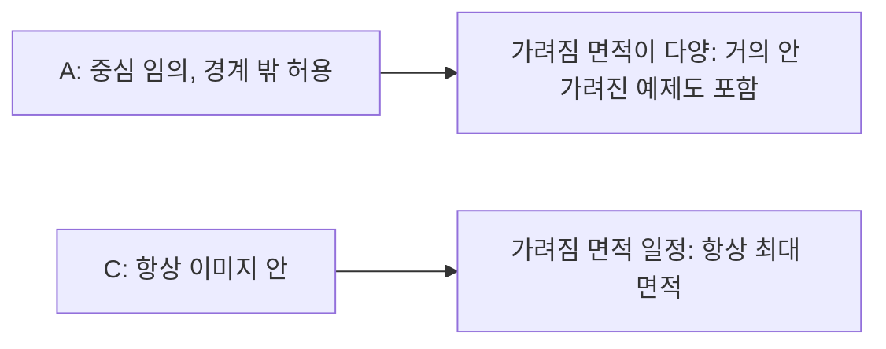
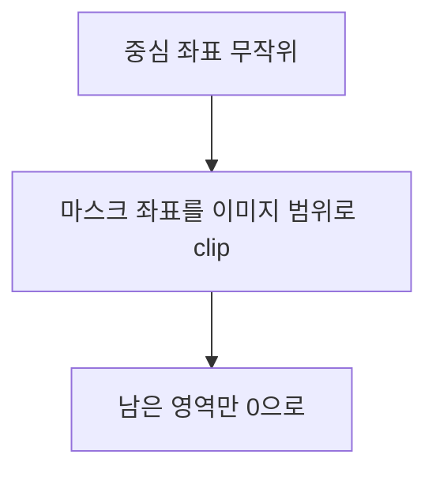

# Cutout 경계 규칙

> Cutout 마스크의 **중심은 이미지 안 아무 곳이나** 고르므로 마스크가 이미지 경계 밖으로 삐져나가 일부만 적용되기도 한다. 논문은 이 "경계 밖 허용"이 좋은 성능에 결정적이었다고 밝힌다. 덕분에 가려지는 면적이 일정하지 않고, 거의 안 가려진 예제도 학습에 섞인다.

## 쉽게 말하면
포스트잇을 사진 위 아무 곳에나 붙이되, 가장자리에 붙이면 반쯤 사진 밖으로 나간다. 그러면 어떤 사진은 많이 가려지고 어떤 사진은 거의 안 가려진다. 모델이 "거의 다 보이는 사진"과 "많이 가려진 사진"을 둘 다 보게 되는 것이 요점이다.

## 자세히
- **논문 설명**(DeVries & Taylor 2017, ar5iv 확인): 패치 중심은 이미지 안의 임의 화소 좌표이고 정사각형은 그 둘레에 놓이므로 **경계를 넘을 수 있다**. 저자들은 이를 허용하는 것이 "좋은 성능에 결정적(critical)"이었다고 하며, 모델이 가끔은 이미지 대부분이 보이는 예제를 봐야 한다는 이유를 든다. 또한 패치를 이미지 안에 두는 대안을 **50% 확률**로 적용해도 비슷한 성능이라고 적었다(문장의 세부 해석은 원문 확인 필요). 패치 크기는 CIFAR-10에 16×16, CIFAR-100에 8×8을 썼고, CIFAR-100은 세부 클래스를 구분해야 해 국소 단서가 중요해서라고 설명한다.
- **직접 계산**(32×32 이미지, 한 변 s, 중심 20만 번 무작위):

| 한 변 | A: 경계 밖 허용(잘림) 평균 가려짐 | B: 패치의 절반 이상이 안에 있는 경우만 | C: 패치를 항상 이미지 안에 |
|---|---|---|---|
| 8 | 5.5% | 5.6% (채택 98%) | 6.2% |
| 16 | 19.1% | 20.1% (채택 91%) | 25.0% |
| 24 | 37.1% | 41.0% (채택 78%) | 56.2% |

  B는 내가 만든 변형이며 논문의 규칙이 아니다.
- **관찰**: A에서는 중심이 이미지 안이므로 패치의 **최소 25%는 항상 이미지 안에** 들어온다(시뮬레이션에서 패치의 25% 미만만 가려지는 경우는 0%였지만 이는 기하학적으로 당연). 반대로 가려지는 면적은 패치 면적의 25%~100% 사이로 퍼져, 같은 s=16에서 **전체의 4.7%~25%** 사이로 흩어진다. C는 항상 최대 면적(25%)이라 "덜 가려진 예제"가 없다. 경계 밖 허용이 효과적인 이유를 논문은 "대부분이 보이는 예제도 봐야 한다"로 설명하는데, 위 숫자가 그 분산 차이를 보여 준다. 이 계산은 성능을 측정한 것이 아니라 마스크 면적 분포만 본 것이다.
- **구현 팁(제안)**: 좌표를 `clip(cy-s//2, 0, H)`처럼 잘라 쓴다. 이미지 안으로 강제 이동하는 구현(C)과 결과가 다르므로 라이브러리의 옵션을 확인한다.

## 그림으로 보기



## 예시
```python
y0,y1 = max(0,cy-s//2), min(H,cy+s-s//2)
x0,x1 = max(0,cx-s//2), min(W,cx+s-s//2)
img[:, y0:y1, x0:x1] = 0
```
- 이미지 분류 증강 파이프라인에서 Cutout 구현이 경계를 잘라 쓰는지 안으로 밀어 넣는지 확인.
- 교육: 위 시뮬레이션을 돌려 가려짐 면적 히스토그램을 그려 비교.

## 헷갈리는 것과 비교
| 개념 | 차이 |
|---|---|
| 경계 밖 허용 | 가려짐 면적이 변동 |
| 항상 안쪽 배치 | 가려짐 면적 고정 |
| 적용 확률 | 증강을 일부 이미지에만 적용하는 별도 설정 |
| [Cutout 패치 크기](#cutout-patch-size) | 마스크 크기 선택 |

## 더 읽을거리
- [Cutout 논문 — ar5iv](https://ar5iv.labs.arxiv.org/html/1708.04552) — 경계 밖 허용이 중요하다는 서술, 패치 크기(열어 확인).
