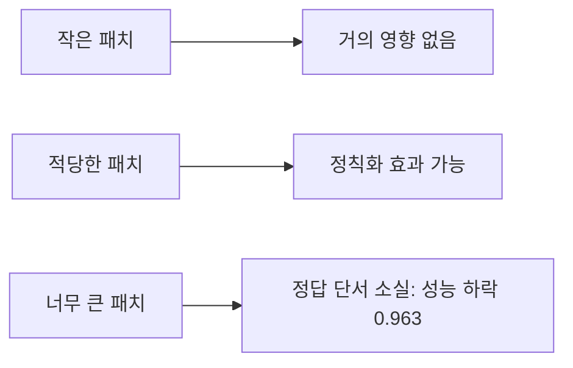
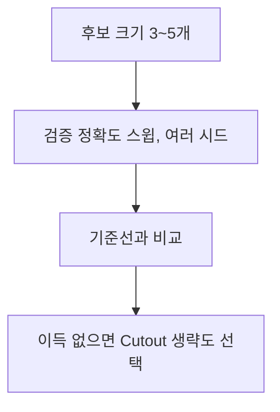

# Cutout 패치 크기

> Cutout이 가리는 정사각형의 한 변 길이는 **데이터셋마다 최적값이 다르고**, 너무 작으면 효과가 없고 너무 크면 정답 단서까지 가려 성능이 떨어진다. 새 데이터에서는 크기를 직접 탐색해야 한다.

## 쉽게 말하면
사진 일부를 포스트잇으로 가리고 무슨 사진인지 맞히게 하는 훈련이다. 우표 크기 포스트잇은 별 영향이 없어서 연습이 안 되고, 사진 절반을 덮는 포스트잇은 아예 못 맞힌다. 사진 속 물체 크기에 맞는 적당한 포스트잇이 있다.

## 자세히
- **Cutout의 정의**(DeVries & Taylor 2017, arXiv 1708.04552 초록 확인): 학습 중 입력의 정사각형 영역을 무작위로 가려 정칙화하는 간단한 기법으로 CIFAR-10 오류 2.56%, CIFAR-100 15.20%, SVHN 1.30%를 보고했다(초록에는 패치 크기 언급 없음). 크기에 대한 논의는 앞서 정리한 [Cutout](#cutout) 노드(논문 본문 기반)에서 다룬다.
- **직접 실행**(scikit-learn digits 8×8 손글씨, 학습 718장·시험 1,079장, 작은 CNN, Adam 60 에폭, 마스크 중심은 균등 무작위이고 경계 밖은 잘림, 5 시드 평균±표준편차):

| 마스크 한 변(픽셀, 이미지는 8×8) | 시험 정확도 |
|---|---|
| 0(Cutout 없음) | 0.976 ± 0.003 |
| 2 | 0.971 ± 0.005 |
| 3 | 0.973 ± 0.007 |
| 4 | 0.976 ± 0.003 |
| 6 | **0.963** ± 0.001 |

- 해석: 이 쉬운 데이터에서는 **Cutout이 이득을 주지 않았다**(기준선 0.976). 변 2~4는 기준선과 차이가 표준편차 안이고, 변 6(이미지 한 변의 75%)은 **분명히 나빠졌다**. 정리하면 "작은 패치는 영향 없음, 지나치게 큰 패치는 손해"이고 "항상 도움이 된다"는 결론은 나오지 않았다. 숫자 하나를 알아보려면 획의 일부만 남아도 되는데 6픽셀 마스크는 숫자 전체를 지워 단서가 사라지기 때문일 것이다(해석).
- **크기 고르는 법(제안)**: ① 패치 크기를 물체 크기 대비로 생각한다(작은 무늬 vs 큰 물체). ② 검증 정확도로 후보 3~5개를 스윕한다(예: 이미지 변의 0%·12%·25%·50%). ③ 시드 여러 개로 차이가 잡음인지 확인한다. ④ 과소적합 징후(학습 정확도 하락)를 함께 본다. 해상도·물체 크기가 다르면 같은 값이 통하지 않는다.
- 한계: 8×8 저해상도·쉬운 데이터의 한 실험이며, CIFAR급 데이터의 결과를 대신하지 못한다.

## 그림으로 보기



## 예시
```python
def cutout(img, s):          # img: (C,H,W)
    cy, cx = random.randrange(H), random.randrange(W)
    img[:, max(0,cy-s//2):cy+s-s//2, max(0,cx-s//2):cx+s-s//2] = 0
```
- 사내 제품 이미지 분류: 물체가 이미지의 30%를 차지하면 패치를 그 절반 안팎에서 시작.
- 교육: 위 표를 재현하고 "효과 없음도 결과"임을 논의.

## 헷갈리는 것과 비교
| 개념 | 차이 |
|---|---|
| Cutout | 연속된 정사각형 영역을 가림 |
| [입력 드롭아웃](#input-dropout-vs-cutout) | 무작위 화소를 가림 |
| [MixUp](#mixup-beta-alpha) | 두 이미지를 섞음 |
| 패치 크기 탐색 | 하이퍼파라미터 스윕 |

## 더 읽을거리
- [Improved Regularization of Convolutional Neural Networks with Cutout](https://arxiv.org/abs/1708.04552) — Cutout 정의와 CIFAR 결과(초록 확인).
- [scikit-learn digits 데이터셋](https://scikit-learn.org/stable/datasets/toy_dataset.html) — 실험 데이터(열어 확인).
