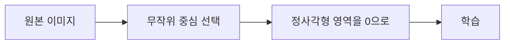
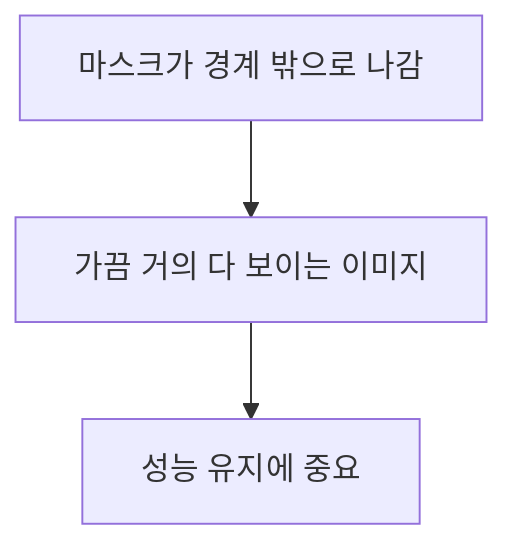

# Cutout

> 학습 이미지의 **무작위 정사각형 영역 하나를 지워(0으로 가려) 학습시키는 데이터 증강**이다. 입력 단계에서 영역 단위로 하는 드롭아웃이며, 모델이 한 부분에만 의존하지 않고 이미지 전체의 단서를 쓰도록 만든다.

## 쉽게 말하면
고양이 사진에서 귀만 보고 "고양이"라고 외우던 학생에게, 시험 연습 때 사진의 한 귀퉁이를 종이로 가려서 보여 준다. 귀가 안 보여도 얼굴·몸통으로 맞히는 법을 배운다.

## 자세히
(DeVries & Taylor 2017, arXiv 1708.04552 PDF 본문을 직접 읽음)
- 방법: 이미지에서 무작위 중심 좌표를 고르고 그 둘레에 정사각형 마스크를 씌워 값을 0으로 만든다(이미지는 평균 0으로 정규화돼 있어 가려진 부분이 배치 통계에 큰 영향을 안 준다). 논문은 마스크 **모양보다 크기가 더 중요한 하이퍼파라미터**라 정사각형만 썼다고 한다.
- 핵심 디테일: 마스크가 이미지 **경계 밖으로 삐져나가도 되게** 해야 성능이 좋았다. 이유(저자 설명): 모델이 이미지가 대부분 보이는 예제도 가끔 봐야 하기 때문이다. 대안으로 마스크를 이미지 안에 두되 **50% 확률로만** 적용해도 비슷했다.
- 직접 계산(32×32 이미지, 마스크 중심 균등 추출, 시행 2만 번): 마스크 한 변 8/16/24일 때 가려지는 면적 평균은 경계 밖 허용 시 5.5% / 19.1% / 37.0%, 이미지 안에 완전히 두면 6.2% / 25.0% / 56.2%. 경계 밖 허용이 평균 가려짐을 줄여 "거의 안 가려진 예제"를 만든다.
- 성과(논문): WRN-28-10 등에 적용해 CIFAR-10·CIFAR-100·SVHN에서 오류율을 낮췄고, shake-shake 모델과 결합해 CIFAR-10 2.56%, CIFAR-100 15.20%, SVHN 1.30%(당시 최고)를 보고했다. 이는 2017년 결과이며 현재 최고 성능은 아니다.
- 패치 크기는 데이터셋마다 최적이 다르다(논문 Figure 3은 CIFAR-10/100에서 길이별 검증 정확도를 비교). 새 데이터에서는 크기를 직접 탐색해야 한다(제안).

## 그림으로 보기

## 예시
- CIFAR-10(32×32)에서 16×16 마스크 적용: 평균 약 19%가 가려진다.
- 교육: "일부를 가려도 맞히는 연습"으로 오버피팅을 설명.

## 헷갈리는 것과 비교
| 개념 | 차이 |
|---|---|
| Cutout | 영역을 0으로 지움, 라벨 그대로 |
| [MixUp·CutMix](#mixup-cutmix) | CutMix는 영역을 다른 이미지로 채우고 라벨도 섞음 |
| 드롭아웃 | 뉴런을 끔, Cutout은 입력 영역을 끔 |

## 더 읽을거리
- [Improved Regularization of Convolutional Neural Networks with Cutout (arXiv 1708.04552)](https://arxiv.org/abs/1708.04552) — 경계 밖 마스크와 결과(PDF 본문 읽음).
