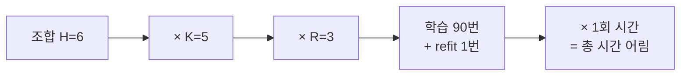
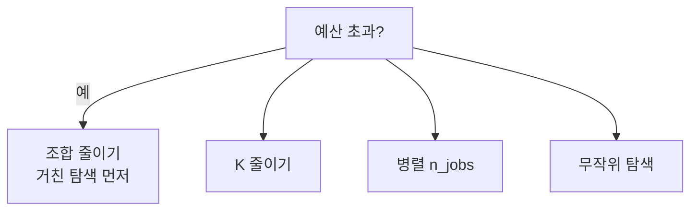

# 교차검증 예산 계획

> 격자 탐색에 교차검증을 쓰면 총 학습 횟수는 (후보 조합 수 H) × (폴드 수 K) × (반복 수 R)이다. 한 번 학습하는 시간을 먼저 재서 곱하면 전체 시간을 대략 어림할 수 있다.

## 쉽게 말하면
요리 대회 예선에서 후보 요리 6개를 심사위원 5명이 3라운드씩 평가하면 평가 횟수가 6×5×3=90번이다. 한 번 평가에 몇 분 걸리는지 알면 총 소요 시간과 필요한 인원을 미리 계산해 일정을 짠다.

## 자세히
- **공식**: 총 학습 횟수 = H × K × R. 마지막에 최적 조합으로 전체 데이터를 다시 학습하는 `refit` 1번이 더해진다(`GridSearchCV` 기본 동작, 문서 기준).
- **직접 해 본 실험(숫자 손글씨 1,797개, SVC)**: `cross_validate`로 5겹을 한 번 돌려 폴드당 `fit_time` 약 0.022초, `score_time` 약 0.012초를 얻었다. gamma 6개 × 5겹 × 3회 반복이면 `n_splits_`는 15, 학습 90번이다. 어림(90 × 0.034초)은 3.1초였는데 실제는 6.0초로 약 2배였다. 실제가 느린 이유는 gamma가 클수록 학습이 오래 걸릴 수 있기 때문이라고 해석하지만 이 실험에서 조합별 시간은 따로 재지 않았다. 어림은 하한으로 보고 2배 여유를 둔다.
- **예산 줄이는 방법**: ① 후보 수 줄이기(로그 눈금 몇 개만, 먼저 거칠게 탐색 후 정밀) ② K 줄이기(3~5) ③ 반복은 최종 후보 몇 개에만 ④ 코어 병렬([n_jobs 병렬 교차검증](#n-jobs-parallel-cv)) ⑤ 무작위 탐색(RandomizedSearchCV)으로 조합 수를 고정.
- **시간 어림 절차(해석)**: 작은 부분 표본으로 1회 시간을 재고 → H×K×R을 곱하고 → 표본 수에 따른 시간 증가(보통 선형 이상)를 고려해 보정 → 코어 수로 나눈다.
- **반복과의 관계**: 반복은 분할 변동을 줄이지만 비용을 R배로 올린다([RepeatedKFold](#repeated-kfold)).

## 그림으로 보기

## 예시
- 랜덤 포레스트 조합 20개 × 5겹, 1회 40초면 20×5×40 = 4,000초(약 67분). 코어 4개면 최선의 경우 약 17분, 실제는 이보다 길다.
- 교육 활용: 학습자가 H·K·R을 바꿔 총 학습 횟수 표를 만들어 보며 "왜 격자를 크게 키우면 안 되는지"를 체감한다.

## 헷갈리는 것과 비교
| 개념 | 차이 |
| --- | --- |
| H×K×R | 총 학습 횟수 |
| refit | 마지막 전체 데이터 재학습 1회 |
| [n_jobs 병렬 교차검증](#n-jobs-parallel-cv) | 횟수는 그대로, 시간만 분산 |
| [교차검증의 분산·편향 절충](#cv-variance-bias-tradeoff) | K 선택의 이유 |

## 더 읽을거리
- [scikit-learn: cross_val_score](https://scikit-learn.org/stable/modules/generated/sklearn.model_selection.cross_val_score.html) — 병렬·분할 인자
- [scikit-learn: Cross-validation](https://scikit-learn.org/stable/modules/cross_validation.html) — cross_validate와 시간 반환 값
