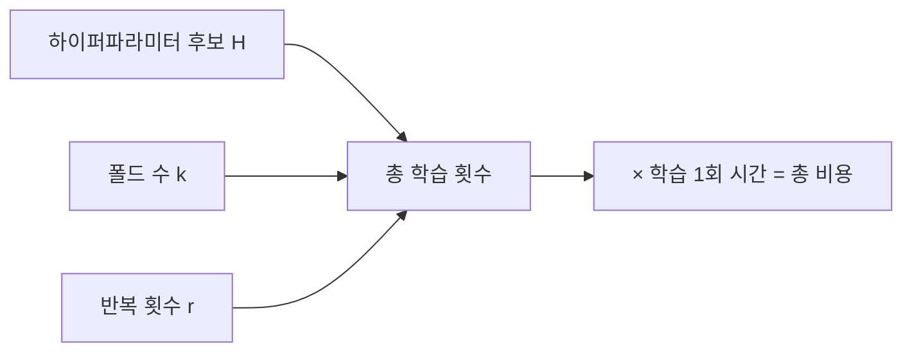
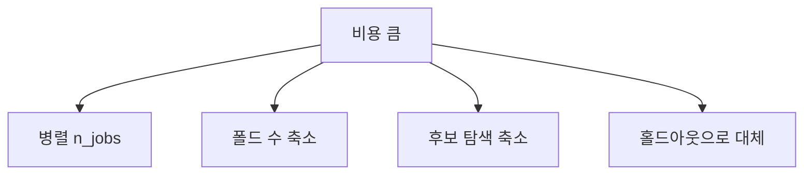

# 교차 검증 계산 비용

> 교차검증의 비용은 **학습해야 하는 모델 수 × 모델 하나의 학습 시간**이다. k-폴드는 k번, LOO는 n번, 하이퍼파라미터 탐색과 반복을 곁들이면 곱으로 불어난다.

## 쉽게 말하면
시험을 한 번 보면 채점 한 번이지만, 5번 나눠 보면 채점도 5번이다. 시험 종류(설정 후보)가 20가지면 100번 채점해야 한다. 그래서 채점이 오래 걸리는 시험(큰 모델)일수록 횟수를 줄여야 한다.

## 자세히
- **모델 수(scikit-learn 가이드)**: K-폴드는 k개, LOO는 n개의 모델을 만든다. LOO는 각 모델이 n-1개로 학습하므로 k-폴드(학습 `(k-1)n/k`)보다 모델 수도 학습량도 크다. 그래서 k<n이면 LOO가 더 비싸다.
- **직접 실험(scikit-learn 1.9.1, digits 400샘플, 로지스틱 회귀, 1대 CPU)**: 5-폴드 0.07초, 10-폴드 0.14초, LOO(400번) 5.96초. 정확도는 0.965, 0.968, 0.975로 비슷하다 → LOO는 약 85배 비쌌지만 점수 차는 작았다. (환경·모델에 따라 수치는 달라진다.)
- **곱셈 구조**: 총 학습 횟수 = (하이퍼파라미터 후보 수) × (폴드 수) × (반복 횟수). 후보 30개, 5-폴드, 3회 반복이면 450번 학습.
- **줄이는 법**
  1. 폴드 수를 5~10으로 두기([k 선택](#cv-variance-bias-tradeoff)).
  2. `n_jobs=-1`로 폴드를 병렬 실행.
  3. 후보 탐색은 무작위 탐색·조기 중단(successive halving)으로 줄이기.
  4. 큰 데이터에는 교차검증 대신 단일 홀드아웃.
  5. 딥러닝처럼 한 번 학습이 비싼 모델은 소수 시드·고정 분할을 쓴다.
- 클라우드 비용 관점: GPU 학습을 k배 반복하면 비용도 k배다. 교차검증 설계는 예산 결정이다.

## 그림으로 보기



## 예시
```python
from sklearn.model_selection import cross_val_score
cross_val_score(model, X, y, cv=5, n_jobs=-1)  # 5개 모델을 병렬 학습
```
- LLM 파인튜닝 평가: 모델 하나가 몇 시간이면 5-폴드는 현실적이지 않아 홀드아웃을 쓴다.

## 헷갈리는 것과 비교
| 개념 | 차이 |
|---|---|
| 교차검증 비용 | 평가를 위한 학습 횟수 |
| 추론 비용 | 서비스 중 예측 비용 |
| [Leave-P-Out](#leave-p-out) | 조합이 폭발하는 극단 |
| [반복 교차검증](#repeated-cross-validation) | 비용을 더 써서 분산을 줄임 |

## 더 읽을거리
- [scikit-learn 교차검증 가이드 — LOO](https://scikit-learn.org/stable/modules/cross_validation.html) — k-폴드 대비 LOO의 모델 수·학습량 비교.
