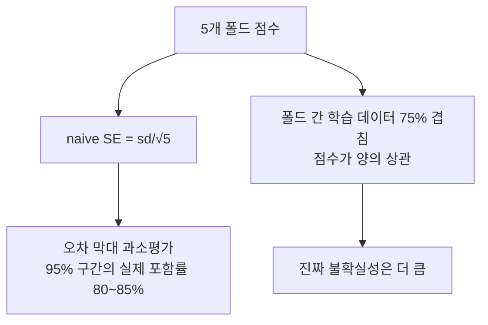
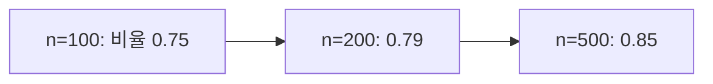

# 교차 검증 오차 막대 과소평가

> K-폴드 점수의 **표준오차를 "폴드 점수의 표준편차 ÷ √K"로 계산하면 실제 불확실성보다 작게 나온다.** 폴드끼리 학습 데이터가 겹쳐 점수가 독립이 아니기 때문이며, 오차 막대와 신뢰구간이 낙관적이 된다.

## 쉽게 말하면
같은 문제집을 조금씩 겹치게 나눠 푼 다섯 번의 시험 점수를 "독립된 다섯 번의 시험"으로 보고 평균의 오차를 재는 셈이다. 사실은 같은 문제를 여러 번 푼 것이라 정보가 다섯 번만큼 새롭지 않다.

## 자세히
- **이론(Bengio & Grandvalet 2004, JMLR, 초록 확인)**: K-폴드 CV 분산의 **모든 분포에서 불편(unbiased)인 추정량은 존재하지 않는다**. 폴드의 학습·테스트 세트가 겹쳐 오차가 독립이 아니고, 이 상관을 무시한 추정량은 분산을 크게 과소평가할 수 있다. 오차 공분산 행렬은 서로 다른 고유값이 3개뿐이라는 분석을 제시한다.
- **직접 시뮬레이션(scikit-learn 1.9.1, 하나의 고정된 모집단 6만 개에서 n개를 400번 뽑아 5-폴드 CV, 표준오차=폴드 표준편차/√5, 비교 대상=400개 CV 평균들의 실제 표준편차)**
  | n | 모델 | 실제 CV 평균의 표준편차 | 평균 naive SE | 비율 | naive 95% 구간의 포함률 |
  |---|---|---|---|---|---|
  | 100 | 로지스틱 | 0.0562 | 0.0419 | 0.75 | 80% |
  | 100 | 트리 | 0.0572 | 0.0441 | 0.77 | 81% |
  | 200 | 로지스틱 | 0.0369 | 0.0292 | 0.79 | 82% |
  | 200 | 트리 | 0.0392 | 0.0290 | 0.74 | 80% |
  | 500 | 로지스틱 | 0.0219 | 0.0187 | 0.85 | 85% |
  | 500 | 트리 | 0.0220 | 0.0178 | 0.81 | 85% |
  naive 표준오차는 실제 변동의 **약 75~85%**였고, "95% 신뢰구간"의 실제 포함률은 **80~85%**에 그쳤다. 표본이 클수록 격차가 줄어든다. (표적을 CV 평균들의 평균으로 둔 근사라 편향은 제외한 변동만 본 것이다. 이 결과는 한 모집단·두 모델의 설정이다.)
- **왜 그런가**: 5-폴드에서 각 폴드의 학습 데이터는 서로 75%가 겹친다. 폴드 점수는 양의 상관을 가지므로 평균의 분산이 독립일 때(σ²/K)보다 크다.
- **대응**
  1. 오차 막대를 쓸 때 "폴드 표준편차/√K"를 **불확실성의 하한**으로 해석하고 신뢰구간이라 부르지 않는다.
  2. 모델 비교는 같은 분할에서 폴드별 **짝지은 차이**를 보되 겹침을 감안해 보수적으로 해석([점수 차이와 노이즈](#cv-score-difference-vs-noise)).
  3. 중요한 비교는 독립 시험 세트나 [반복 교차검증](#repeated-cross-validation)의 반복 간 변동, 부트스트랩, 중첩 교차검증을 함께 본다.
  4. 겹침을 보정한 분산 추정(예: Nadeau & Bengio식 보정 t-검정)을 검토(원문 미열람, 이름만 확인 필요).
  5. 점수 변동 폭을 보고할 때 "폴드 간 표준편차"와 "시드 간 표준편차"를 구분해 표기([여러 시드 평균](#seed-sweep-reporting)).
- 이 노드는 "작은 데이터 검증 전략"의 맥락에서, 데이터가 작을수록 격차가 커진다는 점이 중요하다(위 표 n=100의 비율 0.75).

## 그림으로 보기

## 예시
- 논문 표에 "정확도 82.1 ± 1.2(5-폴드 표준오차)"라고 쓰면 실제 불확실성은 1.5 정도일 수 있다.
- 교육: 독립성 가정이 깨지면 통계 공식이 낙관적이 되는 사례.

## 헷갈리는 것과 비교
| 개념 | 차이 |
|---|---|
| naive 표준오차 | 폴드를 독립으로 가정(과소평가) |
| 시드 간 표준편차 | 분할 운에 따른 변동 |
| 진짜 일반화 불확실성 | 새 데이터 표본에 따른 변동(더 큼) |
| [비관적 편향](#pessimistic-bias-small-k) | 평균의 체계적 오차(분산과 별개) |

## 더 읽을거리
- [Bengio & Grandvalet 2004, JMLR](https://www.jmlr.org/papers/v5/grandvalet04a.html) — K-폴드 분산의 불편 추정량 부재(초록 확인).
- [scikit-learn 교차검증 가이드](https://scikit-learn.org/stable/modules/cross_validation.html) — 평균±표준편차 보고 예시.
