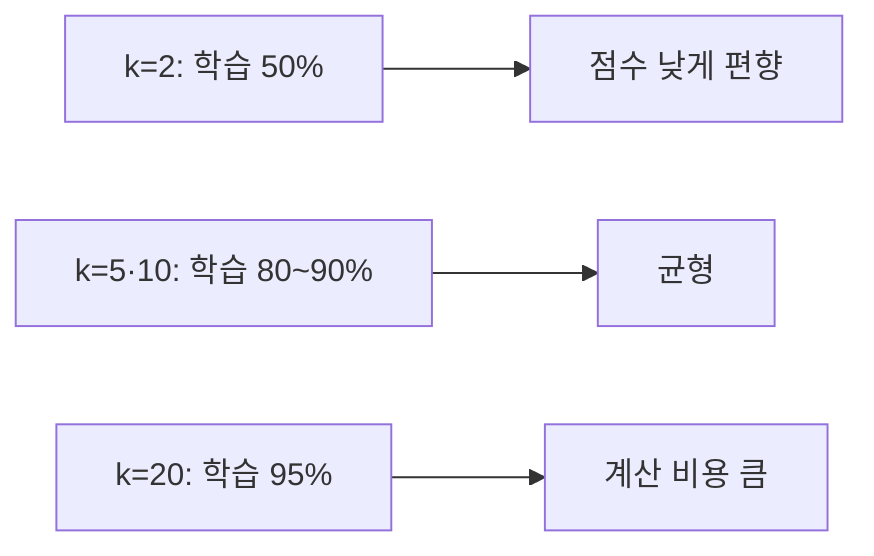
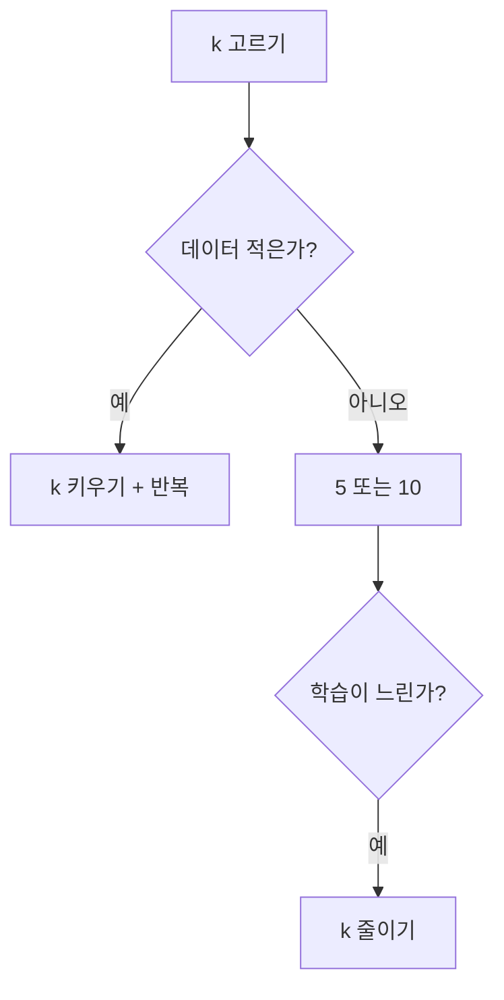

# k 값 선택

> k-겹 교차 검증에서 몇 조각(k)으로 나눌지 고르는 일이다. 5나 10이 흔한 관행이며, k가 작으면 학습 데이터가 적어 점수가 낮게(비관적으로) 나오고 k가 크면 계산이 늘어난다.

## 쉽게 말하면
모의고사 연습을 할 때 "교재의 절반만 보고 시험" 보는 것(k=2)과 "한 문제만 빼고 다 공부하고 시험" 보는 것(k가 아주 큼)은 연습 조건이 다르다. 절반만 공부하면 점수가 낮게 나오고, 거의 다 공부하면 실전에 가까워지지만 시험을 훨씬 많이 쳐야 한다.

## 자세히
(scikit-learn 문서 확인 + **이 세션에서 직접 실험**: scikit-learn 1.9.1, `load_digits`, 표준화 + 로지스틱 회귀, 학습 세트 1,257개(30%는 시험용으로 분리), 각 k를 섞는 시드 10가지로 반복.)
- **직접 실험 결과**

| k | 10회 평균 정확도 | 시드 간 표준편차 | CV 1회 시간 |
|---|---|---|---|
| 2 | 0.9544 | 0.0061 | 0.03초 |
| 3 | 0.9621 | 0.0044 | 0.05초 |
| 5 | 0.9669 | 0.0021 | 0.09초 |
| 10 | 0.9682 | 0.0023 | 0.20초 |
| 20 | 0.9701 | 0.0019 | 0.41초 |

  - 별도로 떼어 둔 시험 세트에서 같은 모델을 학습 세트 전체로 학습해 재니 정확도가 0.9722였다. 즉 k가 커질수록 교차 검증 점수가 이 값에 가까워졌다.
  - 해석: k=2는 학습에 데이터의 절반만 써서 점수가 낮게 나왔고(약 -1.8%p), k가 커질수록 학습 크기가 커져 점수가 오르며 5→10→20 구간에서는 증가폭이 작다. 시간은 k에 거의 비례해서 k=20이 k=5의 약 4.6배였다. 시드 간 표준편차는 k=2가 가장 크고 5 이상에서는 비슷했다. **이 결과는 한 데이터·한 모델의 한 번 실험이며 일반 법칙이 아니다.**
- **공식 문서의 설명**: k-겹은 학습 세트를 k조각으로 나눠 각 조각을 검증으로 한 번씩 쓰고 점수를 평균한다. 각 모델은 (k−1)n/k개로 학습한다. 학습 곡선이 가파른 경우 5·10겹은 일반화 오차를 과대 추정할 수 있다고 문서가 말한다. LOO는 n개 모델이며 5·10겹이 선호된다고 권고한다([Leave-One-Out 검증](#leave-one-out-cv)).
- **고르는 요령(제안)**: ① 기본은 5 또는 10 ② 데이터가 아주 적으면 k를 키우되 계산 시간을 확인 ③ 학습이 느린 모델이면 k를 줄인다 ④ 희귀 클래스가 있으면 k를 희귀 클래스 수 이하로([층화 k-겹](#stratified-k-fold)) ⑤ 점수 차이가 시드 간 표준편차보다 작으면 모델 간 우열을 말하지 않는다.
- **반복 교차 검증**: 같은 k로 섞는 시드를 바꿔 여러 번 돌려 평균하면 분할 운에 덜 흔들린다(이번 실험이 그 방식).

## 그림으로 보기



## 예시
```python
from sklearn.model_selection import KFold, cross_val_score
scores = []
for seed in range(10):
    s = cross_val_score(clf, X_train, y_train, cv=KFold(10, shuffle=True, random_state=seed))
    scores.append(s.mean())
print(sum(scores)/len(scores))
```
(직접 실험에서 쓴 방식을 단순화.)

## 헷갈리는 것과 비교
| 개념 | 차이 |
|---|---|
| k 값 | 조각 수 = 모델 수 |
| 반복 횟수(시드) | 같은 k를 다른 분할로 여러 번 |
| [k-겹 교차 검증](#k-fold-cross-validation) | 상위 개념 |
| [Leave-One-Out 검증](#leave-one-out-cv) | k=n인 극단 |

## 더 읽을거리
- [scikit-learn: Cross-validation](https://scikit-learn.org/stable/modules/cross_validation.html) — k-겹과 LOO 설명(직접 열어 확인).
