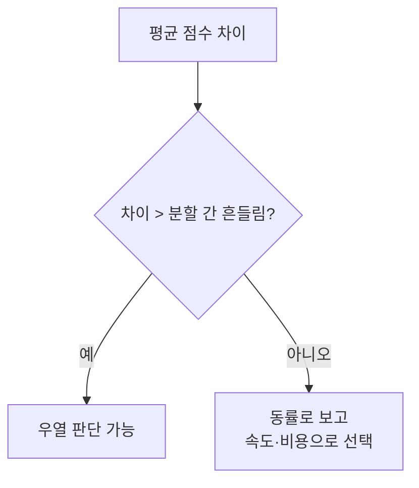
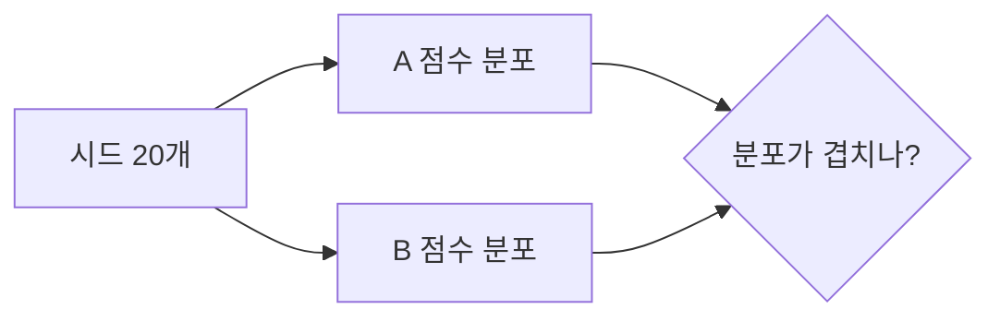

# 점수 차이와 노이즈

> 교차검증 점수가 두 모델 사이에서 조금 달라도, **그 차이가 분할을 바꿨을 때의 흔들림(노이즈)보다 작으면 "어느 쪽이 낫다"고 말할 수 없다.**

## 쉽게 말하면
키 재기를 할 때 자 눈금이 ±1cm씩 흔들린다면 두 사람의 키 차이가 0.2cm라는 결과는 의미가 없다. 흔들림보다 큰 차이만 믿을 수 있다.

## 자세히
- **직접 실험(scikit-learn 1.9.1, digits 300샘플, 5-폴드를 시드 20개로 반복)**
  - 로지스틱 회귀 A(기본)와 B(`C=0.3`): 평균 정확도 둘 다 0.976. 시드별 표준편차 A 0.0050, B 0.0042. 차이 평균 -0.0002, 차이의 표준편차 0.0022. A가 B보다 높았던 시드는 20개 중 2개뿐 → **우열 없음**.
  - A와 결정 트리 C(평균 0.791, 표준편차 0.0193): 차이 평균 0.1845, A가 20개 시드 모두 우세 → **분명한 우열**.
- **기준**: 평균 차이가 시드(분할) 간 표준편차의 몇 배인지 본다. 위 사례에서 A-B는 0.0002 ≪ 0.0022이고, A-C는 0.18 ≫ 0.019다. (엄밀한 통계 검정은 아니며, 정식 검정은 반복 점수가 독립이 아니라는 점을 고려해야 한다 — 일반 지식.)
- **쓸 수 있는 습관**
  1. 점수를 한 숫자로 말하지 말고 `평균 ± 표준편차`와 폴드별 값을 같이 보고.
  2. 같은 분할(시드·폴드)에서 모델을 비교해 "짝지은 차이"를 본다.
  3. 분할을 반복해 표준편차를 줄인다([반복 교차검증](#repeated-cross-validation)).
  4. 차이가 작으면 정확도 외 기준(속도·해석성·비용)으로 고른다.
- 공식 가이드도 층화가 폴드 간 지표 퍼짐을 인위적으로 줄일 수 있다고 경고한다. 퍼짐이 작다고 곧 신뢰할 만한 것은 아니다.

## 그림으로 보기

## 예시
- A 0.976 vs B 0.976이면 더 빠른 쪽을 고른다.
- 교육: 리더보드에서 소수점 셋째 자리 차이의 의미를 설명하는 소재.

## 헷갈리는 것과 비교
| 개념 | 차이 |
|---|---|
| 점수 차이 | 모델 간 평균 격차 |
| 노이즈(분할 간 표준편차) | 같은 모델을 다른 분할로 쟀을 때의 흔들림 |
| [비관적 편향](#pessimistic-bias-small-k) | 모든 모델에 공통으로 낮게 나오는 체계적 오차 |

## 더 읽을거리
- [scikit-learn 교차검증 가이드](https://scikit-learn.org/stable/modules/cross_validation.html) — 평균±표준편차 보고 예시와 층화·퍼짐 주의.
