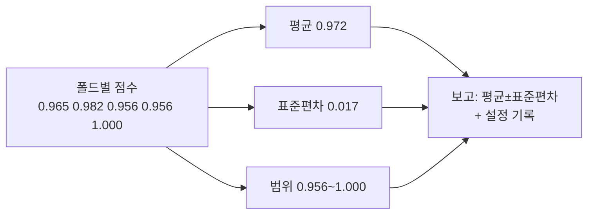
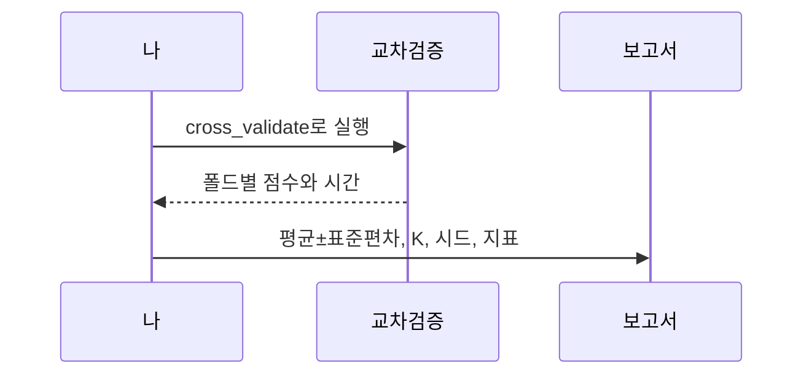

# 교차검증 점수 보고법

> 교차검증 결과는 평균 하나만 적지 말고 평균±표준편차와 폴드별 점수(또는 최솟값·최댓값), 분할 설정을 함께 적는다. 평균만 보면 어떤 폴드에서 무너졌는지, 분할을 바꾸면 얼마나 달라지는지 알 수 없다.

## 쉽게 말하면
학생의 5번 모의고사 평균이 85점이라고만 하면, 80~90점을 꾸준히 받은 학생인지 60점과 100점을 오간 학생인지 구분이 안 된다. 평균과 함께 "점수가 얼마나 들쭉날쭉했는지"를 적어야 그 점수를 얼마나 믿을지 판단할 수 있다.

## 자세히
- **scikit-learn의 기본 보고 형식(문서, 열람)**: `cross_val_score`가 폴드별 점수 배열을 주고, 문서는 `scores.mean()`과 `scores.std()`로 "0.98 accuracy with a standard deviation of 0.02"처럼 요약한다. `cross_validate`는 `test_score`와 함께 `fit_time`, `score_time` 등을 딕셔너리로 돌려준다.
- **직접 해 본 실험(유방암 데이터 569개, 표준화+로지스틱 회귀, 5겹)**: 폴드별 정확도는 0.965, 0.982, 0.956, 0.956, 1.000으로 평균 0.9719, 표준편차 0.017이었다. 폴드 하나(1.000)만 보면 과대평가이고 평균만 보면 폴드 간 격차(0.956~1.000)가 가려진다.
- **분할을 바꾸면**: 섞는 시드만 바꾼 5겹 평균이 시드 0·1은 0.9719, 시드 2는 0.9772였다. 시드 30개를 돌리면 평균이 0.9666~0.9824, 표준편차 0.0044였다. 그래서 "소수점 셋째 자리 차이"로 모델을 가르면 안 된다.
- **주의(해석)**: 폴드별 점수의 표준편차는 신뢰구간이 아니다. 폴드끼리 학습 데이터가 겹쳐 서로 독립이 아니기 때문이다([RepeatedKFold](#repeated-kfold)에서 같은 한계를 다룬다). 편차는 "흔들림의 크기" 정도로만 읽는다.
- **보고 체크리스트**: ① 지표(정확도·F1 등)와 클래스 비율 ② K와 층화·섞기 여부와 시드 ③ 평균±표준편차와 폴드별 최솟값 ④ 전처리를 Pipeline 안에서 했는지 ⑤ 최종 시험 세트 점수는 따로.

## 그림으로 보기

## 예시
- 코드: `s = cross_validate(model, X, y, cv=5, scoring=["accuracy","f1"])` 후 `s["test_accuracy"]`의 평균·표준편차·최솟값을 표로 정리.
- 보고 문장: "5겹 층화 교차검증(시드 0) 정확도 0.972±0.017(폴드 범위 0.956~1.000)".
- 교육 활용: 시드를 바꿔 평균이 어느 자릿수까지 안정적인지 학습자가 직접 확인하게 한다.

## 헷갈리는 것과 비교
| 개념 | 차이 |
| --- | --- |
| 폴드 점수 표준편차 | 폴드 간 흔들림. 신뢰구간 아님 |
| 시드 간 평균의 표준편차 | 분할 선택에서 오는 흔들림 |
| [홀드아웃 vs 교차검증](#holdout-vs-cv) | 분할 방식 선택 |
| [교차검증의 분산·편향 절충](#cv-variance-bias-tradeoff) | K 선택 |

## 더 읽을거리
- [scikit-learn: Cross-validation](https://scikit-learn.org/stable/modules/cross_validation.html) — cross_val_score, cross_validate, 평균·표준편차 요약 예
