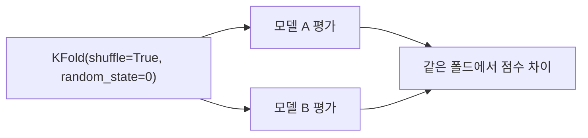

# CV 분할기 시드 정책

> `KFold(shuffle=True)` 같은 분할기에 `random_state`를 **정수로 고정**해야 모델 A·B가 **같은 폴드**에서 비교된다. `None`이면 호출할 때마다 폴드가 달라져, 모델 차이와 분할 차이가 뒤섞인다.

## 쉽게 말하면
두 학생의 점수를 비교하려면 같은 시험지로 봐야 한다. 시험지를 매번 새로 뽑으면 점수 차이가 실력인지 문제 운인지 알 수 없다.

## 자세히
- scikit-learn 문서: `shuffle=True`일 때 `random_state`가 정수면 `split`을 여러 번 불러도 **같은 분할**이 나오고, `None`이면 호출마다 다르다. `shuffle=False`면 시드는 쓰이지 않는다.
- **직접 실행**(scikit-learn 1.9.1, make_classification 600개, A=RandomForest 20그루, B=LogisticRegression, 5-폴드, 20회 반복):

| 분할기 설정 | A의 CV 평균(3회 호출) | A−B 차이의 반복 간 표준편차 |
|---|---|---|
| `shuffle=True`, `random_state=None` | 0.845, 0.838, 0.842 | 0.0090(재사용 객체도 호출마다 재셔플) |
| `shuffle=True`, `random_state=0` | 0.847, 0.847, 0.847 | **0.0000** |
| 모델마다 시드 없는 분할기를 따로 생성 | — | 0.0074 |

  시드가 없으면 같은 모델·같은 데이터인데도 점수가 0.838~0.845로 흔들리고, 모델 비교의 차이에도 분할 노이즈가 섞인다. (표준편차의 정확한 값은 이 합성 설정에 한정.)
- **정책**: ① 비교 실험에서는 분할기를 한 번 만들어 정수 시드로 고정하고 모든 모델에 같은 `cv` 객체를 넘긴다, ② 변동 폭을 보려면 시드를 바꿔 반복(시드 목록), ③ `RepeatedKFold`는 `random_state`로 전체 반복을 재현한다.

## 그림으로 보기


## 예시
```python
cv = KFold(n_splits=5, shuffle=True, random_state=42)   # 한 번만 만들기
for name, model in models.items():
    print(name, cross_val_score(model, X, y, cv=cv).mean())
```

## 헷갈리는 것과 비교
| 개념 | 차이 |
|---|---|
| 분할기 시드 | 폴드 구성 고정 |
| 모델 시드 | 모델 내부 무작위 고정 |
| [RandomState 인스턴스 vs 정수](#randomstate-instance-vs-int) | 정수/인스턴스 선택 기준 |
| [같은 분할로 짝지은 비교](#paired-comparison-same-split) | 같은 폴드의 이점을 통계로 활용 |

## 더 읽을거리
- [KFold API](https://scikit-learn.org/stable/modules/generated/sklearn.model_selection.KFold.html) — shuffle·random_state 설명.
- [scikit-learn: Controlling randomness](https://scikit-learn.org/stable/common_pitfalls.html#controlling-randomness) — 분할기 시드 지침.
