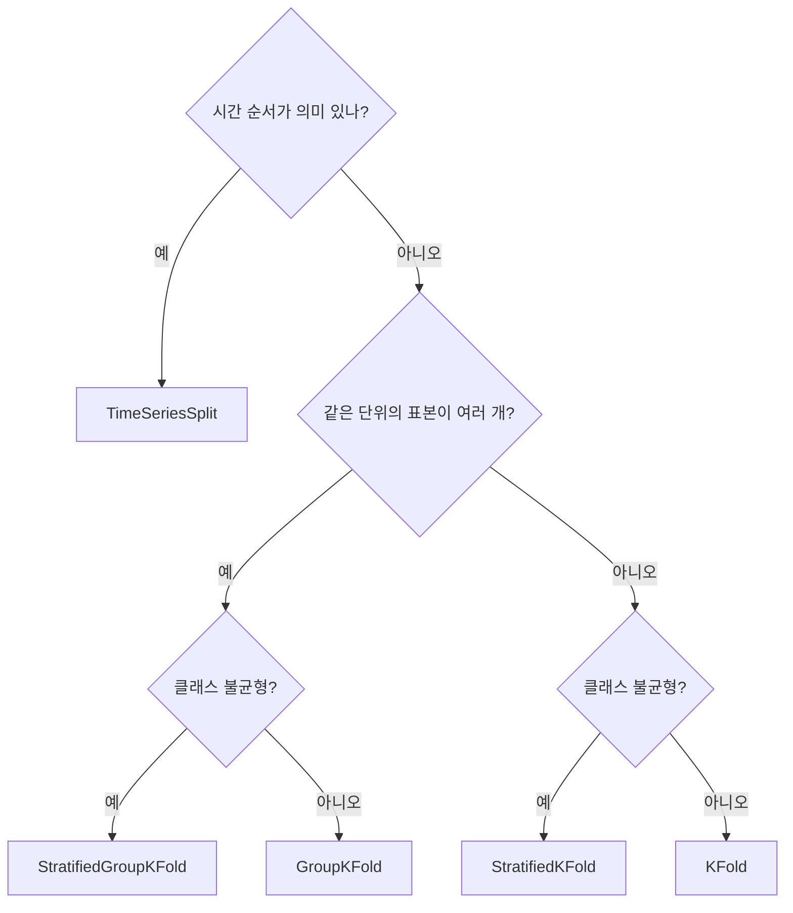
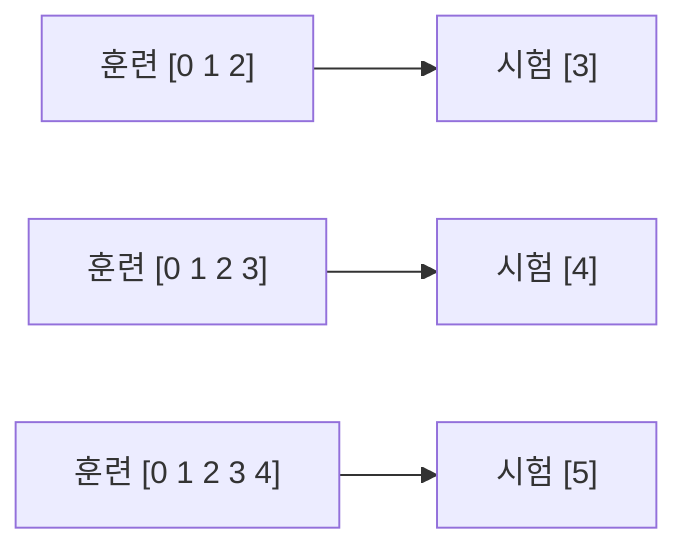

# 교차검증 분할기 고르기

> 교차검증 분할기(splitter)는 데이터를 학습용과 검증용으로 나누는 규칙이다. 데이터가 독립인지, 클래스가 불균형한지, 같은 사람의 표본이 여럿인지, 시간 순서가 있는지에 따라 알맞은 분할기가 다르며, 잘못 고르면 점수가 부풀려진다.

## 쉽게 말하면
시험 범위를 나눌 때, 문제가 서로 독립이면 아무렇게나 섞어도 되지만 같은 단원 문제끼리, 혹은 시간 순서가 있는 뉴스는 섞으면 안 된다. 데이터의 성질에 맞는 칼로 잘라야 한다.

## 자세히
scikit-learn 교차검증 문서(열람)의 분류다.
- **독립 데이터**: `KFold`는 데이터를 k개로 나눠 폴드마다 한 번씩 검증용으로 쓴다(클래스·그룹을 무시). `RepeatedKFold`는 무작위를 바꿔 여러 번 반복, `ShuffleSplit`은 섞은 뒤 독립적으로 분할을 만들어 반복 횟수와 시험 비율을 세밀하게 정한다.
- **클래스 불균형**: `StratifiedKFold`는 폴드마다 전체와 비슷한 클래스 비율을 유지한다. 문서 예(50개 중 클래스 1이 5개, 3겹)에서 StratifiedKFold는 모든 폴드가 약 1:9 비율을 유지했지만 일반 KFold는 소수 클래스 표본이 없는 폴드가 생겼다. 층화는 폴드 간 변동을 줄이므로 희귀 클래스에서는 보고된 변동이 실제 불확실성을 과소평가할 수 있다고 문서가 주의한다.
- **그룹(같은 환자·피험자·실험)**: `GroupKFold`는 같은 그룹이 학습·시험에 동시에 없게 하고(폴드 크기는 다를 수 있음), `StratifiedGroupKFold`는 그룹을 지키며 클래스 비율을 근사 유지한다. `LeaveOneGroupOut`·`LeavePGroupsOut`은 한 그룹(또는 P개)씩 빼는 소모적 방식, `GroupShuffleSplit`은 비용이 클 때 무작위로 뽑는다([그룹 누수 방지](#group-leakage-prevention)).
- **시간 순서 데이터**: `TimeSeriesSplit`은 앞쪽 k개 폴드로 학습하고 k+1번째로 시험한다. 학습 세트가 점점 커지며 각 학습 세트가 이전의 상위 집합이다. 문서 예에서 [0 1 2]→[3], [0 1 2 3]→[4], [0 1 2 3 4]→[5]로 나뉘었다. 폴드가 같은 기간을 덮어야 지표를 비교할 수 있다.
- **무작위 분할이 부적절한 경우(같은 문서)**: 표본이 상관되어 있으면 안 된다. 시간순 뉴스를 섞으면 시험 표본이 학습 표본과 시간상 가까워 점수가 부풀려진다. 데이터가 클래스 순으로 정렬되어 있으면 반드시 섞어야 한다. 희귀 클래스는 폴드에 클래스가 하나도 없어 ROC AUC 같은 지표가 깨질 수 있어 층화를 쓴다. 재현성을 위해 `shuffle=True`에는 정수 `random_state`를 지정한다.
- **선택 순서(해석)**: ① 시간 순서가 의미 있나 → TimeSeriesSplit ② 같은 단위의 표본이 여럿인가 → Group 계열 ③ 클래스가 불균형한가 → 층화 ④ 모두 아니면 KFold. ②와 ③이 동시에 해당하면 StratifiedGroupKFold.
- **함정(해석)**: 전처리·특성 선택도 폴드 안에서 다시 학습해야 한다([전처리 누수](#preprocessing-leakage-pipeline)). 분할 규칙은 운영에서 모델이 겪을 상황(새 환자, 미래 데이터)과 같아야 한다.

## 그림으로 보기

## 예시
- 고객 이탈 예측 모델: 같은 고객의 여러 달 기록이 있고 미래를 예측하므로, 고객 단위 그룹과 시간 순서를 모두 고려한다(그룹 + 시간 분할을 함께 쓰는 방법은 이번에 확인하지 못함).
- 교육 활용: 같은 데이터를 KFold와 TimeSeriesSplit으로 평가해 점수 차이를 보고 왜 시간 데이터에 섞기가 위험한지 설명하게 한다.

## 헷갈리는 것과 비교
| 개념 | 차이 |
| --- | --- |
| [층화 그룹 K겹](#stratified-group-kfold) | 상위 주제. 그룹+클래스 비율 둘 다 지키는 분할기 |
| KFold | 독립 데이터의 기본 분할 |
| StratifiedKFold | 클래스 비율 유지 |
| TimeSeriesSplit | 시간순. 과거로 학습하고 미래로 시험 |

## 더 읽을거리
- [scikit-learn: Cross-validation: evaluating estimator performance](https://scikit-learn.org/stable/modules/cross_validation.html) — 분할기 목록과 주의
