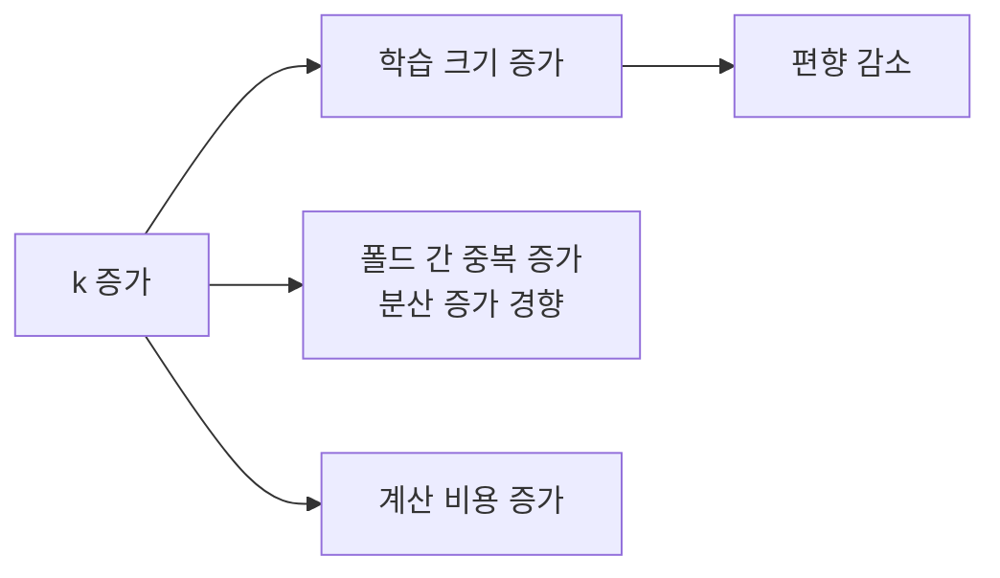
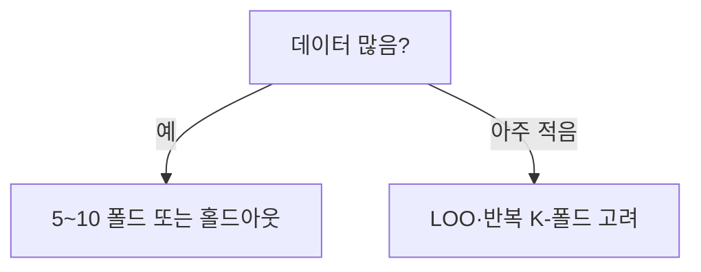

# 교차 검증의 편향-분산 균형

> 교차검증의 폴드 수 k를 정하는 일은 **성능 추정치의 편향(실제보다 비관적으로 보임)과 분산(추정치가 흔들림) 사이의 균형**을 잡는 일이다. 통념은 "k가 클수록 편향↓, 분산↑"이다.

## 쉽게 말하면
시험 점수로 실력을 가늠할 때, 공부 자료를 거의 다 쓰고 한 문제만 시험 보면(LOO) 공부량 면에서 실전과 비슷하지만 한 문제 결과에 점수가 크게 출렁인다. 자료를 절반만 쓰고 보면(k=2) 공부가 부족한 상태를 재서 실력이 낮게 나온다.

## 자세히
- **편향**: 폴드당 학습 크기가 `(k-1)n/k`이다. k가 작으면 학습 데이터가 적어 모델이 덜 배운 상태를 재므로 일반화 오차를 **과대추정**하기 쉽다. scikit-learn 가이드: 학습 곡선이 가파른 구간이면 5·10-폴드가 일반화 오차를 과대추정할 수 있다.
- **분산**: LOO는 n-1개로 학습해 폴드 모델들이 거의 같아서 추정치의 분산이 크다고 가이드는 서술한다("LOO often results in high variance as an estimator for the test error"). 
- **경험칙(가이드)**: 대부분의 저자와 경험적 증거는 LOO보다 **5- 또는 10-폴드**를 권한다. 비용도 LOO는 n개 모델 대 k개 모델이라 더 든다.
- 주의: 이 분산 논의에는 이론적 반론도 있어 데이터·모델에 따라 달라진다(주장: 일반 통념이며 항상 성립하진 않음). 분산을 줄이려면 `RepeatedKFold`로 분할을 바꿔 반복한다.
- 층화는 폴드 간 퍼짐을 인위적으로 줄일 수 있어, 이 분산 추정을 좋게 보이게 할 수 있다(공식 가이드의 주의).

| k | 학습 비율 | 편향 | 분산 | 비용 |
|---|---|---|---|---|
| 2 | 50% | 큼 | 작은 편 | 낮음 |
| 5~10 | 80~90% | 중간 | 중간 | 중간 |
| n(LOO) | (n-1)/n | 작음 | 큰 편 | 높음 |

## 그림으로 보기

## 예시
- 샘플 200개 분류: 10-폴드를 3회 반복(RepeatedKFold)해 평균·표준편차 보고.
- 교육: "점수 하나 vs 평균±표준편차"를 보여 주는 소재.

## 헷갈리는 것과 비교
| 개념 | 차이 |
|---|---|
| 모델의 편향-분산 | 모델 복잡도 문제 |
| CV의 편향-분산 | 평가 *추정치*의 문제(이 글) |
| [Leave-One-Out](#leave-one-out-cv) | k=n인 극단 |
| [학습 곡선](#learning-curve) | 학습 크기에 따른 성능 — 편향 판단 단서 |

## 더 읽을거리
- [scikit-learn 교차검증 가이드](https://scikit-learn.org/stable/modules/cross_validation.html) — LOO의 분산·5/10-폴드 권고·가파른 학습 곡선 주의.
