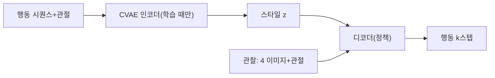
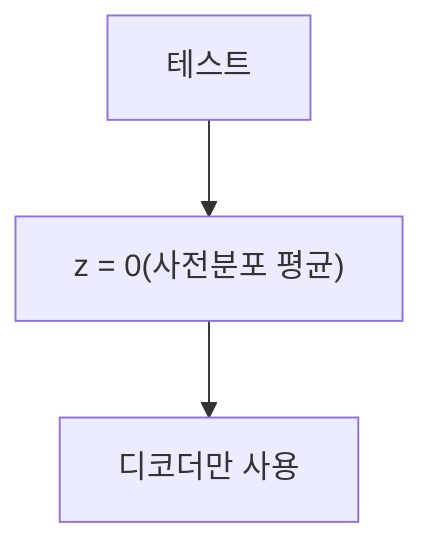

# ACT의 CVAE

> ACT는 사람 시연의 **다양한 방식(스타일)**을 변수 z에 담아 학습하도록 정책을 **조건부 VAE(CVAE)**로 훈련한다. 학습 때만 쓰는 인코더가 z를 만들고, **테스트 때는 인코더를 버리고 z를 사전분포의 평균(0)으로 둔다.** (ACT 논문 본문 직접 읽음, arXiv 2304.13705)

## 쉽게 말하면
같은 요리라도 요리사마다 방식이 다르다. 학습할 때는 "이번 시범은 어떤 스타일인가"를 알려 주는 메모(z)를 쓰고, 실제로 일할 때는 평균적인 스타일로 두고 실행한다.

## 자세히
- 문제(논문): 사람 시연에는 같은 관찰에서도 서로 다른 궤적이 있고, 정밀도가 덜 중요한 구간에서는 더 무작위적이다. 정책이 **정밀이 중요한 구간에 집중**해야 한다.
- 구조: CVAE **인코더**는 행동 시퀀스와 관절 관찰을 받아 스타일 변수 z 분포의 **평균과 분산**을 예측한다(BERT 같은 트랜스포머 인코더, 앞에 학습 가능한 [CLS] 토큰). **디코더(정책)**는 현재 관찰(4개 RGB 이미지와 관절 위치)과 z를 입력으로 행동 시퀀스를 예측한다.
- 입력 규모(논문): ResNet18으로 480×640 이미지를 15×20×512 특징으로 바꾸고 4개를 이어 붙인 1200×512 시퀀스에 관절 위치와 z를 더해 **1202×512**가 트랜스포머 인코더에 들어간다. 디코더는 교차 어텐션으로 인코더에 조건화되고 출력은 k×512 → MLP로 **k×14**(양팔 14 자유도, 다음 k스텝의 목표 관절 위치).
- 손실: 재구성에 **L1**을 사용(L2보다 행동 시퀀스를 더 정밀하게 모델링). 델타 관절 위치보다 **목표 관절 위치**를 행동으로 쓸 때 성능이 좋았다고 보고.
- 테스트: "인코더는 훈련용이며 테스트 때 버린다. z는 사전분포의 평균, 즉 0으로 둔다."
- 한계: 논문은 CVAE가 사람 데이터 모델링에 중요하다고 주장하며, 구체적인 기여는 ablation 표에서 확인해야 한다(이번에 해당 표는 읽지 않았다).

## 그림으로 보기

## 예시
- 같은 컵을 열되 사람마다 쥐는 위치가 다른 시연에서 z가 쥐는 스타일 변동을 흡수.
- 교육: "평균 스타일로 일한다"는 개념을 팀 업무 표준화에 빗대어 설명.

## 헷갈리는 것과 비교
| 개념 | 차이 |
|---|---|
| CVAE 인코더 | 학습 때만 사용, 테스트 때 버림 |
| CVAE 디코더 | 실제 정책으로 사용 |
| [행동 묶음 예측](#action-chunking) | 같은 ACT의 다른 핵심 요소 |

## 더 읽을거리
- [ACT 논문](https://arxiv.org/abs/2304.13705) — CVAE·구조·손실(본문 읽음).
