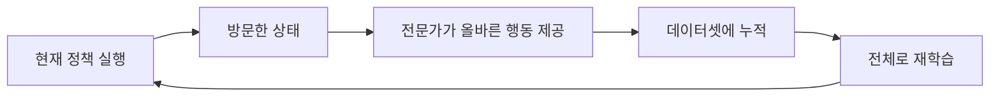
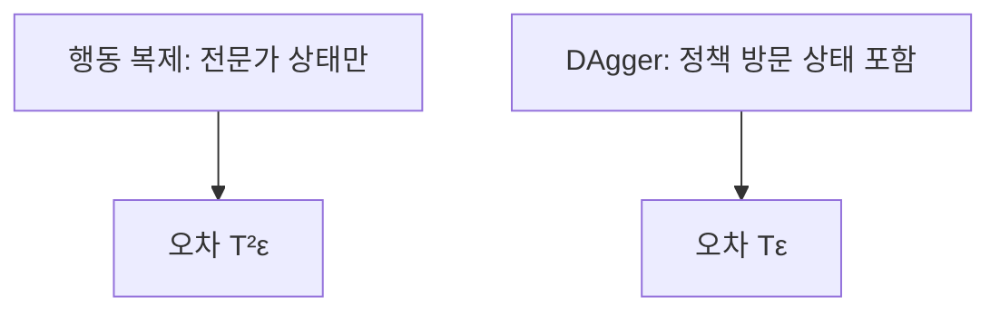

# DAgger

> **Dataset Aggregation.** 정책이 **직접 실행하며 방문한 상태**마다 전문가에게 올바른 행동을 물어 데이터에 계속 **누적**하고, 그 전체로 다시 학습하는 반복 알고리즘. 행동 복제의 오차 누적을 줄인다. (Ross·Gordon·Bagnell, arXiv 1011.0686, 본문 읽음)

## 쉽게 말하면
운전 연습생이 직접 운전하다 실수한 구간마다 교관이 "여기선 이렇게" 알려 주고, 그 노트를 계속 쌓아 다음 연습에 쓰는 방식이다. 연습생이 실제로 가는 길에서 교정을 받는다.

## 자세히
- 알고리즘(논문 Algorithm 3.1):
  1. D를 비우고 초기 정책 π̂₁을 정한다.
  2. i = 1…N 반복: `π_i = β_i·π* + (1−β_i)·π̂_i`(전문가 π*와 학습 정책 혼합)로 T 스텝 궤적을 샘플
  3. **방문한 상태에서 전문가가 준 행동**으로 데이터셋 D_i를 만들고
  4. **D ← D ∪ D_i**로 누적하고 D 전체로 분류기 π̂_{i+1}을 학습
  5. 검증에서 가장 좋은 π̂_i 반환
- β는 선택 사항(실전에서 초반 몇 정책이 서투르므로 전문가를 일정 비율로 섞는 것이 바람직하다고 논문이 설명). 논문 실험에서 β_i는 첫 반복에 전문가만 쓰는 등의 스케줄을 사용했다.
- 직관: 반복할수록 **학습 정책이 만날 법한 입력의 집합**이 쌓인다. Follow-The-Leader 관점에서 매 반복 지금까지 본 모든 궤적에서 최선의 정책을 고른다.
- 이론: N이 Õ(T)이면 (적절한 가정에서) J(π̂) ≤ J(π*) + Tε_N + O(1) 형태의 **T에 선형** 한계를 보인다(Theorem 3.1·3.2 계열). 반면 일반 지도학습은 T²ε([오차 누적](#compounding-error)).
- 실험: 3D 레이싱 게임 **Super Tux Kart** 조향 학습, **Super Mario Bros.**, 필기 인식 순차 라벨링에서 기존 방법(SMILe 등)보다 우수하다고 보고.
- 한계: 학습 중 **전문가를 계속 호출**해야 한다(비용). 위 이론은 논문의 가정 하 결과다.

## 그림으로 보기

## 예시
- 드론 조종 정책이 장애물 앞에서 흔들린 구간마다 조종사에게 정답 조작을 받아 데이터에 추가.
- 교육: 단순한 2D 길찾기에서 행동 복제와 DAgger 성공률을 비교하는 실습.

## 헷갈리는 것과 비교
| 개념 | 차이 |
|---|---|
| DAgger | 정책의 방문 상태에서 전문가 교정, 누적 |
| [행동 복제](#behavior-cloning) | 전문가 시연만 학습 |
| 강화학습 | 보상으로 학습, 전문가 호출 불필요 |

## 더 읽을거리
- [DAgger 논문](https://arxiv.org/abs/1011.0686) — Algorithm 3.1, 정리, 실험(본문 읽음).
