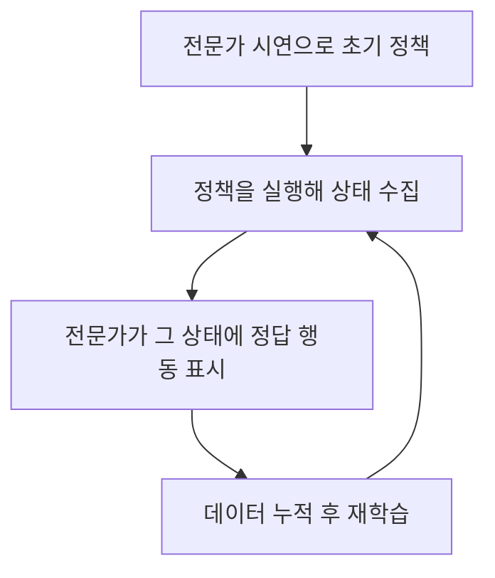
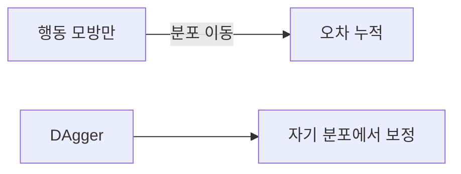

# DAgger

> **DAgger**는 모방 학습에서 **모델이 자기 행동으로 방문한 상태에 전문가 라벨을 계속 보태 가며** 다시 학습하는 반복 알고리즘이다. 분포 이동으로 오차가 쌓이는 문제를 줄인다.

## 쉽게 말하면
운전 연습생이 직접 운전해 보고, 어디서 벗어났는지 강사가 "여기선 이렇게" 알려 주는 걸 모아 다시 연습하는 것이다. 강사가 늘 완벽히 운전하는 영상만 보는 것보다 실수 상황 복구를 배울 수 있다.

## 자세히
(Ross 외, arXiv 1011.0686 초록 확인 — 초록에는 "DAgger"라는 이름이 없고 후속 문헌에서 붙은 이름)
- **문제**: 순차 예측·모방 학습은 통계학습의 **i.i.d. 가정을 위반**해 이론과 실제 모두에서 성능이 떨어진다.
- **기존 방법의 한계**: 더 강한 보장을 주지만 비정상(non-stationary)·확률적 정책을 학습하고 많은 반복이 필요.
- **제안**: **정상·결정적 정책**을 학습하는 반복 알고리즘. **무후회(no-regret) 온라인 학습**으로 정식화하며, 추가 축소 가정 하에 어떤 무후회 알고리즘이든 **자신이 만드는 관측 분포에서** 잘 작동하는 정책을 낳는다.
- **실험**: 두 모방 학습 과제와 한 시퀀스 라벨링 벤치마크에서 이전 방법을 앞섰다.
- 절차(일반 지식): ① 전문가 데이터로 초기 정책 학습 ② 정책을 실행해 방문한 상태 수집 ③ 그 상태에 전문가 행동 라벨 부여 ④ 데이터를 누적해 재학습, 반복.

## 그림으로 보기

## 예시
- 자율주행 모방 학습에서 차선을 벗어난 상태의 복구 조작을 전문가가 라벨링해 추가.
- 로봇 팔 정책이 물체를 놓치는 상황을 사람이 교정해 데이터에 포함.

## 헷갈리는 것과 비교
| 개념 | 차이 |
|---|---|
| 행동 복제 | 전문가 시연만 지도학습 |
| DAgger | 자기 분포의 상태에 전문가 라벨 추가 |
| 강화학습 | 보상으로 시행착오 학습 |
| [예측 오차 누적](#compounding-error) | DAgger가 완화하려는 문제 |

## 더 읽을거리
- [A Reduction of Imitation Learning and Structured Prediction to No-Regret Online Learning](https://arxiv.org/abs/1011.0686)
