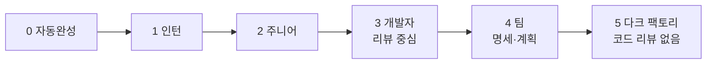
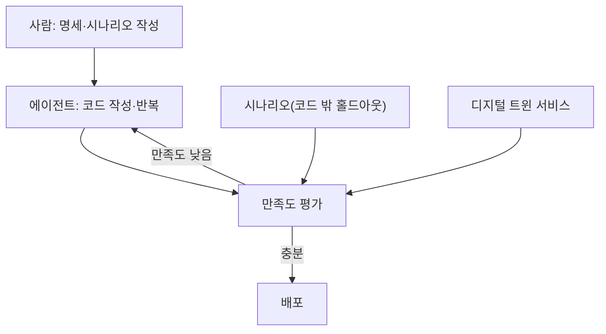

# 다크 팩토리 (무인 공장)

> **사람이 코드를 쓰지도, 리뷰하지도 않고** 명세를 넣으면 소프트웨어가 나오는 극단적 AI 개발 모델. 불 꺼진(lights-out) 무인 공장에서 이름을 빌렸다. Dan Shapiro의 5단계 분류에서 최상위(Level 5)이며, StrongDM의 "소프트웨어 팩토리"가 대표 사례로 소개된다.

## 쉽게 말하면
사람 작업자가 없어 조명이 필요 없는 로봇 공장처럼, 코드 작성과 점검을 모두 에이전트가 하고 사람은 "무엇을 만들지(명세)"와 "잘 만들었는지의 시험 시나리오"만 다룬다. 가장 큰 의문은 **아무도 코드를 보지 않는데 어떻게 믿는가**다.

## 자세히
- **Dan Shapiro의 5단계**(2026-01 글, Simon Willison의 요약 기준): 0 "스파이시 자동완성" → 1 "코딩 인턴"(AI가 작은 조각, 사람이 전부 검토) → 2 "주니어 개발자"(AI와 짝 코딩, 한 줄씩 확인) → 3 "개발자"(AI가 대부분 작성, 사람은 주로 리뷰) → 4 "엔지니어링 팀"(사람은 관리자처럼 명세·계획, 에이전트가 수행) → 5 "다크 소프트웨어 팩토리"(명세를 넣으면 소프트웨어가 나오며 사람은 코드를 리뷰하지 않음). 각 단계에 몇 퍼센트의 개발자가 있다는 주장은 출처마다 달라 확정하기 어렵다.
- **StrongDM 팩토리**(Simon Willison이 2026-02-07 정리):
  - 규칙: 사람은 코드를 **쓰지도 리뷰하지도 않는다**("Code must not be reviewed by humans"). 에이전트가 코드를 쓰고 테스트를 돌려 결과가 수렴할 때까지 반복.
  - **시나리오 = 홀드아웃**: 끝에서 끝까지의 사용자 이야기를 코드베이스 **밖에** 두어 코딩 에이전트가 볼 수 없게 한다. 성공은 합격/불합격이 아니라 "관찰된 실행 중 사용자를 만족시킬 만한 비율"인 **확률적 만족도**로 잰다.
  - **디지털 트윈 유니버스**: Okta·Jira·Slack·Google Workspace 같은 서비스를 에이전트가 행동 복제해 호출 제한·비용 없이 대량·장애 시험을 한다.
  - 비용: 팀은 엔지니어 1인당 하루 **최소 1,000달러어치 토큰**을 쓰라고 제안한다.
- **Simon Willison의 반응**: 사람 리뷰 금지 규칙이 가장 눈에 띈다며 LLM의 오류를 생각하면 어떻게 합리적인지 묻는다. 월 약 2만 달러라는 토큰 비용은 결국 사업 모델의 문제가 되며, 에이전트가 사람 리뷰 없이 코드가 동작함을 **증명하는 방법**에 가장 관심이 있다고 말한다.
- **비판·위험**(검색 결과에 담긴 Stanford Law 글 요약): 만족도 지표가 AI 판사에 의존해 **순환 문제**가 생긴다는 지적이 있다(원문은 이번에 열어 보지 못함). 또 Mastra는 "모든 변경을 dark로 돌리는 것은 나쁜 생각"이라고 한다(내 지식 기반 정리).
- **판단 기준**: 되돌리기 쉽고 시험 가능한 영역에서만 점진적으로 적용하고, 홀드아웃 시험·디지털 트윈 같은 **강한 검증 장치**가 없으면 위험하다. 대부분의 기업에는 Level 3~4가 현실적이다.

## 그림으로 보기

## 예시
- 사내 도구를 다크 방식으로 시험할 때: 시나리오 20개를 에이전트가 못 보는 저장소에 두고, 구현이 끝나면 시나리오 실행 성공 비율을 보고 배포 여부를 사람이 정한다(완전 무인이 아니라 Level 4에 가까운 변형).
- 교육 포인트: "AI가 만든 결과를 내가 직접 확인하지 않아도 되는 조건은 무엇인가?"를 토론 주제로.

## 헷갈리는 것과 비교
| 개념 | 차이 |
|---|---|
| 다크 팩토리 | 코드 작성·리뷰 모두 무인(Level 5) |
| 게이트형 팩토리 | 스펙·머지 승인은 사람([사람 관문 설계](#human-gates)) |
| [AI 팩토리](#ai-factory) | 역할 나눈 에이전트 라인 전반 |
| [검증 병목](#verification-bottleneck) | 사람 리뷰가 병목이 되는 문제(다크는 이를 없애려는 시도) |

## 더 읽을거리
- [Simon Willison: StrongDM software factory](https://simonwillison.net/2026/feb/7/software-factory/) — 규칙·시나리오·디지털 트윈 요약과 반응.
- [Simon Willison: The Five Levels](https://simonwillison.net/2026/Jan/28/the-five-levels/) — Shapiro 5단계 요약.
- [Stanford Law: Built by Agents, Tested by Agents, Trusted by Whom?](https://law.stanford.edu/2026/02/08/built-by-agents-tested-by-agents-trusted-by-whom/) — 신뢰·검증 관점의 비판(링크만 확인, 본문은 열어 보지 못함).
