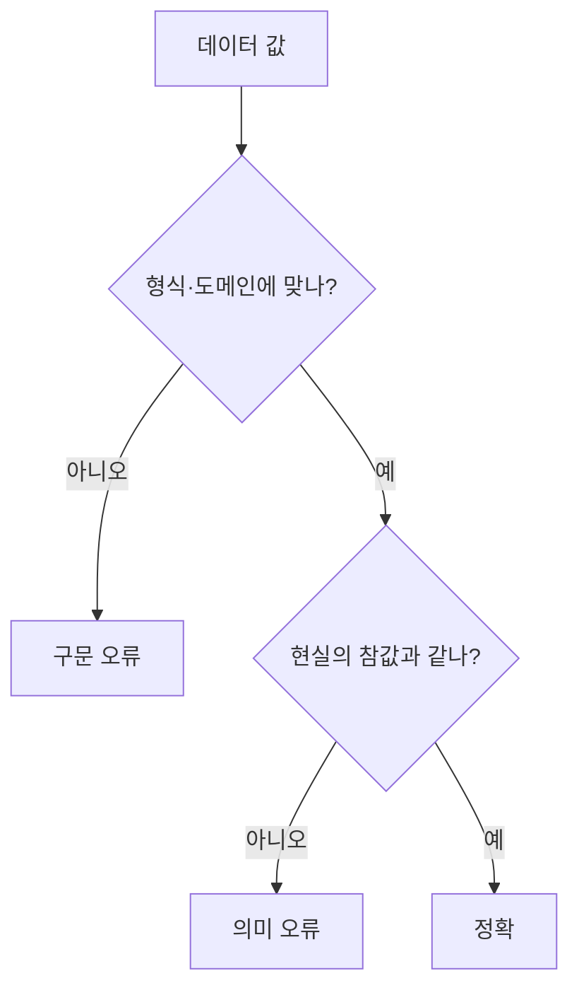
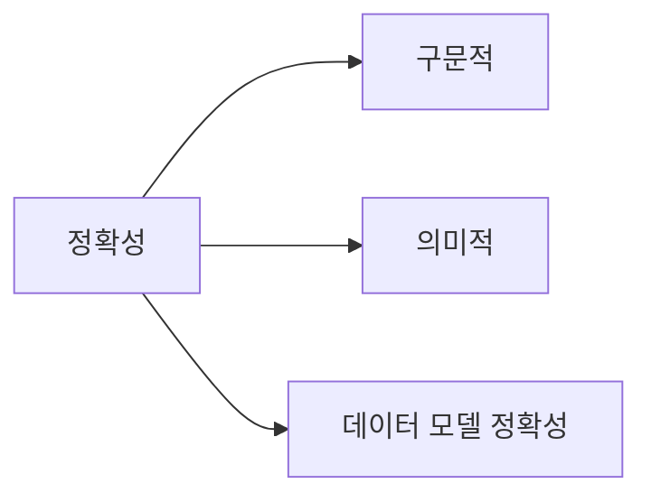

# 정확성의 구문·의미 측면

> ISO/IEC 25012의 **정확성(Accuracy)** 은 데이터가 의도한 속성의 실제 값을 올바르게 나타내는 정도이고, 이를 **구문적(형식이 맞는가)** 과 **의미적(뜻이 맞는가)** 으로 나눠 본다.

## 쉽게 말하면
택배 주소란에 "서울시 강남구 테헤란로 152"라고 올바른 형식으로 적었는데, 실제 고객은 부산에 산다면? 형식은 맞지만 뜻(사실)은 틀렸다. 반대로 "서울시 ㄱㄴㄷ"은 형식부터 틀렸다. 두 종류의 오류를 따로 잡아야 한다.

## 자세히
(ISO 원문은 유료라 읽지 못했다. DATAVERSITY의 ISO 25000 해설을 직접 열어 확인한 2차 출처 기준이다.)
- **ISO/IEC 25012:2008**: 데이터 품질을 15개 특성으로 나누고 **내재적(inherent)** 과 **시스템 의존적(system-dependent)** 두 관점으로 본다. 정확성은 내재적 특성이다(ISO 카탈로그는 2025년 재검토·확정으로 표기했다고 검색 결과에 나옴).
- **정의(해설)**: 데이터가 의도한 맥락에서 속성의 참값을 올바르게 나타낸다. 표준은 이를 **구문적**(형식)과 **의미적**(뜻) 양쪽에 적용하고, **데이터 모델 정확성**도 포함한다. 해설에 구체 예는 없어 아래 구분 기준은 일반적 해석이다.
- **구문적 정확성의 검사(일반 원칙)**: 정의된 도메인(형식·허용 값 집합)에 맞는가. 예: 날짜 형식 `YYYY-MM-DD`, 우편번호 5자리, 나이는 0~120 정수. 정규식·스키마 검증으로 자동화하기 쉽다.
- **의미적 정확성의 검사(일반 원칙)**: 형식이 맞아도 현실과 맞는가. 기준 데이터(원천 시스템·권위 있는 목록)와 대조하거나 표본을 사람이 확인해야 한다. 자동화가 어렵고 비싸다.
- **AI와의 연결(해석)**: 학습 데이터의 라벨 오류는 의미적 부정확, 깨진 인코딩은 구문적 부정확이다. 구문 검사는 파이프라인 입구에서, 의미 검사는 표본 감사로 나눠 설계한다.
- **주의**: 다른 품질 모델은 같은 개념을 다른 이름·분류로 부르므로 용어를 그대로 옮기지 않는다.

## 그림으로 보기

## 예시
- 고객 DB: 전화번호 `010-12-345`는 구문 오류, 형식이 맞는 `010-1234-5678`이 다른 사람 번호면 의미 오류.
- 교육 소재: "맞춤법은 맞는데 사실이 틀린 문장"과 "사실은 맞는데 맞춤법이 틀린 문장"을 구분해 보기.

## 헷갈리는 것과 비교
| 개념 | 차이 |
|---|---|
| 구문적 정확성 | 형식·도메인 일치 |
| 의미적 정확성 | 현실 참값 일치 |
| [데이터 최신성](#data-currentness) | 값이 충분히 새로운가 |
| [데이터 신뢰성](#data-credibility) | 사용자가 믿을 만한가 |

## 더 읽을거리
- [Mind the Gap: ISO 25000 data quality standards (DATAVERSITY)](https://www.dataversity.net/articles/mind-the-gap-did-you-know-about-the-iso-25000-series-data-quality-standards-me-neither/) — 정확성 정의의 2차 해설(직접 읽음).
- [ISO/IEC 25012 (arc42 Quality Model)](https://quality.arc42.org/standards/iso-iec-25012) — 15개 특성 개요(정의는 간략).
