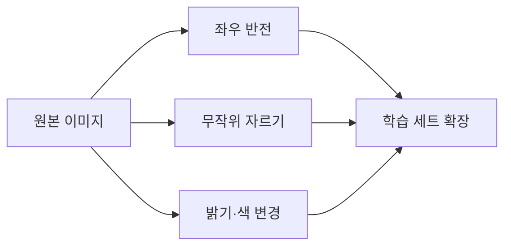
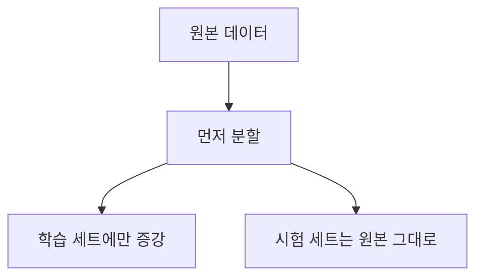

# 데이터 증강

> 새 데이터를 모으지 않고, 기존 샘플을 뒤집기·자르기·색 바꾸기·번역 왕복 등으로 변형해 학습 데이터의 범위를 넓히는 기법이다. 변형해도 정답(라벨)이 그대로인 변형만 써야 한다.

## 쉽게 말하면
같은 얼굴 사진을 좌우로 뒤집고, 조금 어둡게 하고, 약간 잘라서 여러 장으로 쓰는 것이다. 사람이 보면 모두 같은 사람인데, 모델은 다양한 조건에서 같은 대상을 알아보는 연습을 하게 된다.

## 자세히
(torchvision 공식 문서와 UDA 논문 초록을 직접 열어 확인.)
- **이미지(torchvision.transforms.v2, 문서 확인)**: `RandomHorizontalFlip`(확률 p로 좌우 반전), `RandomResizedCrop`(임의 영역 잘라 크기 맞춤), `ColorJitter`(밝기·대비·채도·색조 무작위 변경), `RandAugment`(무작위 연산 묶음), `AutoAugment`(ImageNet·CIFAR10·SVHN에서 학습된 정책), `TrivialAugmentWide`(튜닝 없는 데이터셋 독립 증강), `MixUp`·`CutMix`(배치 안 샘플 쌍을 섞음, DataLoader 이후나 collate 함수에서 적용). v2는 이미지와 함께 **박스·마스크·비디오·키포인트**도 같이 변환한다. 박스는 `tv_tensors.BoundingBoxes`로 감싸 넘기면 이미지와 같이 좌표가 바뀐다.
- **텍스트·음성**: 번역 왕복(back-translation), 유의어 치환, 잡음 추가 등이 쓰인다(일반적 기법). UDA 논문(arXiv:1904.12848)은 이미지의 RandAugment와 텍스트의 back-translation 같은 **고급 증강**이 단순 잡음보다 좋은 교란을 만든다고 주장한다.
- **UDA의 보고 결과(초록 확인, 논문 주장)**: IMDb에서 라벨 20개만으로 오류율 4.20%(저자는 라벨 25,000개로 학습한 기존 최고 모델을 넘는다고 주장), CIFAR-10에서 라벨 250개로 5.43%.
- **주의**: ① 증강은 **학습 세트에만** 적용하고 시험 세트에는 쓰지 않는다. 증강 전에 분할해 같은 원본의 증강본이 양쪽에 걸치지 않게 한다([그룹 단위 분할](#group-wise-split)). ② 라벨을 바꾸는 변형은 금지(숫자 6을 상하 반전하면 9). 글자 인식에 좌우 반전은 부적합. ③ 의료·위성 등은 도메인 전문가와 변형 범위를 정한다(일반적 주의).
- **표적 수집과의 차이**: 증강은 기존 정보를 변형하므로 새로운 현실 사례를 만들지 못한다. 약한 슬라이스에 진짜 새 데이터가 필요한지는 [표적 데이터 수집](#targeted-data-collection)에서 판단한다.

## 그림으로 보기



## 예시
```python
from torchvision.transforms import v2
import torch
transform = v2.Compose([
    v2.RandomResizedCrop(size=(224, 224), antialias=True),
    v2.RandomHorizontalFlip(p=0.5),
    v2.ColorJitter(brightness=0.2, contrast=0.2),
    v2.ToDtype(torch.float32, scale=True),
])
```
(공식 문서 예시를 줄임.) 야간 이미지가 부족한 불량 검출 모델에는 밝기 범위를 넓힌 ColorJitter를 쓴다.

## 헷갈리는 것과 비교
| 개념 | 차이 |
|---|---|
| 데이터 증강 | 기존 샘플을 변형해 확장 |
| [합성 데이터](#synthetic-data) | 생성 모델·시뮬레이션으로 새 샘플 생성 |
| [표적 데이터 수집](#targeted-data-collection) | 현실에서 약한 곳 데이터를 추가 |
| [근접 중복 제거](#near-duplicate-removal) | 반대로 거의 같은 샘플을 줄임 |

## 더 읽을거리
- [torchvision transforms v2 문서](https://docs.pytorch.org/vision/stable/transforms.html) — 증강 변환 목록과 박스·마스크 동시 변환(직접 열어 확인).
- [Unsupervised Data Augmentation (arXiv:1904.12848)](https://arxiv.org/abs/1904.12848) — 고급 증강과 일관성 학습(초록 직접 확인).
