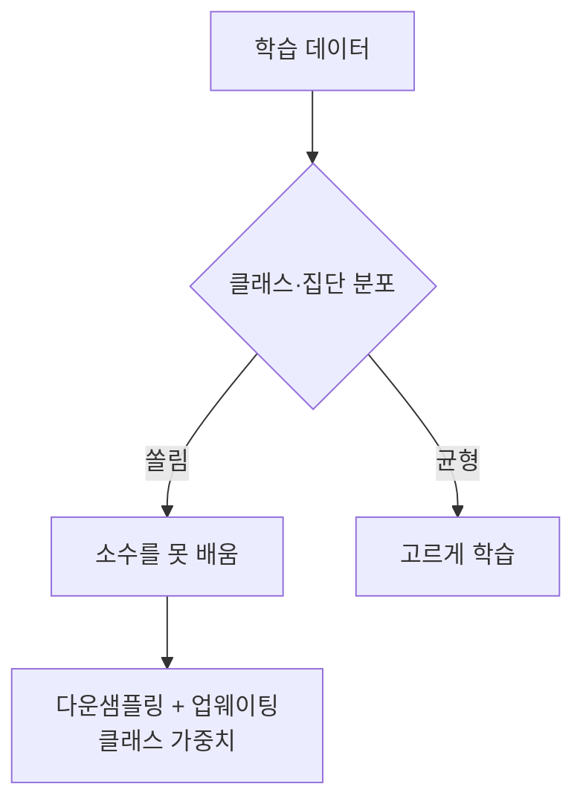
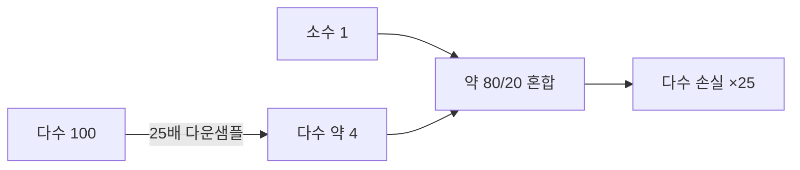

# 데이터 균형 특성

> ISO/IEC 5259-2가 ML·분석용 데이터에 추가로 둔 품질 특성의 하나로, **클래스·집단의 분포가 한쪽으로 쏠리지 않은 정도**를 뜻한다. 쏠린 데이터는 소수 쪽을 잘 못 배운다.

## 쉽게 말하면
반 학생 100명 중 99명이 오른손잡이고 1명이 왼손잡이일 때, "모두 오른손잡이다"라고 답해도 정확도 99%다. 하지만 왼손잡이 학생에게는 쓸모없다. 데이터가 한쪽으로 쏠리면 평균 점수는 좋아 보여도 소수는 외면당한다.

## 자세히
(ISO/IEC 5259-2:2024-11의 **목차**를 DIN 사본 PDF에서 직접 확인했다. 본문 정의·측정식은 유료라 읽지 못했으므로 아래 "정의"는 일반적 이해다. 불균형 대응 기법은 Google ML 단기 강좌와 scikit-learn 문서를 직접 읽었다.)
- **ISO/IEC 5259-2 구조(목차 확인)**: 6.2 내재적 5개(정확성·완전성·일관성·신뢰성·최신성) / 6.3 내재+시스템 의존 6개(접근성·준수·효율성·정밀성·추적성·이해 용이성) / 6.4 시스템 의존 3개(가용성·이식성·복구성) / **6.5 추가 특성 9개**: 감사 가능성, **균형(Balance, 6.5.2)**, 다양성, 효과성, 식별 가능성, 관련성, 대표성, 유사성, 적시성. 25012에 없던 AI 특유 특성이 6.5에 모여 있다.
- **균형의 일반적 의미(추정)**: 레이블 클래스 비율, 또는 성별·연령 같은 집단 비율의 쏠림. 클래스 분포는 한 열의 값 개수만 세면 측정되지만 구체 측정식은 표준 본문에서 확인하지 못했다.
- **불균형이 왜 문제인가(Google ML 강좌, 직접 읽음)**: 배치에 두 클래스가 충분히 있어야 학습이 된다. 예: 꽃 데이터 200:2에서 배치 20개 중엔 보통 소수가 0개, 배치 100개여도 평균 약 1개. 소수 비율 예로 약 1%(위 예), 신용카드 사기 0.1% 미만, 희귀 바이러스 환자 0.01% 미만이 언급된다. 강좌는 "약간 불균형한 데이터는 문제가 아니다"라고 하며 등급 구간 표는 제공하지 않는다.
- **대응 ① 다수 클래스 다운샘플링 + 업웨이팅(강좌)**: 다수를 25배 줄이면 약 80/20 혼합이 되고, 다수 클래스 손실에 같은 25를 곱해 예측 편향을 바로잡는다. 장점은 빠른 수렴·두 가지 학습(특징-레이블 관계, 실제 분포), 단점은 인공적으로 균형 잡힌 세계에서 학습해 편향이 생기는 점이다. 배율은 하이퍼파라미터처럼 실험한다.
- **대응 ② 클래스 가중치(scikit-learn)**: `compute_class_weight("balanced")`는 `n_samples / (n_classes × bincount(y))`. 예: y=[1,1,1,1,0,0] → 클래스 0은 6/(2×2)=1.5, 클래스 1은 6/(2×4)=0.75.
- **균형 ≠ 정답**: 균형 잡힌 학습 데이터가 실제 운영 분포와 다르면 보정이 필요하다. 균형과 [대표성](#data-representativeness)은 별개 특성이다(일반 구분).

## 그림으로 보기

## 예시
- 사기 탐지: 정상 99.9% : 사기 0.1%. 정확도만 보면 "전부 정상"이 99.9%이므로 재현율·정밀도를 함께 보고, 다운샘플링+가중치를 시도.
- 교육 소재: "정확도 99%의 함정" 토론.

## 헷갈리는 것과 비교
| 개념 | 차이 |
|---|---|
| [데이터 균형 특성](#data-balance-characteristic) | 클래스·집단 분포가 쏠렸는지 |
| [데이터 다양성 특성](#data-diversity-characteristic) | 다양한 상황·집단이 포함되었는지 |
| 대표성 | 실제 대상 집단을 닮았는지 |
| 클래스 가중치 | 불균형에 대응하는 학습 기법 |

## 더 읽을거리
- [Class-imbalanced datasets (Google ML Crash Course)](https://developers.google.com/machine-learning/crash-course/overfitting/imbalanced-datasets) — 다운샘플링·업웨이팅(직접 읽음).
- [compute_class_weight (scikit-learn)](https://scikit-learn.org/stable/modules/generated/sklearn.utils.class_weight.compute_class_weight.html) — balanced 공식과 예(직접 읽음).
- [ISO/IEC 5259-2:2024 (ISO)](https://www.iso.org/standard/81860.html) — 목차는 DIN 사본으로 확인, 본문은 유료.
