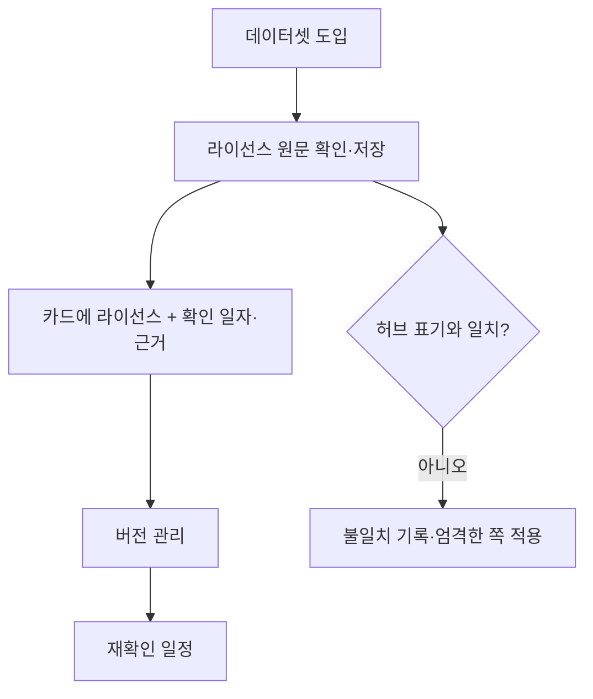
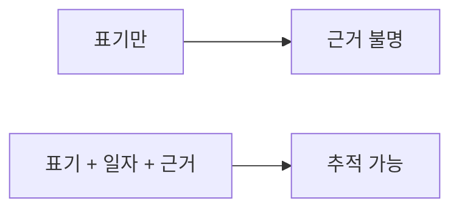

# 데이터 카드에 라이선스 기록

> 데이터셋의 문서(데이터 카드)에 **라이선스 이름만 적는 것이 아니라, 언제·무엇을 근거로 확인했는지까지 함께 남기는 형식**이다. 라이선스 표기는 틀리거나 바뀔 수 있으므로 확인 일자와 근거가 있어야 나중에 다시 따져 볼 수 있다.

## 쉽게 말하면
식품 포장에 "유통기한 있음"이라고만 적는 대신 "2026-11-22에 확인, 근거는 이 서류"를 같이 적는 것이다. 표기만 있으면 틀렸을 때 누구 잘못인지, 언제 기준인지 알 수 없다.

## 자세히
(Hugging Face Hub 문서의 데이터셋 카드 절을 직접 열어 확인하고, `huggingface_hub` 2.4.0으로 카드 메타데이터 출력을 직접 실행. 법률 자문이 아니다.)
- **왜 확인 기록이 필요한가**: [데이터셋 라이선스 점검표](#dataset-license-checklist)에 정리된 감사 연구는 널리 쓰이는 호스팅 사이트에서 라이선스 누락과 분류 오류가 흔하다고 보고한다(상위 노드에서 초록을 확인한 수치). 허브 표기를 그대로 믿었다가 나중에 틀렸음이 드러나면, 어떤 근거로 언제 판단했는지가 방어와 수정의 기준이 된다.
- **Hugging Face 데이터셋 카드(문서 확인)**: 리포지터리의 `README.md`가 데이터 카드이고, 맨 위 `---` 사이 YAML 메타데이터에 `license`(유효한 라이선스 식별자), `language`, `tags`, `task_categories` 등을 적는다. 표의 키워드로 고른 라이선스는 데이터셋 페이지에 표시된다고 문서가 설명한다. 라이브러리로 직접 만들어 본 출력(2026-11-22): `license: other`와 함께 `license_name`, `license_link`, `source_datasets`, `annotations_creators`, `language_creators`가 YAML로 나온다. `license: other`를 쓸 때 이름·링크 필드로 원문을 가리킬 수 있다.
- **확인 일자·근거 기록 형식(제안, Hub 표준 필드 아님)**: 라이브러리(`DatasetCardData`)는 임의 키도 YAML로 출력하지만, Hub가 이를 화면에 보여 주는지는 확인하지 못했다. 안전하게는 카드 본문에 표로 둔다.
  ```yaml
  license: cc-by-sa-4.0           # 표준 필드
  license_checked_on: "2026-11-22"   # 제안: 확인 일자
  license_evidence: "https://..."    # 제안: 근거 URL(스냅샷 사본 경로 병기)
  ```
  | 항목 | 내용 |
  |---|---|
  | 확인 일자·확인자 | 2026-11-22, 담당자 |
  | 근거 | 라이선스 원문 URL + 보관한 사본 경로·해시 |
  | 출처별 약관 | 원 출처 도메인의 약관·robots.txt 기록([도메인별 허용 의사 기록](#domain-consent-registry)) |
  | 상업 이용 | 가능/불가/조건부, 판단 이유 |
  | 상속 조건 | ShareAlike·NoDerivatives 등([카피레프트 오픈 데이터](#copyleft-open-data)) |
  | 불일치 | 허브 표기와 원문이 다르면 기록하고 더 엄격한 쪽 적용 |
  | 재확인 일정 | 다음 확인 날짜 |
- **운영(제안)**: ① 가져오는 시점에 라이선스 원문을 저장하고 해시 ② 카드 변경 이력을 버전 관리(Git) ③ 라이선스 표기가 없으면 "미확인"으로 명시하고 사용 보류 ④ 출처 데이터셋을 `source_datasets`로 연결해 계보를 남김.
- **한계**: 기록은 판단의 증거이지 정당성을 보증하지 않는다. 판단이 틀릴 수 있어 법무 검토가 필요한 항목은 따로 표시한다.

## 그림으로 보기



## 예시
- 외부 말뭉치를 내부 파인튜닝에 쓰기 전: 카드에 `license: other`, 원문 링크, 확인 일자 2026-11-22, 비상업 제한 여부와 법무 검토 결과 링크를 남김.
- 교육 소재: "AI 데이터 카드 한 장 만들기" — 위 표를 채우는 실습.

## 헷갈리는 것과 비교
| 개념 | 차이 |
|---|---|
| 데이터 카드의 라이선스 기록 | 확인 일자·근거까지 문서화 |
| [데이터셋 라이선스 점검표](#dataset-license-checklist) | 무엇을 점검할지 목록 |
| [도메인별 허용 의사 기록](#domain-consent-registry) | 웹 도메인 단위 장부 |
| 모델 카드 | 모델을 설명하는 문서(데이터 카드는 데이터셋용) |

## 더 읽을거리
- [Hugging Face Hub: Dataset Cards](https://huggingface.co/docs/hub/datasets-cards) — YAML 메타데이터와 라이선스 표시(직접 확인).
