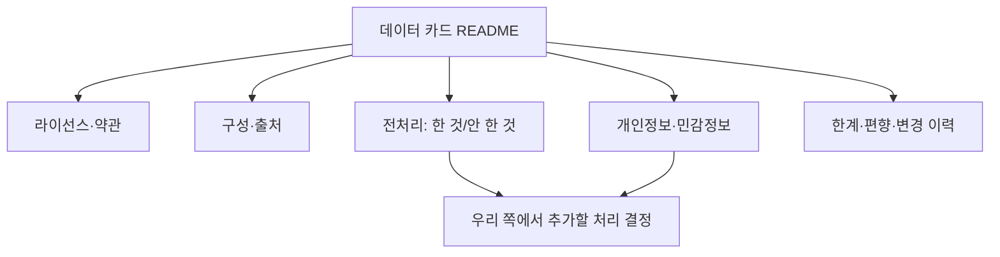
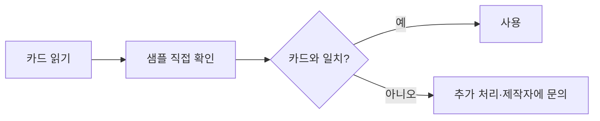

# 데이터 카드 읽기

> 데이터셋을 쓰기 전에 **README 형식의 설명서(데이터 카드)에서 "무엇을 했고 무엇을 안 했는지"를 확인**하는 습관. 처리하지 않은 것, 알려진 한계, 라이선스가 여기에 적혀 있다.

## 쉽게 말하면
식품 포장의 성분표와 같다. "무엇이 들었나, 알레르기 유발 성분은, 어디서 만들었나"를 구매 전에 읽는다. 성분표를 안 읽고 먹었다가 문제가 생기면 그건 먹은 사람 책임이 되기 쉽다.

## 자세히
- **기원**: Gebru 외, "Datasheets for Datasets"(arXiv 1803.09010, 2018-03 제출, 2021-12 CACM 게재, 초록 직접 읽음). 전자부품 데이터시트처럼 각 데이터셋에 설명서를 붙여 제작자와 사용자 사이의 소통과 투명성·책임성을 높이자는 제안이다. 초록에 따르면 동기, 구성, 수집 과정, 권장 용도 등을 문서화한다(질문 범주 전체 목록은 이번에 확인하지 못함).
- **Hugging Face의 데이터 카드**(공식 문서, 직접 읽음): 저장소의 `README.md`가 데이터 카드이고, 맨 위 YAML 메타데이터에 라이선스·언어·태그·작업 범주 등이 들어간다. 편향 같은 잠재 한계를 적는 것을 권장한다.
- **읽는 순서(제안)**: ① 라이선스와 추가 약관 ② 구성(크기·언어·출처) ③ 전처리: 한 것과 **안 한 것** ④ 개인정보·민감정보 처리 ⑤ 알려진 한계·편향 ⑥ 변경 이력(버전별 삭제·수정).
- **FineWeb 카드로 연습**(직접 읽음): ODC-By 1.0과 Common Crawl 약관 → 이메일은 정규식으로 치환, 공개 IP는 무작위 주소로 대체, **전화번호는 오탐이 많아 처리하지 않았다**고 명시 → PII가 남아 있을 가능성이 매우 높다는 경고 → PII 제거 요청 양식 → v1.3.0에서 삭제 요청에 따라 일부 도메인 제거. 이 한 장으로 "전화번호는 따로 처리해야 한다"는 사실을 알 수 있다([추가 PII 단계](#extra-pii-pass)).
- 주의: 카드는 제작자의 자기 보고다. 중요한 사용이면 샘플을 직접 열어 눈검사하고, 카드에 없는 내용은 "확인되지 않음"으로 취급한다.

## 그림으로 보기

## 예시
| 카드 항목(FineWeb) | 읽고 얻는 결론 |
|---|---|
| 이메일 치환 | 이메일은 대부분 처리됨 |
| 전화번호 미처리 | 직접 마스킹 필요 |
| PII 잔존 경고 | 민감 용도엔 추가 점검 |
| 삭제 요청 이력 | 버전 고정·갱신 정책 확인 |
- 업무 장면: 공개 데이터셋을 사내 교육 실습에 쓰기 전에 체크리스트 6항목을 채워 보고서 한 장으로 남긴다.

## 헷갈리는 것과 비교
| 개념 | 차이 |
|---|---|
| 데이터 카드(데이터시트) | 데이터셋 설명서 |
| 모델 카드 | 모델의 용도·한계 설명서 |
| [FineWeb 이용 조건](#fineweb-license-terms) | 카드에서 읽어 낸 라이선스 사례 |
| [추가 PII 단계](#extra-pii-pass) | 카드가 말한 미처리 부분을 보완 |

## 더 읽을거리
- [Datasheets for Datasets (arXiv 1803.09010)](https://arxiv.org/abs/1803.09010) — 데이터시트 제안(초록 직접 읽음).
- [Hugging Face Dataset Cards 문서](https://huggingface.co/docs/hub/datasets-cards) — 카드 구성과 메타데이터(직접 읽음).
- [FineWeb 데이터셋 카드](https://huggingface.co/datasets/HuggingFaceFW/fineweb) — 읽기 연습용 실제 카드(README 직접 읽음).
