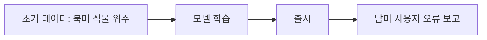

# 데이터 연쇄(data cascade)

> **초기 데이터 문제가 시간이 지난 뒤 하류에서 터지는 현상**이다. 학습 데이터와 실제 사용자 데이터의 불일치 효과가 늦게 드러난다.

## 쉽게 말하면
집을 지을 때 기초 공사의 균열이 입주 후 몇 달 뒤 벽 전체의 균열로 나타나는 것이다. 문제가 나타난 곳과 원인이 있는 곳이 멀리 떨어져 있다.

## 자세히
(Google PAIR "Data Collection + Evaluation" 챕터를 직접 읽었다.)
- **정의(PAIR)**: 학습 데이터와 현실 사용자 데이터의 **불일치 효과가 지연**된 경우를 연쇄라 한다.
- **예(PAIR)**: 식물 식별 앱이 주로 북미 식물로 학습됐다가 남미 사용자들이 나중에 인식 오류를 보고했다. 남미 식물을 학습에 포함하거나 북미에서만 출시했으면 피할 수 있었다.
- **흔한 원인(PAIR)**: 데이터에 대한 불완전한 이해, 현실과 안 맞는 데이터, 부실한 문서화, 데이터 작업의 저평가.
- **대응(해석)**: 학습 데이터 범위(지역·언어·환경)를 문서로 남기고 출시 범위와 대조한다. [대표성 점검](#representativeness-check)이 그 첫걸음이다.

## 그림으로 보기

## 예시
- 한국어 상담 챗봇을 표준어 데이터로만 학습했다가 지역 방언 고객 응대에서 문제가 터진다 → 출시 전 방언 샘플을 시험한다(제안).

## 헷갈리는 것과 비교
| 개념 | 차이 |
|---|---|
| 데이터 연쇄 | 초기 데이터 문제가 지연되어 하류에 영향 |
| [대표성 점검](#representativeness-check) | 학습 데이터와 사용자 분포 비교 |
| 데이터 드리프트 | 운영 중 분포가 변함 |

## 더 읽을거리
- [Google PAIR — Data Collection + Evaluation](https://pair.withgoogle.com/chapter/data-collection/) — 직접 읽음.
